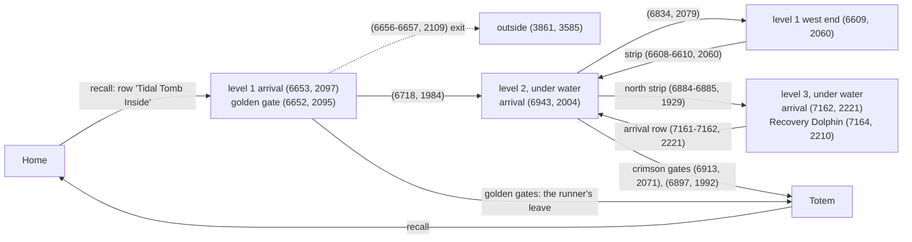
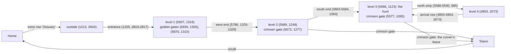

# Dungeon simulator (`harness/sim/`): the Mausoleum, Tidal Tomb, the Ossuary

An offline game world for the hunt runner (user request 2026-10-13: "train our combat runner in the
emulated game world ... run tests much faster"). It is not an Outlands server: it is the one dungeon
level Logan Wolf fought on (2026-10-12, capture `20261012_210013`), on the real map, with the creatures,
pets and mechanics the `--pets` runner meets there, each number calibrated from that capture or the
wiki. The runner under test is the unmodified `loop_hunt.HuntLoop` (`tamer.Team`), on virtual time:
a 30-minute hunt takes 16-24 s of CPU on a loaded desktop (75-115× real time; "Speed" below), and a batch spreads its careers over
`--jobs` processes. Since 2026-10-24 a second scenario, **Tidal Tomb** (`--scenario tidal_tomb`, "Tidal Tomb" below), from
Logan's first visit there, and since 2026-10-28 a third, **the Ossuary** (`--scenario ossuary`, "The Ossuary" below);
everything below that names no dungeon is the Mausoleum's.

```mermaid
flowchart LR
  subgraph Runner[unchanged runner code]
    HL[loop_hunt.HuntLoop + tamer.Team<br/>Mover, crawl, escape, humanize]
  end
  subgraph Sim[harness/sim]
    CL[clock.SimClock<br/>time.* patched in harness modules]
    LK[link.SimLink<br/>the Link API]
    WM[world.runtime.WorldRuntime<br/>the client's world model]
    W[world.World<br/>the server: map, mobs, pets, mechanics]
  end
  HL -- act / send --> LK
  LK -- C2S --> WM
  LK -- C2S --> W
  W -- S2C --> WM
  LK -- state / movement --> HL
  CL -. advance: World.run_until .-> W
  HL -. sleep / monotonic .-> CL
```

## Running

```
python harness/sim/run.py --runs 24 --minutes 30 --compare -- [loop_hunt arguments]
python harness/sim/run.py --runs 24 --set tamer.FALLBACK_S=0          # an experiment on a constant
python harness/sim/run.py --log run.log --seed 7                       # one run, with the runner's log
python harness/sim/run.py --seed 5 --at-hunt --trace [DIR]             # ... and its trace for the viz Sim page ("Traces")
python harness/sim/run.py --runs 24 --armor 86                          # Logan in another suit's AR ("Player armor")
python harness/sim/run.py --runs 24 --aspect-tier 10                    # ... or his Command tier: its AR and the pets' damage, speed, resistance
python harness/sim/run.py --runs 24 --aspect-tier off --armor 80        # ... or no aspect active (after a death, out of arcane essence)
python harness/sim/run.py --runs 24 --team nightmare_fire                 # another of Logan's teams ("Pets, teams and perks")
python harness/sim/run.py --runs 24 --team "GirthyEarthy, a tidal mantis" --bestiary none   # pets by name, no bestiary perks
python harness/sim/tamer_scan.py                                         # his codex, bestiary loadouts and pets' Guide values
# or from the viz: Sim page, `run…` (run.py or a fight script with its options; docs/VISUALIZER.md §2.20)
python harness/sim/cast_scan.py [--since 20261010] && python harness/sim/cast_scan.py --summary   # cast/flight times
python harness/test_sim.py                                             # the tests (~50 s)
python harness/sim/calibrate.py [--scenario tidal_tomb] --logs <logs dir> [--scan 20261010] [TAG...]   # refresh the observations
python harness/sim/armor_scan.py [--since 20261012] [--out rows.json]   # monster melee on Logan against his AR, by era
python harness/sim/kb_scan.py --location "Tidal Tomb" --out harness/data/sim/tidal_tomb_kb.json \
    --observed harness/data/sim/tidal_tomb_observed.json --mechanic 4641 ...   # a dungeon's wiki stats from the store
python harness/sim/run.py --scenario tidal_tomb --runs 8 --compare     # Tidal Tomb's level 1 ("Tidal Tomb" below)
python harness/sim/run.py --scenario tidal_tomb --area 6815 1907 6969 2100 -- --enter-via 6718 1984 --leave-gate 6913 2071
                                                                       # ... its level 2, under water
python harness/sim/run.py --scenario tidal_tomb --area 7047 1906 7257 2223 -- --enter-via 6609 2060 --enter-via 6884 1929 \
    --fight-via 6884 1929 --leave-gate 6897 1992 --leave-via 7161 2221   # ... its level 3, level 2 fought through
python harness/sim/run.py --scenario tidal_tomb --area 7350 1936 7427 1981 -- --enter-via 6609 2060 \
    --enter-via 6821 1909 --fight-via 6821 1909 --enter-via 7058 2008 --leave-gate 7107 2055 --leave-via 7425 1958
                                                                       # ... Marinerbane's room, by level 3's west entrance
python harness/sim/run.py --scenario tidal_tomb --runs 8 --compare --instrument "eminently melodious"
                                                                       # ... with another instrument quality (+15 barding)
python harness/sim/run.py --scenario ossuary --runs 24 --compare      # the Ossuary's level 3 ("The Ossuary" below)
python harness/sim/run.py --scenario ossuary --area 5581 1225 5689 1363 -- --enter-via 1205 2816 --enter-via 5786 1327 \
    --leave-gate 5672 1277                                             # ... its level 2
python harness/sim/run.py --runs 98 --links "current, effective_barding=10"   # Mastery Chain links ("Mastery Chain links")
python harness/sim/bard_scan.py                                        # the live barding against the effective skill
# live against simulated (docs below, "Parity with the live runs"): a batch as live plays, then the comparison
python harness/sim/run.py --runs 144 --seed 17 --others --eerie --prior <main checkout>/harness/data/harness.db \
    --json -- --vet-range 5 --crawl-learn-s 180 > sim.jsonl
python harness/sim/parity.py sim.jsonl --db <main checkout>/harness/data/harness.db --logs <main checkout>/logs
# ... one team's live window against a batch of it as it was then ("Recalibrating"): the pinned loadout, the levels then
python harness/sim/run.py --runs 144 --seed 17 --others --eerie --prior <store> --team nightmare_fire \
    --pet-level NightmareA=14 --pet-level NightmareB=14 --pet-level "a searing imp=14" --json -- --vet-range 5 \
    --crawl-learn-s 180 > nf.jsonl
python harness/sim/parity.py nf.jsonl --team nightmare_fire --since 2026-10-25T12:00 --until 2026-10-25T18:00
python harness/sim/fight1822.py 1,2,...,24 [--log] [--trace DIR] [--harness DIR]   # the 18:22 live death replayed
python harness/sim/fight1820.py 1,2,...,48 [--awake] [--log] [--trace DIR] [--harness DIR]   # the 2026-10-21 18:21 blightmare death
python harness/sim/fight2227.py 1,2,...,12 [--log] [--trace DIR] [--harness DIR]   # the 2026-10-21 22:27 ping-pong at a ledge
python harness/sim/fight1853.py 1,2,...,12 [level1|level2] [--log] [--trace DIR] [--harness DIR]   # the 2026-10-22 18:53 red on the walk in
python harness/sim/fight2001.py 1,2,...,24 [--log] [--trace DIR] [--harness DIR]   # the 2026-10-22 20:01 reds in the east wing's dead end
python harness/sim/fight2203.py 1,2,...,24 [--log] [--trace DIR] [--harness DIR]   # the 2026-10-22 22:03 caster red at the east wing's mouth
python harness/sim/fight2343.py 1-24 [--log] [--trace DIR] [--harness DIR]          # the 2026-10-30 23:43 three caster reds and a Wall of Stone sealing the east wing (World.add_wall)
python harness/sim/fight2330.py 1,2,...,96 [--log] [--trace DIR] [--harness DIR]   # the 2026-10-23 23:30 blightmare death, the pets off guard
python harness/sim/fight0038.py 1-200 [--log] [--trace DIR] [--harness DIR]   # the 2026-10-25 00:38 death vetting a pet in two casters' reach
# with red players (docs below, "Red players"): gold banked an hour with them, their numbers against the live ones
python harness/sim/run.py --runs 98 --jobs 16 --careers 14 --seed 17 --reds --others --eerie --prior <main checkout>/harness/data/harness.db \
    -- --vet-range 5 --crawl-learn-s 180
python harness/sim/red_scan.py <capture tag> ...                       # the live reds' evidence from the captures
```

- Defaults added to the runner's arguments: `--pets --leave-recall <tome> --enter-recall <tome>
  --enter-rune Mausoleum --crawl --timeout <minutes>`, and the scenario's
  `runner` block: `--enter-via` the four teleporters Logan took in (two of them short hops on the
  second level) and `--leave-gate 5203 703 --gate-dest Totem`. The character starts at home (the DTF
  landing) with both pets, recalls to the gold gate on the first level, walks in, hunts, leaves by the
  crimson moongate to Totem and recalls home from there, by the runner's own rules. `--at-hunt` starts
  on the fight level instead.
- **Memory persists across runs** (user 2026-10-13). The runs are split into `--careers` (default
  CPU threads - 1, `DEFAULT_CAREERS`) careers. Each career runs one after another on one memory store, as the
  live runner keeps its store between runs: crawl priors, fights, avoided types, learnt teleporters. `--fresh`
  gives every run a new store. Summaries carry `career` and `career_run`. A career's next run starts `RUN_GAP_S`
  600 s of game time after the last one ended (live: median 685 s between Logan's runs), so the store's times read
  as live: the return rule's visits since `hunt_return.LIVE_SINCE` (game time starts 2026-10-21 00:00, `EPOCH`) and
  the crawl's recent kills. Before 2026-10-20 every run started at 2026-10-12 21:16, before that cut: the return
  rule never saw a career's visits.
- `--prior DB`: every career's store starts with DB's hunt history for the scenario's character (episodes and hunt
  job events older than `EPOCH`): the live store, so the crawl starts from the live zone knowledge and the return
  rule from the live visits, as a live run does. Without it a career starts empty and the crawl stays shallow
  (77 % of its time in zones 1-2 against the live 46 %).
- **Parallel runs**: one process per career (`--jobs` workers, default CPU threads - 3), so the
  careers bound the parallelism. A batch keeps off two logical CPUs for the game (`cpu_budget.limit`, user
  2026-10-17). The desktop has 16 cores / 32 threads (user 2026-10-13): batches
  since then use `--runs 98 --jobs 16 --careers 14` (careers of 7 runs, as the earlier `--runs 49
  --jobs 7` ones).
- Each run prints a row (kills, gold, damage taken, deaths, pet deaths, vet uses, potions, rule
  violations); `all:` aggregates (kills and gold per game hour, deaths per hour, runs with a death /
  a pet death / a pet left behind, crashes, violations; `pet_deaths`: the pet deaths' readouts summed); `--compare`
  sets the runs per hour on the level beside the live trip's; `--json` prints every run's summary (with
  `death_causes`: who did the damage in the 15 s before a death; `pet_deaths`: each pet death's readout, who hurt it
  and what healed it in its last 15 s, where it and Logan stood, his distance at its hits, `vet_reach`, who fought it,
  the other pets, the runner's intents meanwhile; `junctures`, `kills_by`, `bard`, ...).
- Seeds make runs reproducible (the world's randomness and the runner's `--seed`).
- `--others`: other (blue) players on the fight level (the scenario's `others`, "Other players" below). Off by
  default, so batches stay comparable with the earlier ones; `all:` then adds an `others` block (in-view numbers
  against the captures', their kills, the runner's "All Kill" at a monster on one, opens of their corpses, seconds
  engaged on a monster fighting one before ours hurt it, kills lost to their loot rights).
- `--eerie`: the Field of Souls' eerie corpses (the scenario's `eerie`, Halloween 2026-10-17 to 10-24): one appears at
  one of the 11 live spots at `per_h` an hour, lies `lifetime_s`, and goes when another player stands within 2 of it;
  the pack holds `jars` empty soul jars. Off by default. The runner's `--soul-jars` walks to them (docs/HUNT_LOOP.md
  "Soul jars").
- `--json` summaries also carry the runner's own records as the live store keeps them (`visits`, `fights`,
  `death_events`, `leave_events`), the monsters met by type (`met`) and the eerie corpses (`eerie`): sim/parity.py
  reads them.

## Pieces

| File | What it is |
|---|---|
| `sim/clock.py` | `SimClock` + `install()`: every loaded harness module's `time` becomes a view of the virtual clock (`monotonic`, `time`, `sleep`, `strftime` on game time), so the runner's 100+ direct `time.*` calls run unchanged. `sleep(dt)` advances the world. |
| `sim/link.py` | `SimLink`: `act`/`send` (walks get their sequence number, as the proxy stamps them), `state`/`movement` (the server's position as movement truth, the client model's snapshot, events), `wait`/`pos`/`open_containers` from `agent_link.Link`. A state read costs 20 ms of game time, a packet 2 ms. |
| `sim/world.py` | The server (module docstring): walking by `pathfind.Walk.can_walk` on the install's map (z from the map), line of sight by `los.Sight`, monster and pet AI, other players (`--others`), bard skills, vet supplies, potions, Stationary Penalty, corpses and loot, the rune tome (escape.py's gump layout), our death. |
| `sim/packets.py` | The S2C packets in the Outlands V10/V12 shapes the world model reads. |
| `sim/scenario.py` | Loads `harness/data/sim/<name>.json` (its `inherit` takes the named blocks of another scenario: Tidal Tomb has Logan's tamer block, pack, bard, vet, potions and the engine defaults from the Mausoleum's), builds each creature's spec from the wiki stats and the capture (its docstring gives the order of evidence), puts the character's Mastery Chain in (`sim/chain.apply`) and Logan's pets last (`sim/pets.select`); the barding numbers from the effective barding skill (`bard_eff`, `bard_chance`, `bard_secs`, `song_share`). |
| `sim/chain.py`, `data/sim/mastery_links.json` | The Mastery Chain as an input ("Mastery Chain links"): the link types the simulator models with their values per material (the wiki's table), `run.py --links` specs, Logan's chain (his tamer file's `chain`). |
| `sim/bard_scan.py`, `data/sim/bard_observed.json` | Logan's live barding answers (the hunt task logs) at the effective barding skill his songs printed: each type's difficulty per skill, the duration rule's check ("Barding from the effective skill"). |
| `sim/pets.py` | Logan's pets ("Pets, teams and perks"): the Guide's stats at each pet's level, its abilities, the Taming Bestiary's perks and the Healer's Codex; the team and loadout `run.py --team / --bestiary` pick; how a pet takes the monsters' numbers measured on a reference pet. |
| `sim/tamer_scan.py` | Reads the Healer's Codex, the Taming Bestiary loadouts and the pets' Guide values from the memory store's gumps into `data/sim/tamer/logan_wolf_observed.json`. |
| `sim/calibrate.py` | The capture extractor that writes `<name>_observed.json` for the region and captures of the scenario's `calibration` block (`--scenario`; its rules are in the file's `rules`). Red players are no creature type. |
| `sim/kb_scan.py` | A dungeon's wiki stats from the memory store's wiki rows (Creatures List rows at a location, the tameables' follower abilities, chosen patch notes): `tidal_tomb_kb.json`. |
| `sim/run.py` | Runs, pool, careers (their clock and `--prior` memory), aggregate, comparison with the first trip. |
| `sim/parity.py` | Live against simulated, per hour on the level, with the live 95 % interval ("Parity with the live runs"). |
| `sim/armor.py`, `sim/armor_scan.py` | The player's armor ("Player armor"): the Outlands rule and a suit's AR; the scan of Logan's captures that tests the rule and fitted `player_melee_k`. |
| `sim/shove_scan.py` | Shoves and stamina in the live captures (the walking rules of "Shoving and stamina"). |
| `sim/cast_scan.py` | Cast and flight times of the monsters' and pets' ranged attacks in the live captures (0x6E -> 0xC0 -> '-N'), per type ("Cast and flight times"). |
| `sim/trace.py` | A run's trace (`run.py --trace`, `fight*.py --trace DIR`): every mobile's record each tick and the combat events, read by the viz Sim page ("Traces"). |
| `sim/viewmap.py` | The Sim page's map underlay (floor/wall PNG chunks) and line of sight, for viz_server's `/api/sim/map` and `/api/sim/los`. |
| `sim/reds.py` | Red players (`--reds`, `World.add_red`): arrivals, Tracking, the walk graph across levels, the kits, the PvP rules ("Red players"). |
| `sim/red_scan.py`, `sim/entry_scan.py` | Every red-player encounter in the live captures, and where players appear and leave on Maus 3 (the evidence of "Red players", docs/NOTES.md "Red players met live"). |
| `sim/fight1949.py`, `sim/fight1822.py`, `sim/fight1820.py`, `sim/fight2330.py`, `sim/fight0038.py` | Live fights replayed from the capture's positions over many seeds, the deployed runner (`--harness`) against the current one. `fight2330` also sets the runner's state as live (the pets on a dropped 'All Kill', following, taken for guarding) and places another player's party on a reanimated daemon. `fight0038` gives its two casters the capture's cadence and `ranged.area_r` (a spell landing on every one of our side within `area_r` of its victim and in the caster's range, sight or not: the live 00:38:37.7-44.7 lightnings and fireballs on Logan and all three pets at once); no scenario type has `area_r`. |
| `harness/los.py` | Line of sight (ServUO `Map.LineOfSight`), shared with the live harness: 61 of 61 server answers on the trip agree (59 accepted targets seen, both "Target cannot be seen." blocked) once our z comes from the map; ~100,000 checks/s. |
| `data/sim/mausoleum.json` | The scenario: player, his tamer block (`tamer`: character and team; the pets in `data/sim/tamer/`), pack, tome rows, bard/vet/potion numbers, defaults, specials, 74 spawns (checked against the live sightings 2026-10-20), eerie corpses, other players, the trip reference. Every number has its evidence in a `note`. |
| `data/sim/mausoleum_kb.json` | Wiki stats of 31 creatures, both pets, 22 mechanics, with knowledge ids. |
| `data/sim/mausoleum_observed.json` | The capture's observations (86 KB), every number with its sample size. |
| `data/sim/tidal_tomb.json`, `_kb.json`, `_observed.json` | Tidal Tomb: the scenario ("Tidal Tomb" below), the wiki's 41 creatures and 7 patch-note mechanics (kb_scan), the observations of captures 20261024_102346 and 20261024_225113, three levels (calibrate). |
| `data/sim/ossuary.json`, `_kb.json`, `_observed.json` | The Ossuary ("The Ossuary" below): four levels in two boxes, 214 spawns, 12 specials; the wiki's 88 creatures (kb_scan) and 5 by hand; the user's three visits of 2026-10-28 (calibrate). |
| `data/sim/tamer/logan_wolf.json`, `_observed.json` | Logan the tamer: skills, species, the 8 pets, 5 team presets, the live anchors, the perk tables (hand-authored, each block with its evidence); the scan's codex, loadouts and Guide values (generated, committed). |

## Calibration (2026-10-13)

What the capture and the wiki fixed:

- **Creature hits are the wiki's**: every creature that died in view took exactly its wiki Hits + 1 in
  "-N" numbers (shadowguard 8001, shade wolf 5001, bound soul 8001, corpse purger 7001, ...). Gold on the
  corpse is the wiki Gold Value (lifted medians within -5..+17 %). A lift within `world.LIFT_GAP_S` 0.5 s of the last
  one taken is refused as live: "You must wait another moment before you may pick up an item from here." and `27 05`
  (metric `lift_waits`; the store's 144 refusals, docs/NOTES.md "Loot left in corpses").
- **Our pets' real hits** come from the "-N" numbers vs the 0xA1 share: the gravebug ~4.5 hits per point
  (450), the phoenix ~6.6 (660). Their attack periods from the attack animations: 1.91 s and 1.80 s;
  their hits from the attributed numbers (gravebug median 76, phoenix 198-238). The phoenix's damage x 1.373 since
  2026-10-20 from 134 live kills ("Parity with the live runs").
- **Monster melee on pets** from the attributed hits (shadowguard 20-44, shade wolf 18-37, nightstalker
  21-79, ...), swing ~3 s; types never fought take the wiki melee x 0.5 (the observed/wiki ratio).
  Casters' spells are [INFERENCE] (the wiki's spell damage x 0.5 every 6 s): none was attributable.
- **Barding**: the wiki formula `max(S/100 - difficulty/100, 0.33 x S/100)` with S = 149 fitted by
  maximum likelihood to the trip's 47 answered attempts; durations and refusal texts as the trip's. Since
  2026-10-20 the live success rate by type where it has 10+ attempts (`bard.observed`). Since 2026-10-26 everything from
  the effective barding skill and each type's live-fitted difficulty ("Barding from the effective skill").
- **Aggro range 10** with sight (2026-10-15 audit below: 210 of 211 war-mode flips with the nearest of us
  seen at 1-10 tiles). It was 13 for a day on the user's guess ("I think its 12 or 13"), 10 before that,
  from the capture's war-mode switches 1-13 tiles from us, median 7. The wiki's flat 20-tile Perception
  Range put the sim's banshees on us from across the room (6 of 9 deaths).
- **Threat** (revised 2026-10-15 on the user's word: "Any mob that 'sees' Logan before it sees a pet is
  going to aggro on him directly"): a monster goes for the nearest of us it sees within its aggro range,
  a pet on a tie. (2026-10-13 to 10-15: any guarding pet within 6 tiles of us drew it, `guard_draw_r`,
  seen or not: too kind to a player walking ahead of his pets.) Since 2026-10-20 a guarding Tank in its sight within
  its range + 3 takes it instead with `tank_draw` 0.9 (the live first contacts; "Parity with the live runs"). Damage
  builds threat x 4.0 for the gravebug (Tank) and x 0.3 for the phoenix, fitted so the gravebug takes most of the
  damage as live. Our aggressive acts add 400, but only before any pet has hurt the monster.
- **Specials, from what reached Logan** (all 23 of his hits were these; the cadences, chances and
  numbers below are the 2026-10-13 calibration, revised where the "Monster mechanics audit" says so):
  - Bleeds: 8-10 every 3 s for 5 ticks, then "You are no longer bleeding.".
  - The bound soul's bleed lands on everyone within a tile (an opener of 23-32, 2 per 19 swings with
    Logan beside it) [INFERENCE: area].
  - The vampire bat's bleed hits its target.
  - The nightstalker's Charge: a jump up to 12 tiles every ~8.5 s, 37-42 on up to 3 within a tile.
  - The vampire countess' transfix (three fights over 20261012_210013, 20261013_173449 and _204518):
    an attempt every ~5.3 s; with no copy of hers up half succeed (6 of 12), with one up none (0 of
    5). Each hits the pet for 36-45 at once and makes a hostile copy of it, with the pet's name, that
    wakes 0-2.5 s later, goes for any of us but its original within 3 tiles (live, 4 of its 10 hits
    were on Logan, 28-37 each) and vanishes after 9.9-11 s (n=6). Until then the pet itself stands
    transfixed: no step, no attack.
    About 2 % of her transfixes take Logan instead (`player_share` 0.018: 2 on him live against 110 pet copies):
    "The creature overpowers your will and transfixes you!", no copy, his steps denied and his item uses
    refused for 11.1 s, then "You are no longer hindered." (`World.transfix_player`). A pet command meanwhile gets
    "You have been silenced and cannot speak." and the pets don't take it (live 2026-10-17 15:27:06, 2026-10-21
    09:49:20; `World._speech`, metric `silenced`).
  - The corpsebride's wail, every 7.6 s: 13-25 on each of us within a tile 75 % of the time (the pets
    beside it live: about 18 of 24), 20 % at 2-3 tiles (Logan: 2 of 11) [INFERENCE: an area hit].
  - The shade wolf's Vanish: 4.3-15 s into a fight, then every 19-22 s, it is unseen and can't be hit
    for 3.5-6 s. It comes back on the target it had, with a swing at once.
- **Barding songs** (2026-10-13, the second trip): a bard skill at the ground plays a song for 15
  minutes, 10 s between songs: less damage to us and the pets from creatures (bleeds and area hits
  too), more healing received, more damage by us and the pets. 15.0 % each on the second trip, 17.7 %
  since the user's Effective Barding links (the crawl, 20261013_204518), which also lengthened the
  bard skills' effects ~18 % (discord 71 s, peace 43 s, provoke 36 s). Since 2026-10-26 both follow the effective
  barding skill ("Barding from the effective skill").
- **Moongate menus** open with the last destination selected, as live; the runner then presses Travel
  on the first menu. A double-click on a gate within a tile opens its menu, and Travel works from
  there, as Logan left on the crawl.
- **Pet pace**: one step per 0.21 s out of war mode (n=470 and 471, capture), the pace of our run;
  `calibrate.py` writes it as `step_interval_s_not_fighting` (2026-10-13; 0.3 s before, uncited).
  The world's step and swing timers keep their cadence across its 0.1 s ticks (`World._due`). Before
  that fix every 0.21 s step re-armed from the tick it fired on, so pets walked at 0.3 s anyway and
  fell 9-10 tiles behind a runner leaving a room.

`run.py --runs 24 --minutes 30 --compare`, per hour on the level (sim 8.7 h over 24 runs; the trip 13.1 min):

| | sim | trip |
|---|---|---|
| kills | 66 | 115 |
| damage to us | 1453 | 1703 |
| vet supplies | 121 | 197 |
| heal potions | 26.5 | 27.5 |
| provocations | 0 | 18 |
| discord success | 0.58 | 0.60 |
| peace success | 0.53 | 0.57 |
| gravebug : phoenix damage taken | 6.3 | 9.5 |

The runner kills at about 58 % of Logan's rate there: it explores an unknown floor (85 crawl waypoints)
where he walked straight to the next pack, and waits for mobs to come rather than opening (user
2026-10-12). The 0 provocations were a runner bug that only the simulator's link exposed, not a choice: every
one ended "no second target" until 2026-10-26 (below, "Provocation never went out").

## What the simulator found (and what was fixed)

- **The crawl never moved with our pets out** (fixed, `crawl.py`): our own pets fell through to the
  monster branch of `Crawl.observe` (threats.identify calls every non-human a monster), so they were
  "targets in reach" and the crawl held at its waypoint for minutes.
- **Pets counted as attackers** (fixed, `loop_hunt.attackers`): a war-mode pet adjacent to us while we
  took damage was "attacking us", so two pets beside us made the two-attacker leave rule fire. Now a
  pet line or a non-attackable notoriety excludes it (also in `tamer.pet_attackers`).
- **Resting after the run's time was up** (fixed, `loop_hunt.go_back`): a leave at the end rested at home
  before noticing; it now stops at once.
- **Pets left behind vs dying while waiting for them** (`tamer.follow`; first calibration, before aggro 10
  and the threat fit): recalling at once after a low-hits leave left a pet more than 3 tiles off behind
  in 13 of 24 runs; standing 3 s for the pets killed us in 8 of 16 (bleeds and ranged hits finish us during
  the wait and the cast). Now a hurt leave
  falls back from the attackers while the pets come (`FALLBACK_*`), a leave for a pet while we are fine
  waits the full 10 s. On the final model 6 of 24 runs still leave a pet behind and 6 of 24 die once in
  30 minutes: the leave thresholds are the open question (below).
- **Thresholds** (24 runs x 30 min each, final model):

  | runner arguments | kills / game h | deaths / game h | runs with a pet left behind |
  |---|---|---|---|
  | defaults (`--leave-at 0.35`, `--heal-at 0.80`) | 58.0 | 0.60 | 6 |
  | `--leave-at 0.5` | 47.5 | 0.23 | 13 |
  | `--leave-at 0.5 --heal-at 0.9` | 52.6 | 0.56 | 11 |
  | `--leave-at 0.6 --heal-at 0.9` | 34.5 | 0.35 | 14 |

  Leaving earlier trades kills for deaths, and every extra leave is another chance to strand a pet.
  Deaths cluster in the shade wolf room at (5180, 710) (several melee mobs at once) and under banshees
  (5205-5210, 705-720). Nothing adopted as a default: the monsters' damage to the player is the least
  calibrated number (23 hits on the trip), see the captures wanted.
- **Recall ping-pong once the vet supplies ran out** (fixed, `tamer.rested`): with no supplies the rest
  counted every pet as rested, so a pet below `--pet-leave-at` made the run leave on arrival, rest,
  recall in and leave again, up to 436 recalls in a game hour (17 of 48 one-hour runs). The rest now
  waits for natural regeneration to `--pet-heal-at` and stops the run past `--rest-timeout`.
- **One-hour runs** (48 x 60 min each, defaults, after that fix):

  | measure | pets step 0.3 s, 59 vet | pets 0.21 s (captured) | + 200 vet supplies |
  |---|---|---|---|
  | game hours | 28.8 | 32.3 | 36.6 |
  | kills / hour on the level (trip: 115) | 69 | 71 | 72 |
  | gold / game hour | 50,800 | 48,700 | 63,100 |
  | deaths / game hour | 0.52 | 0.28 | 0.36 |
  | runs that strand the gravebug on a hurt leave | 10 | 6 | 6 |
  | runs out of vet supplies | 27 | 33 | 0 |
  | median run length (of 60 min) | 38 | 45 | 60 |

  Kills (first batch): banshee 610, shadow minion 371, apparition 220, vampire bat 82, shadowguard 73,
  shade wolf 60, nightstalker 3, reanimated knight 2 (median time from target to kill: shadow minion
  14 s, vampire bat 15 s, shade wolf 18 s, banshee 22 s, shadowguard 30 s, apparition 32 s; 53
  apparitions dropped as unengaged). Deaths in the last batch (13): 4 to a nightstalker and 3 to shade
  wolves, mostly in the room at (5177-5182, 699-711); 3 under banshees (5207, 704-716); 3 to shadow
  minions (5207, 691-695, and one at home after a leave on 30-odd hits).
- **How monsters got onto us instead of the pets** (the first aggro rule, 13 seeds, 240 times a
  monster picked us; replaced the same day, below):
  - 154: **the first sighting**. A monster picks the nearest of us within its 10-tile aggro range
    (guarding pets first, but only those in range and sight). The runner walks first and the pets
    follow 1-3 tiles behind (live too: within 3 tiles at the end of 16 of the trip's 22 10+ step walks),
    so a monster at 9 tiles sees only us. With the pets at 0.3 s a step they fell 9-22 tiles behind
    the runner's 0.20 s run and this was most deaths; the capture's 0.21 s (n=470) halved them.
  - 40: the pets were in range but out of the monster's sight (around a corner or a door).
  - 46: **our aggressive acts**: Discordance/Peacemaking/"All Kill" at it adds 400 threat on us (user
    2026-10-12: aggressive acts pull aggro); a pet must deal 100+ (gravebug, x4) to take it back.
  - It then stays on us: it switches only to a pet with more threat, and both guarding pets go for the
    same monster (the nearest one on us). Seed 2: a nightstalker took us at 9 tiles (pets 12), both
    pets fought the reanimated knight, and the nightstalker hit us 43 then 34 (the knight 23) and
    killed us from full hits in 3 s; the runner had just discorded the knight.
  - Live, that rule is harsher than the server (docs/NOTES.md "Guarding pets take a monster's aggro"):
    on the trip all 11 monsters we hadn't acted on went to a pet first, and none of Logan's 23 hits in
    13 minutes was an ordinary swing or spell from a monster that had picked him. They were bleed ticks
    and openers (bound souls, a vampire bat), one nightstalker Charge (an area hit, knowledge #14625:
    the -42 on him landed with a -37 on the gravebug) and the countess' transfixed copies.
- **The revised aggro and specials** (2026-10-13; 48 x 60 min, defaults, 200 vet supplies):

  | measure | old rule | revised | revised, `--pet-leave-at 0.35` |
  |---|---|---|---|
  | game hours | 36.6 | 41.6 | 44.9 |
  | kills / hour on the level (trip: 115) | 72 | 78 | 79 |
  | gold / game hour | 63,100 | 74,000 | 74,300 |
  | damage to us / hour on the level (trip: 1,703) | 1,321 | 71 | - |
  | heal potions / hour on the level (trip: 27.5) | 23.8 | 0.9 | - |
  | deaths / game hour | 0.36 | 0.17 | 0.18 |
  | runs that strand a pet | 6 | 0 | 1 |
  | runs with a pet death (the gravebug in 10) | 0 | 10 | 2 |

  The risk moved from us to the tank:
  - Leaving at `--pet-leave-at` 0.20 (90 of 450 hits) is too late: in 6 of the 10 the run was already
    leaving for the gravebug (below 20 %) when it died during the "All Follow Me" and the recall,
    with monsters still on it; in 3 it died before the leave. At 0.35, 2 runs of 48 lose it
    instead of 10, at no cost in kills.
  - We take far less than Logan did: 71 an hour against his 1,703. That isn't distance: the runner
    stood within a tile of a fighting monster as often as Logan (13 % of the time a war-mode monster
    was in view vs 12 % live). It is the route: the crawl never reached the bound souls and corpse
    purgers (x 5261-5277, y 645-661) where Logan took two bleeds. His other damage was one countess
    fight, so the trip's 13 minutes are one sample, not a rate.
- **The loop crawl** (`--crawl-loop`, 2026-10-13). This batch includes the pace-grid fix, the shade
  wolf's Vanish and the copies picking any of us. 48 x 60 min, `--pet-leave-at 0.35`, 200 vet
  supplies:

  | measure | zone crawl | loop crawl |
  |---|---|---|
  | game hours | 37.7 | 25.1 |
  | kills / hour on the level (trip: 115) | 78 | 107 |
  | gold / game hour | 74,200 | 79,700 |
  | damage to us / hour on the level (trip: 1,703) | 102 | 686 |
  | heal potions / hour on the level (trip: 27.5) | 1.3 | 7.9 |
  | deaths / game hour | 0.21 | 0.68 |
  | runs with a pet death | 3 | 9 |
  | runs that strand a pet | 3 | 6 |
  | median run length (of 60 min) | 60 | 34 |

  - Looping kills at about Logan's rate and dies three times as often. 7 deaths were to the countess'
    copies (5184-5188, 681-682), where Logan fought and survived by running. 5 were in the
    nightstalker room (5180-5182, 704-715), which Logan never entered: he only saw its wolves and its
    nightstalker from 18 tiles. 3 were to shade wolves, 1 each to a banshee and a corpsebride.
  - The tour (85 waypoints, nearest next from the exit) takes the nightstalker and countess rooms at
    stops 7-11 and the east at 29-33 and 49-80. So no run reached the bound souls before it ended:
    none killed one.
  - Our damage in 8 x 30 min (1,736) was the nightstalker's Charge landing beside the pet it fought
    (867) and the countess' copies (772); the rest was under 40 a source. With guarding pets,
    monsters picked us almost only while the pets were following (the leave) or on "All Kill".
- **With the real way out** (the crimson moongate; 49 x 60 min, `--pet-leave-at 0.35`, careers of 7
  runs on one memory store):

  | measure | zone crawl | loop crawl |
  |---|---|---|
  | game hours | 22.9 | 4.3 |
  | kills / hour on the level (trip: 115) | 80 | 87 |
  | deaths / game hour | 1.14 | 10.07 |
  | runs with a death / a pet death (of 49) | 26 / 24 | 43 / 41 |
  | median run length (of 60 min) | 19 | 3 |

  - Most deaths happen on the walk out: 24 of the zone crawl's ended "moongate: died", 42 of the
    loop's. They cluster in the countess' room (5175-5190, 680) and at the gate (5200-5205, 695-700).
  - The gate is reachable from the west rooms only through the countess' room, 50-110 steps; from the
    arrival, through the nightstalker room (114 steps from (5207, 721)).
  - The loop reaches the nightstalker room 3 minutes in, takes the first leave there and dies on the
    way out in almost every run. A career's memory doesn't save it: it dies before it has a fight to
    learn from.
  - With the same rules, the zone crawl's death rate went 0.18 -> 0.66 a game hour (fresh memory)
    once recall-anywhere was gone.
- **Heal in place, out of the nightstalker room** (user 2026-10-13; the scenario's `runner` block then
  added `--heal-in-place --crawl-avoid 5170 690 5188 718`, the room reopened later the same day, below;
  49 x 60 min, careers, `--pet-leave-at 0.35`):

  | measure | zone crawl | loop crawl |
  |---|---|---|
  | game hours | 35.4 | 18.1 |
  | kills / hour on the level | 80 | 84 |
  | gold / game hour | 74,000 | 66,600 |
  | deaths / game hour | 0.39 | 2.10 |
  | runs with a death / a pet death (of 49) | 14 / 7 | 38 / 22 |
  | leaves / game hour | 1.0 | 2.1 |
  | median run length (of 60 min) | 60 | 18 |

  - The loop now reaches the east: 19 bound souls and 13 corpse purgers killed.
  - It still dies too often. 25 of its 38 deaths are on the walk to the gate, clustered at
    (5200-5210, 690-700), the banshee room around the gate, and in the countess' room.
  - Before the loot fix (below), 19 runs ended on "to the corpse: no route".
  - With heal potions between steps on the walk out (user: "I just run and heal and hope for the
    best, with pets guarding"; `drink_on_the_run`), 49 more runs: 10.1 potions a hunting hour (was
    6.9) but deaths 2.35 a game hour, no better. The walk out is as dangerous for a real player
    (user: banshees catch players on their way to the gate too).
- **An unreachable corpse ended the run** (fixed, `loop_hunt` loot): the walk to it raised Abort("no
  route"). Now that corpse is left.
- **The second trip's model, and the barding songs** (capture 20261013_173449; 2 x 49 x 60 min per
  arm, seeds 0 and 1000, careers, `--pet-leave-at 0.35`, heal in place, out of the nightstalker room).
  The transfixed pet now stands out of the fight for the copy's ~11 s, one copy at a time; the
  corpsebride wails; `--songs` (default on) keeps the three songs up.

  | measure | zone, songs | zone, no songs | loop, songs | loop, no songs |
  |---|---|---|---|---|
  | game hours | 78.3 | 80.8 | 40.7 | 33.6 |
  | kills / hour on the level | 85 | 82 | 89 | 87 |
  | gold / game hour | 78,400 | 75,700 | 67,300 | 69,400 |
  | deaths / game hour | 0.33 | 0.31 | 1.70 | 2.11 |
  | runs with a death / a pet death (of 98) | 26 / 7 | 25 / 13 | 69 / 38 | 71 / 46 |
  | damage to us / hunting hour | 121 | 118 | 946 | 909 |
  | damage to the pets / hunting hour | 8,479 | 11,027 | 18,628 | 20,294 |

  - The songs spare the pets: about half the runs with a pet death in the zone crawl, a fifth fewer
    deaths in the loop. Our own damage doesn't fall: most of it is now the corpsebride's wail, the
    transfixed copies and, in the loop, the nightstalker (174 an hour, though the crawl stays out of
    its room) [INFERENCE: its Charge reaches 12 tiles, onto us passing the room on the way to the gate].
  - The loop still dies five times as often as the zone crawl.
- **With the crawl's updates** (20261013_204518: the barding after the links, the transfix hit on the
  pet, the gate double-clicked from a tile, songs on the way in, the teleporter pet fix; same 2 x 49 x
  60 min per crawl, songs on): zone 83 kills a hunting hour, 0.34 deaths a game hour, 10 runs of 98
  with a pet death; loop 84 kills, 1.47 deaths, 35. No run failed at a teleporter (2 of 14 had before
  the fix).
  - Against Logan's crawl on the same level (12.7 min, his loop plus the nightstalker room and the
    east): 137 kills an hour, ~780 damage an hour to him, no death. The simulated loop takes about as
    much damage (961) but kills 40 % slower and dies. He fought nearly without a break (595 of 764 s,
    6 engagements, the longest 11 kills); the gap is in how fast the next fight starts and ends, not
    in the damage [INFERENCE].
- **The nightstalker room open, and aggro management** (user 2026-10-13; `aggro.py`, docs/HUNT_LOOP.md
  "Aggro"; the vampiric consort spawned where Logan met one; 98 x 60 min per arm, `--jobs 16 --careers
  14`, `--pet-leave-at 0.35`; "off" = `--pull-budget 0 --no-reposition --never-aggro none`):

  | measure | zone, aggro on | zone, off | loop, aggro on | loop, off |
  |---|---|---|---|---|
  | deaths / game hour | 1.10 | 0.81 | 3.19 | 3.85 |
  | runs with a death / a pet death | 50 / 47 | 42 / 44 | 45 / 73 | 45 / 79 |
  | kills / hunting hour | 79 | 80 | 89 | 91 |
  | median run (min) | 21 | 26 | 3 | 3 |
  | the consort's damage on the pets | 0 | 0 | 108 | 843 |

  - With the room open both crawls die far more (the zone crawl had 0.34 deaths and 10 pet-death runs
    with it closed). Most pet damage in the loop is the nightstalker's (6,000 an hour).
  - The aggro rules keep the consort off (843 -> 108) and help the loop a little; the zone crawl is
    within noise or worse.
- **The gravebug's Devour mid-fight** (fixed 2026-10-13 on the user's question; docs/NOTES.md "Aggro
  management"): the simulator fed it 36 every 14 s and only out of a fight; live it feeds 54 every
  15 s, mostly mid-fight. Same arms after the fix:

  | measure | zone, aggro on | zone, off | loop, aggro on | loop, off |
  |---|---|---|---|---|
  | deaths / game hour | 0.81 | 0.88 | 3.54 | 3.90 |
  | runs with a death / a pet death | 43 / 50 | 44 / 47 | 49 / 71 | 51 / 75 |
  | kills / hunting hour | 84 | 82 | 101 | 83 |
  | gold / game hour | 74,200 | 72,700 | 69,300 | 52,800 |
  | median run (min) | 28 | 23 | 4 | 3 |

  - The aggro rules now give the loop more kills and gold (+31 %) and slightly fewer deaths; the zone
    crawl is even. Both still die far more than with the room closed.
  - An earlier reading that the simulator overrates two monsters on the tank (19.6/s vs live 8.5/s) came
    from a small sample of early-death runs; on longer runs it is 5.9/s. The room's toll is more likely
    how the runner walks in: from the south past the stalker and the knight, waking both, where Logan
    held at the north edge and let them come in stages [INFERENCE].
- **Hold at first sight** (`--hold-first-sight`, 2026-10-14; docs/HUNT_LOOP.md "Aggro"): with nothing
  fighting, stop where an idle monster first sees us and let it come, as Logan did at the nightstalker
  room. 98 x 60 min per arm, the other aggro rules on:

  | measure | zone, hold | zone, no hold | loop, hold | loop, no hold |
  |---|---|---|---|---|
  | deaths / game hour | 0.51 | 0.81 | 2.23 | 3.54 |
  | runs with a death / a pet death | 29 / 40 | 43 / 50 | 49 / 61 | 49 / 71 |
  | kills / hunting hour | 82 | 84 | 97 | 101 |
  | gold / game hour | 71,100 | 74,200 | 64,600 | 69,300 |
  | median run (min) | 32 | 28 | 6 | 4 |

  - A third fewer deaths in the zone crawl and over a third fewer in the loop, for 4-7 % less gold.
  - The loop still dies four times as often as the zone crawl; the nightstalker still does most of its
    pet damage (4,800 an hour).
- **The pull spot** (2026-10-14): holding now starts a tile outside the first monster's aggro range,
  and the runner first steps (up to 3) to where the fewest of the waiting monsters (by weight, at least
  one) would see it. Same arms, hold on: zone 0.47 deaths a game hour (0.51 without the spot), 28 runs
  with a death, 46 with a pet death (40), 88 kills a hunting hour (82), 78,300 gold a game hour
  (71,100); loop 2.14 deaths (2.23), 40 runs with a death (49), 62 with a pet death (61), 95 kills
  (97), 63,700 gold (64,600). More kills and gold in the zone crawl, fewer runs with a death in the
  loop; the pet deaths didn't move. The nightstalker still does 5,300 an hour on the pets in the loop.
- **The 2026-10-14 runs** (docs/NOTES.md "Logan Wolf's Mausoleum runs of 2026-10-14"): the reanimated
  knight now charges like the nightstalker (live -32 on Logan once in 3 charges) and the character
  carries 15 Adventurer's Ropes (the simulator answers `[Rope` with the prompt and a cursor, jumps up to
  10 tiles in sight, takes the following pets along, 5 s cooldown). Same arms: zone 0.40 deaths a game
  hour, 24 runs with a death, 42 with a pet death, 87 kills a hunting hour, 77,100 gold; loop 2.47, 50,
  59, 96, 65,500. The knight's charges do 69 (zone) and 216 (loop) an hour to us. The ropes don't run:
  no players in the simulator, so no flight from one.
- **Faster from one fight to the next** (2026-10-14, user: "can you make it move from one fight to the
  next faster?"). The zone crawl spent 30 % of its time on the level holding at cleared waypoints
  (`--crawl-depleted-s` 90 s, a virtual-time profile of the runner); the pets style now waits 5 s
  there (`--crawl-dwell` 1.5), and doesn't walk on while a vet channel runs or a pet in reach still
  needs one (`tamer.Team.busy_healing`). 98 x 60 min: zone 98 kills a hunting hour (87), 85,100 gold
  a game hour (77,100), 32 runs of 98 with a pet death (42), but 1.17 deaths a game hour (0.40);
  loop 99 kills (96), 67,400 gold (65,500), 50 pet-death runs (59), 1.86 deaths (2.47).
- **What killed us at the faster pace** (2026-10-14): the crawl opened its deep zones sooner and spent
  more time there (zone 4 opened 28 times in the 98 runs against 16; 37 countess kills against 11), and 46
  of the 54 deaths came after a leave at 35 %: about half 20-29 tiles from the gate in the countess and
  corpsebride rooms 1-25 s after it, 13 at the gate itself waiting for the pets. Arms (98 x 60 min each,
  same seeds; the runs are deterministic per seed):

  | arm | kills/h | gold/game h | deaths/game h | runs with a death |
  |---|---|---|---|---|
  | fast pace, leave 35 %, zones <= 30 | 103 | 89,300 | 1.25 | 53 |
  | old pace (90 s / 6 s), leave 35 % | 83 | 72,500 | 0.58 | 38 |
  | fast, zones <= 15 | 91 | 84,700 | 0.64 | 38 |
  | fast, leave 50 % | 106 | 89,900 | 0.79 | 37 |
  | fast, leave 60 % | 103 | 86,000 | 0.93 | 43 |
  | fast, leave 50 %, zones <= 20 | 100 | 89,100 | 0.54 | 29 |
  | fast, leave 50 %, zones <= 15 | 92 | 84,700 | 0.65 | 36 |
  | old pace, leave 50 % | 86 | 75,100 | 0.67 | 41 |

  The pets style now leaves at 50 % and opens a zone only below 20 hits lost a minute (STYLE_DEFAULTS).
  With everything below too (the vet resurrection, the daemon, the purger, the souls, Maus 4): zone 95
  kills an hour, 86,600 gold a game hour, 0.48 deaths (31 runs), 24 runs with a pet death, 11 pets
  vetted back; the old defaults in the same world: 104, 92,600, 0.82 (48). Loop: 100, 71,700, 1.51.
  The same code without Maus 4's links (a different random draw) gave 0.62 deaths: differences of 0.1-0.15
  a game hour are within the noise of 98 runs.
- **A target that left the view alive counted as a kill** (fixed, `HuntLoop.scan_events`): a 0x1D
  without the 0xAF of a death (a shade wolf's Vanish) was a kill, so the runner logged 4,967 kills for
  the simulator's 4,220 and walked off mid-fight; now 4,310 for 4,078.
- **The first live run's death** (2026-10-15, docs/NOTES.md "The pets runner's first live run"): the
  apparition's hit on everyone within 1 (`burst`, radius 1, every 8.8 s, 46-49 on us, 36-38 on a pet),
  a retreat to the tile the fewest idle monsters see, apparitions and daemons stood off, no wait for the
  pets beside the gate when hurt, potions drunk while waiting. Zone 98 x 60 min: 99 kills an hour, 88,500
  gold a game hour, 0.38 deaths (25 runs; 0.48, 31 before), 4 of the 25 at the gate (13 of 54 at the
  faster pace's start); loop 101, 70,200, 1.36 (1.51).
- **Vet supplies at 5 tiles and keeping off the tank** (2026-10-15: the Healer's Codex at tier 3; the user
  asked to stand off the tank). `run.py` now gives the simulated supplies the runner's `--vet-range`
  (before, the world healed at 2 whatever the runner thought). 98 x 60 min zone:

  | arm | kills/h | gold/game h | deaths/game h | runs with a death | runs with a pet death |
  |---|---|---|---|---|---|
  | range 2 | 99 | 88,500 | 0.38 | 25 | 29 |
  | range 5, no spacing (`--set tamer.SPACING_R=99`) | 88 | 78,400 | 1.11 | 52 | 15 |
  | range 5, spacing | 98 | 83,300 | 1.43 | 63 | 31 |

  With the pets kept alive the runs last longer in the countess rooms (countess kills 5 -> 22, transfixed
  copies' damage to us 56 -> 159 an hour): our deaths rise with range 5 alone. Spacing adds fight deaths
  (36 against 17; nightstalkers, corpsebrides, banshees) [INFERENCE: stepping 3 off the tank leaves us
  the monsters' nearest target and walks us into casters' sight more; not checked]. Kept on: the user's
  call, and the simulator's targeting of a lone player is a model, not measured.
- **New in the world** (captures 20261014_210020 and _221341, docs/NOTES.md): the forgotten souls (4 at
  the consort, their fire marks 0x6D70, no damage), the reanimated daemon (its bone burst on each of us
  within 5: pets 94-107, us 39-49, every ~15 s), the corpse purger's disease (2 of 3 barrage hits; -21
  every 5 s, 4 ticks, stacking), the vet resurrection of a pet's ghost (31 %), Maus 4's two links and four
  of its monsters (wiki stats; no fight there yet), the second level's hop at (5512, 669).
- **The 19:49 live fight** (20261015_171928, 2026-10-15; the user: "prove that the runner can handle that
  same fight correctly before we try again"). Three new rules from that capture, each with its evidence in
  the scenario's notes:
  - the apparition's **blink**: "*phases*", gone 0.5-1.3 s, back on its target's own tile with its area hit at
    once, when its target is beyond reach (cooldown 6 s [INFERENCE]);
  - the banshee's **spells** as seen (`ranged_observed`): 21-28 every 3.4 s at 5 tiles (n=8), about three
    times the wiki-derived 12.5-17.5 every 6 s;
  - a **wake delay** (`defaults.wake_s` 1.5-3 s): an idle monster takes a target that long after one of us
    came into its range and sight (live 1.8 and 2.7 s for apparitions; a second one 12 tiles off, out of
    sight by the map, idle 6 s).
  The fight replayed from the arrival (5207, 737) with both apparitions, two banshees and no respawns
  (`python harness/sim/fight1949.py 1,2,...,24`, `--harness <snapshot>` for the deployed runner; 24 seeds,
  4 game minutes each):

  | measure | deployed runner (0f55eb8) | after the fixes |
  |---|---|---|
  | deaths | 2 | 0 |
  | leaves before the time was up | 2 | 0 |
  | Logan's lowest hits, median / worst | 41 / 0 | 42 / 12 |
  | damage on Logan, mean | 173 | 159 |
  | from banshees, mean | 74 | 29 |
  | from apparitions, mean | 99 | 129 |
  | kills, mean (of 4) | 3.7 | 2.9 |

  The apparition damage rose: the phoenix, a ranged pet that follows Logan, draws the second apparition's
  blink onto itself within 2 of him. Kills fell: two banshees seeing one tile are now passed by.
  The whole level for 30 min (8 seeds, the live arguments) died in 5 of 8 runs with either runner (deployed:
  shade wolves, a banshee, corpsebrides; new: tormented souls twice, a corpse purger, a reanimated knight
  with an apparition, a banshee with a bat): with the new calibration the simulator is far harsher than its
  0.17 deaths per game hour of 2026-10-13, nearer the live runs of 2026-10-15.
- **A monster on another player behind a wall was still waited for** (fixed 27b3e84, `tamer.walk_to_see`; found with
  the other players, "Other players" below): the live 10:10:57 case of 2026-10-19 put in the simulator, Lord
  Phaze's tormented soul stood out of Logan's sight from his tile (5242, 683), no tile within bard_step's 2 steps
  saw it, and 4b06515's "All Kill" rule waited 15 s for it to come on. Now the runner walks round until it sees it.
- **The 18:22 live death at an eerie corpse** (2026-10-20, capture 20261020_180909; docs/NOTES.md "Dead after a
  soul-jar walk" and "The 18:22 death replayed"): the jar walk went 18 tiles alone into the countess room while the
  pets fought a shadowguard. `harness/sim/fight1822.py` replays the minute from 18:22:00 (Logan at (5210, 680), the
  shadowguard, the countess room and its neighbours as live, the corpse, no respawns; 4 game minutes, 24 seeds). On
  the final calibration below: the morning's runner (c334fce) 7 deaths, jars filled 24, Logan's lowest hits median
  43; the runner with the jar guards (4c72c12), the transfix wait and failed-walk carry-on (d445cbd, 7047a1d) and
  fight step-aways that don't wait for mobiles (`mobile_wait=0`, docs/HUNT_LOOP.md "Self care") 1 death, 13 jars,
  55; with the Tank draw since ("Parity with the live runs") 3 deaths, 9 jars, 53. Seed 5 had died "retreat: … cut
  by mobiles we couldn't shove; waiting" in the corridor.
- **Provocation never went out** (fixed 2026-10-26, `tamer.Team.use`; test_sim `test_bard_provoke`, failing before):
  every batch since the first compare showed 0 provocations, but the run logs had the runner trying one or several
  times per run ("Provocation on a vampire bat onto 0x00300036: no second target"). The runner took the second
  cursor's event mark *after* sending the first target. Live, `agent_link.Link.act` only sends and the server's
  second cursor reaches `link.events` on a later state read, so the mark came first and the cursor was found. The
  simulator's `SimLink.send` runs the World and pumps its reply inside the send, so the "Whom do you wish them to
  attack?" cursor was already behind the mark; `_cursor` waited it out and the cursor stayed open. Now the mark is
  taken before the first answer, and the first cursor's id is excluded. Live behaviour is unchanged.
  Two blocks of 144 runs each (`--others --eerie --prior <store> -- --vet-range 5 --crawl-learn-s 180`):

  | | seeds 17-160, before | after | seeds 161-304, before | after |
  |---|---|---|---|---|
  | provocations ok / failed | 0 / 0 | 369 / 312 | 0 / 0 | 335 / 301 |
  | runs with a death | 4 | 6 | 3 | 6 |
  | deaths per game hour | 0.06 | 0.08 | 0.04 | 0.08 |
  | gold banked per game hour | 134.4k | 134.3k | 136.8k | 136.2k |
  | damage to Logan per game hour | 1,753 | 1,754 | 1,576 | 1,788 |
  | kills per game hour | 121.9 | 122.3 | 121.7 | 121.5 |

  Deaths 7 -> 12 over the 288 runs (one-sided p 0.18 for an equal rate: not significant, but higher in both
  blocks). The batches now play the provocations the live runner already makes. One death (seed 84) came 6 s after
  a failed provocation, with the bound soul it targeted on Logan. That is the World's rule that a failed incite turns
  the first creature on the bard (`World._bard`, [INFERENCE], never checked against a capture). The other deaths
  were purger-room deaths with no provocation near them. Live success rate: 17 of 27 answered at Tidal Tomb
  (`tidal_tomb_observed.json`); the simulator gets 54 % at the Mausoleum.

## Monster mechanics audit (2026-10-15)

Every creature type fought on 2026-10-15 (test shard 20261015_090607, _115604, _171928, _204514; the live
server 20261015_210709 as it stood at 21:32; _195157 never reached the Mausoleum), with the earlier
Mausoleum captures (20261012_210013 to 20261014_221341) where a rate needed more n. Each capture replayed
through `WorldRuntime`; a "-N" on one of us is a monster's when that monster's animation came within 0.15 s
of it (the number and the animation arrive together: lag 0.0 s in 244 of 357 unambiguous cases) and no
other did. Observed numbers are divided by (1 - the Song of Discordance then up, 15.8-18.4 %): the sim
cuts them again (Logan's apparition hit: 56/59/60 without the song, 45-49 with it). Each change carries
its evidence in `mausoleum.json`'s notes.

| creature | mechanic | observed (n) | modelled before | now |
|---|---|---|---|---|
| all | wake range | 252 idle monsters woke (3 more were woken by our hits); none had kept one of us in sight within 10 tiles for 5+ s idle, 102 had within 13; the onset (2.2 s before the flip) median 10 | 13 | **10; 13 for the shadow minion and the calamity** (`aggro_observed`) |
| all | wake delay | 10-tile crossing to war 1.4-2.6 s, median 2.2 (188) | 1.5-3 s | same |
| all | whom first | nearest seen at the crossing; the gravebug got the first contact in 61 of the 99 wakes where Logan was nearest (guard + Tank threat) | nearest seen, pet on a tie; threat | same (2026-10-20: the simulator gave the gravebug 29 % of those; now `tank_draw`, 61 %) |
| all | Logan's and the phoenix's share | Logan 1.4-1.95x the gravebug's number (4 types, 30 hits); the phoenix 1.35-1.92x on melee (5 types, 34 hits), ~1x on spells and area hits | everyone x1 | **Logan x1.6 (melee and spells), phoenix x1.7 melee** (`_taken_x`) |
| all | chase pace | one tile per 0.33-0.54 s by type (14 types, 12-157 steps) | wiki speed 0.33-0.55 | same (within 10 %) |
| all | swing | 3.36-3.43 s (shade wolf 61, apparition 55, shadowguard 22, bat 16, nightstalker 13) | 2.96-3.36 s | same (<15 % off) |
| all | spell range | hits at 11-14 tiles: 12 of 65 | 10 | **12** |
| all | leash, fleeing | none of 136 monsters at 20 % hits or less fled (banshees aside; an apparition's blink and one shadowguard at the view's edge moved 5+ off); no chase out to a give-up seen | leash 24 / 8 s unseen | same, unmeasured |
| apparition | blink | "*phases*" 0.6-3.3 s after waking (30), then every 7.8-16.5 s, median 8.1 (48), beside its target or not; back on the target's own tile 1.1-1.6 s later (56) | only when the target was out of reach, every 6 s | **every ~8 s from waking** |
| apparition | area hit | only at a blink's landing (56 of 56), radius 2 (34 hits at 2, none at 3+); Logan 55-60 song-free, the pets 37-38 with or without the song (12/6) | own 8.8 s timer; Logan 46-49 | **at the landing only; Logan 55-60; pets uncut by the song** |
| apparition | melee | gravebug 15-26, median 20.5 (44) | 20-25 | same |
| banshee | spells | gravebug 16-23, median 19 (17); Logan 1.74x; every 3.4 s (8) | 21-28 on everyone | **16-23 gravebug-referenced** |
| banshee | dematerialize | at the instant it is hit (63 of 63), 7.5-14.8 s apart (42); gone 0.5 s after the emote, back 1.5 s after it, 3-12 tiles off (61); "*evasive*" 5.1 s, "*materializes*" 6.7 s after | none | **new** |
| corpsebride | melee | gravebug 7-13, median 10 (44) | 20-24 (the wail mixed in) | **7-13** |
| corpsebride | wail | every 7.5-7.8 s (57); hit within 2 tiles 82 of 94, at 3-4 47 of 61, 5+ 2 of 73; Logan 23-33, pets 15-26 | 75 % within 1, 20 % at 2-3; 13-25 | **90 % within 2, 75 % at 3-4; split** |
| nightstalker | melee | gravebug 18-29, median 25 (30) | 21-79 | **18-29** |
| nightstalker | Charge | "*charges*" every 8.0 s (32); the jump and its hit 0.8-1.0 s after the emote (25); gravebug 31-43 | at once, every 8.5 s, 37-42 | **called 0.8-1.0 s ahead**, 31-43 |
| nightstalker | Vanish | gone 3.2-4.4 s mid-fight, back 2 tiles off with a hit (5) | none | **new** [INFERENCE: how often] |
| reanimated knight | melee | gravebug 12-21 (6), 3.39 s (25) | 25-30 | **12-21** |
| reanimated knight | Charge | every 15.1-15.8 s (6), 1.0-1.1 s after the emote (13); gravebug 25-37, Logan 44-56 (3) | every 8.5 s, 25-35 | **15.2 s, called, Logan 44-56** |
| shade wolf | melee | gravebug 13-33, median 20 (128) | 18-37, 22.5 | same |
| shade wolf | Vanish | gone 3.2-10.1 s, median 4.4 (43); first 2.7-31 s in (23), then every 18.6-26.1 s (21) | 4-15 s, 15-22 s, 3.5-6 s | same |
| shade wolf, nightstalker | Frenzy | "*frenzies*" 31: no change in damage or cadence (27) | none | none |
| shadow minion | spells | gravebug 11-23, median 15 (32), 3.3 s apart (10) | 10-15 every 6 s | **11-23 every 3.4 s** |
| shadowguard | melee | gravebug 19-32, median 23 (33) | 20-44, 27 | same |
| vampire bat | melee | gravebug 9-17, median 12 (26) | 13-22, 15.5 | same (23 % off) |
| vampire bat | bleed | none reached Logan; on pets invisible | 15 % | same, unmeasurable |
| vampire countess | melee, spells | gravebug melee 13-23 (20), spells 5-27 (8) | 15-20, 15-20 | same |
| vampire countess | transfix | attempts every 5.5 s (83); a copy in 27 of 100: 20 of 76 with none up, 7 of 24 with one up (the other pet); the hit on the pet 40-55 | 50 %, never with a copy up; 36-45 | **27 % either way; 40-55** |
| transfixed copy | pace, hits | steps 0.36-0.41 s (101), swings 3.38 s (24); Logan 24-34 (11), phoenix 31-36 (7) | the pet's 0.21 s and 1.91 s; 28-37 | **0.4 s, 3.38 s, 15-21 gravebug-referenced** |
| transfixed pet | after release | attacks again within 0.3-2.7 s in 25 of 27 releases (attack animations); once (21:20:02.8 live) the phoenix stood 46.7 s until "All Guard Me", an "All Kill" having come while it was transfixed | resumes at once | same; the one idle case is n=1, not modelled |
| guarding pets | the other pet's fight | the phoenix on guard attacked within 2 s in 99 % of 2,414 half-second samples where a monster fought only the gravebug | guard takes whatever attacks us or the pets | same |
| vampire | feed | "*attempts to feed*", "*feeds*" 5.0-5.9 s later (4 of 9), 4-5 ticks 0.5 s apart on its target, 13-18 (47 ticks); no heal seen after 24 feeds | drain 10 % of hits, 10, with a heal | **feed** [INFERENCE: every 6-14 s] |
| elder vampire | feed, spawn | as the vampire's, ticks 19-23 (51); idle at (5213-5217, 639-640) in 5 captures | not spawned | **spawned, feed** |
| elder vampire countess | transfix, spawn | 12 attempts; copies of both pets 19:19:04/22 (171928); idle at (5216-5218, 638-640) in 6 captures | not spawned | **spawned, the countess' transfix** [INFERENCE] |
| abomination, newly reanimated, tormented soul, spare parts | melee | 1-4 hits each | wiki x 0.5 | same, n < 3 |

**Wake distances per type** (`mausoleum.json` `aggro_observed`, which the runner can read: flip = the nearest of
us at the war-mode flip; onset = the nearest of us in sight 2.2 s before it, the median delay; idle = monsters
that had one of us in sight within 10 / 13 tiles for over 5 s and stayed idle):

| type | wakes | flip median / p90 / max | onset median / p90 / max | idle in sight ≤10 / ≤13 | range |
|---|---|---|---|---|---|
| shade wolf | 41 | 8 / 10 / 15 | 10 / 12 / 13 | 0 / 12 | 10 |
| apparition | 32 | 9 / 10 / 15 | 10 / 11 / 16 | 0 / 7 | 10 |
| banshee | 30 | 7 / 11 / 18 | 10 / 11 / 11 | 0 / 8 | 10 |
| shadow minion | 20 | 7.5 / 15 / 18 | 13 / 18 / 18 | 0 / 0 | **13** |
| vampire bat | 18 | 7 / 10 / 10 | 10 / 11 / 13 | 0 / 4 | 10 |
| corpsebride | 16 | 7.5 / 10 / 10 | 8 / 10 / 10 | 0 / 3 | 10 |
| calamity | 15 | 7 / 9 / 10 | 12 / 13 / 14 | 0 / 0 | **13** |
| nightstalker | 13 | 6 / 10 / 12 | 10 / 12 / 14 | 0 / 1 | 10 |
| shadowguard | 12 | 8 / 10 / 13 | 9 / 11 / 11 | 0 / 0 | 10 |
| reanimated knight | 12 | 6 / 8 / 9 | 9 / 11 / 11 | 0 / 3 | 10 |
| vampire countess | 10 | 6 / 9 / 10 | 10 / 11 / 11 | 0 / 2 | 10 |
| spare parts, newly reanimated, insane reanimator, abomination, elder vampire(s), vampire, corpse eater, others | 1-7 each | 2-8.5 medians | 7-12.5 medians | 0 / 0-2 | 10 |

**Our line of sight (`harness/los.py`) is not too permissive** at this level: within 10 tiles nothing it called
"in sight" stayed idle, so the long idle sightings are range, not sight. The user's column case (20261015_210709,
the reanimated knight at (5179, 707), Logan coming up x=5182): our LoS said in sight from 13 tiles at 21:49:57;
he stood at 13 for 10 s with the knight idle, reached 10 at 21:50:07.5, and it went to war at 21:50:09.5 at 6.
That is the 10-tile range plus the ~2 s delay; the columns didn't need to block anything. If anything our LoS is
a little strict: in 25 of 252 flips the nearest of us was out of sight by it (the monster may have seen another
of us, or the line was a near thing) [INFERENCE].

Not measurable from the captures: bleeds and poison on the pets (no message for them; none reached Logan
on 2026-10-15), the leash distance, the dematerialize's landing rule (it looks random), how often a
nightstalker vanishes, the elder vampires' own numbers (one fight each), and whom a monster picks before
the pets' threat takes it (the first hit is after the guard has engaged).

The 19:49 fight replayed on this calibration (`fight1949.py 1,...,8`): no deaths in 8; Logan's lowest
hits median 38, worst 23; damage on him mean 272 (apparitions 240: every blink now lands its hit, beside
the gravebug too; banshees 32); kills 3.0 of 4.

The whole level from home, 8 game minutes (`run.py`, seeds 1-8, the current runner): Logan died in 5 of 8
(shadow minions' spells at 13 tiles on the walk out, transfixed copies with a corpsebride, apparitions);
with every aggro range at 10, 3 of seeds 1-6. Live on 2026-10-15 the runner died in at least 6 of the 13
test-shard runs (1, 4, 5, 9, 10, 11) and in neither of the two longest (run 13, 20 min; the first live-server
run): near the test shard's rate, harsher than the latest runs.

Then the runner took the same per-type ranges (`aggro.aggro_range`, holding for a monster only within its own
range): the whole level, seeds 1-8, 8 minutes: 1 death in 8 (seed 8), 273-617 damage on Logan, 8-14 kills;
test_hunt is back on seed 1. The 19:49 fight, 24 seeds: 1 death, Logan's lowest hits median 34.5, 378 damage
(342 from apparitions: the second one on Logan in 22 of 24). Holding a tile beyond each range instead: no
death in 24, median 28.5, 371; within noise, so the hold stays at the range itself (the user: no holding for
a monster that can't wake).

**A pet holds while its target blinks (2026-10-17).** Live 20261017_110506 the gravebug moved 0-1 tiles in the
1.6 s after 15 of 20 apparition "*phases*"; the simulator's pets went back to following Logan the moment their
target vanished, so they came onto him and the landing hit both (a step off the tank could never work there).
Now a pet whose target blinked (`blink_to` set; not a banshee's dematerialize, not on "All Follow Me") holds
until it lands. The runner's step-off on the "*phases*" (`Team.blink_tiles`, HUNT_LOOP "Out of a Charge's
reach"), the whole level, seeds 17-64, 8 minutes:

| | deaths | of them at the gate on the way out | damage on Logan | from apparitions | kills |
|---|---|---|---|---|---|
| before both | 10 | 6 | 494 | 292 | 9.6 |
| the step-off, old pets | 7 | 5 | 455 | 291 | 7.7 |
| the pet hold, no step-off | 18 | 14 | 371 | 107 | 10.3 |
| both | 17 | 14 | 351 | 70 | 11.6 |

The step-off takes a third off the apparitions' share. The pet hold itself moved the deaths to the walk out at
time up (14 of 48 dead between the fight and the crimson gate): more kills, deeper zones open [INFERENCE], and a
long way out through the countess room. That walk is the open problem now, not the apparitions.

## Other players (2026-10-19)

User request 2026-10-19: other (non-hostile) players in the simulator, so the pets runner's handling of monsters
fighting someone else, loot rights on their kills and crowded spawns can be tested and A/B'd. Off by default
(`run.py --others`, the scenario's `others.enabled`); reds are out of scope here ("Red players" below). The numbers
come from 19 live captures with Logan on Maus 3 (6.69 h, docs/NOTES.md "Other players at the Mausoleum"); each
parameter's evidence is in `mausoleum.json`'s `others.note`.

- **Who**: blue players (notoriety 1, 92 % of the live sightings), a human body, flags 0x20 as every live player's
  0x20/0x77, a player's name (16 seen live) as name and click label: the runner's `threats.identify` calls them
  players. 47 % come with a pet or summon (live 266 of 565), drawn by the live sightings (giant and black widows,
  liches, a vampire, a colossal spitting viper, a sun wyrmling, ...) with the live tag ("(bonded)" or "(summoned)").
- **Coming and going**: they arrive at a spawn area out of our view, 11 an hour across the level (Poisson), and stay
  5-30 min (mode 10) [INFERENCE: both level-wide, not observable; set so the in-view numbers match]; some are there
  at the start. They run (0.2 s a step) to a spawn area within 40 tiles, stand about it 5-40 s, and go on; their time
  up, they leave once out of our view.
- **Fighting**: a player takes a monster on itself or its pet, else the nearest in its sight within 10 that isn't
  on our party [INFERENCE], and hits it every 1.5 s from up to 8 tiles (its pet in melee, 60 % of the damage) at a
  group rate drawn per player from the live kills (178-885 hits/s, mode 456). Monsters take them as targets by the
  same rules as us (first sight, threat). They never die (healed at a quarter) [INFERENCE]. No "-N" over their
  fights, as live; their hits on a banshee trigger its dematerialize as ours do.
- **Loot rights**: a monster another player did more damage to than our party leaves a blue corpse (0xDEAD notoriety
  1, live 160 of 164), sent when it comes into our view; opening one answers "You may not loot this corpse." (and a
  lift from it `27 05`). Such kills aren't in `kills` (`others_kills`).
- **In view, live against the simulator** (144-run batches, players on, the code of 27b3e84):

  | | live | zone crawl | loop crawl |
  |---|---|---|---|
  | one or more players in view | 27.4 % | 31.2 % | 31.4 % |
  | players in view, mean | 0.36 | 0.41 | 0.39 |
  | arrivals in view an hour | 82 | 66 | 77 |
  | in-view stay p25 / median / p75 / p90, s | 3.9 / 8 / 25 / 44 | 3 / 11 / 28 / 52 | 4 / 10 / 22 / 43 |
  | monsters on a player dying in view an hour | 42 | 34 | 30 |
  | our credited kills that were theirs (blue) | 12 % (task logs 10-16..19) | 9 % | 9 % |

- **A/B** (144 runs each, seeds 17/65/113 x 48, 20 min; "waited" = seconds the runner was engaged on a monster fighting
  another player before any of ours hurt it, by `World.engaged_fn`):

  | | Runs with a death | Deaths/h | Gold/h | Kills/h | Pet-death runs | "All Kill" at a monster on a player | Kills lost to their loot rights | Their corpses opened | Waited, s (monsters) |
  |---|---|---|---|---|---|---|---|---|---|
  | Zone crawl, players off | 58 | 1.46 | 96.0k | 101.6 | 53 | - | 0 | - | - |
  | Zone crawl, players on | 45 | 1.05 | 80.5k | 84.3 | 42 | 333 | 363 | 0 | 1,455 (375) |
  | Zone crawl, players on, before 27b3e84 | 51 | 1.21 | 82.1k | 85.6 | 42 | 280 | 395 | 0 | 1,991 (406) |
  | Loop crawl, players off | 62 | 1.60 | 98.1k | 104.8 | 43 | - | 0 | - | - |
  | Loop crawl, players on | 52 | 1.27 | 82.2k | 81.6 | 43 | 274 | 318 | 0 | 1,234 (309) |
  | Loop crawl, players on, before 27b3e84 | 56 | 1.38 | 82.1k | 81.7 | 44 | 217 | 327 | 0 | 1,352 (295) |

  Players take a sixth of the gold and kills (they kill 260-270 monsters an hour across the level) and a quarter of
  the deaths [INFERENCE: fewer monsters left to wake us]. The runner never tried one of their corpses; the walk to
  see a monster on a player behind a wall (27b3e84) cut the waits by a quarter on the zone crawl at no cost. The
  waits left are ~4 s a monster: the approach and the "All Kill" itself.
- **Why off by default**: players move every headline number 15-30 % (gold, kills, deaths), so with them on no batch
  would compare with the tables above this section. Use `--others` for anything players touch (targets on others,
  loot rights, crowding), and for a final check of a change.
- **Tidal Tomb** (2026-10-26, user: "Add other players to TT"): its own `others` block (`tidal_tomb.json`, every
  number's evidence in its note), level 1. Measured over the three captures with Logan there (1.39 h, the method
  above): another player in view 8.9 % of the time (here 27.4 %), 36 arrivals in view an hour, in-view stays median
  4 s (p90 44): they mostly cross the level. 63 % come with a pet or summon (earth and water elementals, azure wyrms,
  widows). 12 monsters an hour died beside one of them in our view. The fight rules and damage rates are the
  Mausoleum's. Arrivals 20 an hour, stays 30-300 s, 1-10 s at a spawn area and `engage_r` 5 are fitted. The sim
  matches live on how often players are in view, but not on arrivals, stays or their kills:

  | level 1, in our view | live | sim (24 runs, 20 min) |
  |---|---|---|
  | one or more players | 8.9 % | 8.9 % |
  | players, mean | 0.10 | 0.10 |
  | arrivals an hour | 36 | 23 |
  | stay p25 / median / p75 / p90, s | 2 / 4 / 10 / 44 | 2 / 8 / 18 / 46 |
  | their kills an hour | 12 | 19.5 |

  The same 24 runs without players: kills 309 -> 291 an hour, gold 113.8k -> 108.4k (-5 %), damage to Logan 512 ->
  503, no deaths either way. That is much less than the gap to the runner's first live visits (241 kills, 90.7k
  gold an hour, "The runner live on level 1 against the sim"). Hunters out of our view clearing spawns (the
  Mausoleum's `unseen`) aren't modelled here: no Tidal Tomb measure of idle monsters at our approach yet.

## Red players (2026-10-21; a batch option since 2026-10-23)

User 2026-10-22: red players as an option in the simulator, "as accurate as you can make it to what we've seen from
reds live", to model gold banked per hour with the main killer in it and to try strategies against them; "reds are
regular players so all the same rules apply to them, and extra PvP restrictions apply to them once they attack
someone". `run.py --reds` turns on the scenario's `reds` (off by default, so earlier batches stay comparable); the code
is `sim/reds.py`; every number in `mausoleum.json` `reds` carries its evidence: docs/NOTES.md "Red players met live"
(31 live Logan captures, `sim/red_scan.py`) and "Red players: the game rules" (wiki, patch notes, forums, knowledge
ids). `World.add_red(x, y, kit=, spec=, route=)` still places one for a test or a live-death replay: an attacker that
knows where we are, walking a live red's own tiles first when given a route.

- **Coming in.** Groups of 1-4 (live sizes) arrive at `arrive_per_h`, recalling in within 8 tiles of a first-level gold
  gate (the only places magic travel into a dungeon lands), and run the teleporters down as Logan does, some hunting
  the first two levels a while first (`upper`). That is the only way onto Maus 3 (user 2026-10-23): the crimson gate is
  exit-only, and (5243, 612) at the north end of the north-east hall, where players were seen popping in and leaving,
  is the door of the mini-boss room, the Cistern Gorgon's (its other side about (5199, 842)). On the fight level a
  group hunts for `stay_s`, then leaves; some are there when a run starts.
- **Finding us.** Tracking every 5 s at the red's skill (80-100), 50 tiles in a dungeon, gives our tile at that moment;
  in view they see us move. A group shares what it knows and decides together whether to attack (`attack_p` 0.9 on
  Maus 3, `attack_p_transit` 0.1 on the levels it crosses). It drops us as a target when we leave its level or stay
  out of its view 30 s (`lose_s`).
- **Moving.** Running 0.19-0.22 s a tile on the map's walk graph (`reds.Graph`: ~17k tiles, the teleporters as edges;
  routes from a BFS distance field per goal, ~10 ms, cached), through a mobile only at full stamina (a shove -10, a
  Total Refresh when blocked), Teleport or a rope to close 6+ steps (in view 0.22 jumps an appearance, live 0.23),
  through a teleporter after us if it saw us take it (live Botan). No red follows through the crimson gate (Heat of
  Battle: no moongate for 2 min after attacking a blue; live 0 of 13 escapes).
- **Kits** (live shares 30 / 7 / 2 of 39): **mage**: an opener then the live spell mix (Energy Bolt 22-34 every ~2.2 s,
  Explosion, Flamestrike, Lightning, Magic Arrow, Weaken, Poison, Paralyze, Telekinesis with a stuck explosion potion,
  a Greater Heal when hurt); it stands its cast, checks range (12) and sight when the cast ends and holds the spell
  (precast) while they fail, moving meanwhile; casts from within 8 and closes to 1-4; 100 mana at 1 a second.
  **melee**: swings when adjacent (59 % for 10-28, 1.34-2.26 s), Hamstring on a hit, weapon poison; 30 % approach in
  Stealth (walking, unseen) and open with a swing beside us. **archer**: a crossbow (8) or bow (10), standing 0.5-1 s
  to shoot, melee and Hamstring when adjacent. 25 % bring a summon whose 1-7 chips add to theirs. What a red holds is
  sent (0x2E): the runner reads empty hands, a bow or a crossbow as a ranged red.
- **The PvP rules on our side** (World): a red's attack line or hit flags us 60 s (`PVP_FLAG_S`): a rope then starts the
  2-minute cooldown and no pet follows the jump; heal potions heal 21-29 (live while flagged) and the vet supplies 15-22
  on us. A red's hit breaks our recall (500641, then the disturb recovery: 502644 until it passes). Hamstring: stamina
  0, a walk's pace (steps closer than 0.38 s refused), no regen, 3 s, then the stamina back and 30 s immune. Paralyze:
  steps refused with "You are frozen and cannot move." until 10 s pass or damage breaks it.
- **Monsters** take reds as targets by the rules they take anyone (a hit breaks a red's cast); reds heal themselves
  and never die here [INFERENCE: one of ~50 live appearances died]; reds and our pets leave each other be (live).
- `run.py` reports `reds` in `all:` (the live comparisons below) and the scenario's `places` share of our time
  (`place_share`: `east_wing`, `gate_arrival`).

**Against the live numbers** (196 runs, seeds 17 and 115 x 98, 30 min, `--reds --others --eerie --prior <the live
store> -- --vet-range 5 --crawl-learn-s 180`; live: the runner era on Maus 3, 11.22 h, 20 groups):

| | live | simulator |
|---|---|---|
| red groups coming into view an hour on Maus 3 | 1.78 (1.09-2.75) | 1.81 |
| ... an hour of walk-in (levels 1-2) | 1.57 | 1.46 |
| group size 1 / 2 / 3 / 4 | 58 / 25 / 12.5 / 4 % | 70 / 19 / 7 / 3 % |
| appearances that attacked | 62 % | 79 % |
| attack line: s after first sight / tiles (median) | 2.9 / 4 | 2.3 / 4 |
| jumps (Teleport, rope) an appearance in view | 0.23 | 0.25 |
| met within 2.6 min of our arrival on the level | 9 of 24 | 55 % |
| a group met again in the run | ~2-3 of 20 | 9 % |
| our position at first sight: east wing / gate and arrival | 7 / 4 of 24 | 23 / 43 % |
| red deaths an hour on Maus 3 | 0.71 (0.31-1.40) | 0.47 |
| groups that killed us | 8 of 18 (44 %) | 27 % |
| first sight to death, median | 9.5 s | 14.9 s |
| killed us: a red nearer the gate at first sight / not | 7 of 12 / 0 of 5 | 35 % (80) / 4 % (28) |
| killed us: Logan in the east wing at first sight / elsewhere | 4 of 7 / 4 of 11 | 32 % (25) / 25 % (83) |

The encounters come out at the live rates, places and timing; the current runner dies in them about half as often
as the runners of the live era did. Replaying the live red deaths (the live tiles; this simulator) with the runner that
died live (a snapshot of its checkout, `--harness`) against today's: `sim/fight2001.py` 24 of 24 dead against 0 of 24,
`sim/fight1853.py level2` 8 of 12 against 1 of 12 (`level1` 0 of 12 against 1 of 12), `sim/fight2203.py` 2 of 24
against 0 of 24 (live that run ended on a route error with Logan alive, which the simulator doesn't reproduce). So
the simulated reds kill the runner versions that died to them [INFERENCE: today's lower lethality is the runner's
fixes of 10-21/22, not the model]. Not matched: the simulator meets 55 % of its groups within 2.6 min of our arrival
(live 38 %) and more of them at the gate and the arrival (43 %, live 4 of 24): every red comes onto Maus 3 at the
arrival, beside the gate.

**Gold banked** (since 2026-10-23, with or without reds): live the drop-off at home takes what we carry; the simulator
has no house (`--no-drop-off`), so `World._land` on the home rune counts the gold looted so far as banked
(`gold_banked`), and a death loses only what came after (`gold_lost`). `all:` gives `banked_per_h` (game hours of the
runs) and `banked_per_h_net`, which adds `--death-downtime-min` (default the scenario's `reds.death_downtime_s`: live
the next run came a median 21 min after a red death) for each death. Same seeds, 196 runs each:

| | no reds | reds |
|---|---|---|
| gold looted an hour | 107.1k | 90.4k |
| gold banked an hour | 102.5k | 84.3k |
| banked an hour net of death downtime | 91.1k | 68.6k |
| deaths an hour | 0.36 | 0.65 |
| kills an hour | 96.8 | 83.3 |

Reds take 18 % of the banked gold (25 % net; Welch t -6.1 on per-run banked gold per hour).

**First strategy A/B: keep the crawl out of the east wing** (user 2026-10-22: hunt where we can loop round a red back to
the gate, not in a dead end; `--crawl-avoid 5224 655 5247 737`, 196 runs each, reds on): our time in the wing 33 % ->
13 %, groups first met there 25 -> 12 and their deaths 8 -> 3, but deaths elsewhere 21 -> 25; deaths an hour 0.65 ->
0.67, banked an hour 84.3k -> 80.6k (Welch t -0.6). A group met in the wing kills us a little more often than one met
elsewhere (32 % against 25 %); the strong marker is a red nearer the gate than we are (35 % against 4 %, live 7 of 12
against 0 of 5), and every red comes in at the arrival beside the gate, so the time taken out of the wing went to
places where reds coming in stand between us and the gate. No gain from this one.

The simulator also sends the 0x1D the live server sends when a mobile goes out of view range (since 2026-10-21; live
17:37:10.92 I Make Bodies stepping to 19 tiles, 17:37:13.63 Botan); before, the client model kept such a mobile at
its last tile out to its own 24-tile prune (the simulator sends no 0xC8), so a red out of view still showed where it
left the view, and so did monsters. Before / after, the runner of the day, 20 min runs: 144 runs seed 1017 deaths/h
0.71 / 0.89 (runs with a death 28 / 34), kills/h 111.8 / 115.3, gold/h 111,661 / 114,755, damage on Logan/h 3,110 /
3,262, runs with a pet death 42 / 45; 48 runs seed 17 deaths/h 0.73 / 0.93 (10 / 12), kills/h 113.5 / 110.2. Both
blocks put the deaths up a little (38 / 46 runs with a death of 192, about the noise) [INFERENCE: the runner no longer
sees stale monsters 19-24 tiles off, as live it never did].

## Parity with the live runs (2026-10-20)

After the 18:22 death the question was how close the simulator is to the game as the runner meets it now. The
yardstick: Logan's live pets visits on the live server since 2026-10-15 21:10 (41 visits, 5.55 h on the level when
the last table was made; the store grows with every run), against a batch played as live plays: `run.py --runs 144
--seed 17 --others --eerie --prior <the main store> -- --vet-range 5 --crawl-learn-s 180`, compared by
`sim/parity.py` (both sides the runner's own records; the captures for the pets' damage and the monsters met; the
live 95 % interval a bootstrap over the visits; deaths in a visit left for a red or a hostile player don't count,
the simulator has none).

What was off, and the changes:

- **Game time** (`run.py`): the simulator's clock started 2026-10-12, before `hunt_return.LIVE_SINCE`, so the return
  rule never read a career's own visits; each career run restarted at the same time. Now `EPOCH` 2026-10-21 and a
  career's runs 600 s apart (`RUN_GAP_S`, live median 685 s).
- **The runner's memory** (`run.py --prior`): careers started empty and the crawl stayed shallow (77 % of its time in
  zones 1-2 against the live 46 %). Seeded from the live store, zone shares 17/22/36/21/4 % against 15/31/31/21/2 %.
- **Spawns** (`spawn_note`): idle first sightings over 37 live visits put one monster at each spawn. Out: a second
  banshee and a second shadowguard at one spawn, a shadow minion, a vampire bat and a shade wolf where none was ever
  seen. In: the apparition as the two live spawns (A and B of the 19:49 fight), a second vampire, the blightmare
  (met 2.5 an hour live, absent before) with its spells and Spellblight from the 10-19 fight.
- **Bard success by type** (`bard.observed`, 458/653 discords, 111/163 peaces live): the formula's 49 % floor for
  every target past difficulty 100 gave 1.6x the live failures.
- **The phoenix's damage** x 1.373 (134 live kills from full hits: 530 a phoenix attack against the simulator's 386;
  the cadences 1.86 s and 1.79 s and the gravebug's numbers matched). Kill times from our first hit came within
  0.9-1.3x of live (tormented soul 20.2 s against 15.6, shadowguard 20.5 against 18.0; 1.6x and 1.5x before).
- **Eerie corpses** (`--eerie`): 2.4-2.7 an hour in view against the live 2.5.
- **First contact** (`defaults.tank_draw`, adopted on the user's call 2026-10-20): where Logan was the nearest seen
  at a wake, the gravebug took the first contact in 61 of 99 live (the 2026-10-15 audit) but 29 % in the simulator
  (334 wakes), where a monster kept the nearest it saw until a pet's damage outweighed him. Now a guarding Tank that
  the monster sees within its range + 3 takes the wake with a chance of 0.9, which gives 61 % (373 wakes). It was
  the nightstalker's gap above all: at its wakes live a pet was nearer in 13 of 22 and Logan in 4, simulated Logan in
  31 of 44 (the pets a tile behind him on the line, as live: idle pets stood behind him 290 of 320 times live), and
  it charged onto him. Deaths 2.0 -> 1.5 an hour; the damage on Logan 2,308 -> 1,757, which the capture mapping fix
  below shows was at the live 2,315 before and is under it since.
- **Vet range after a step** (`World._vet_finish`): the first build cut a channel's range to 1 when we stepped during
  it [INFERENCE then]; live, 126 of 128 channels with steps of ours in them finished and healed, 44 of them with the
  nearest pet 2-8 tiles off. The simulator's runner had "too far from every pet at the finish" 30 times an hour
  (live 0.6). Removed (`test_bard_and_vet`).
- **The phoenix's shot** (`World._step_to_shot`): blind to its target, the simulated phoenix stepped only straight at
  it and stood 25 % of its targeting time behind a pillar or the gravebug in a gap, 2 tiles off, without an attack
  (527 s an hour; one bound soul fight lasted 100 s on the gravebug alone). Live it went 10+ s without an attack in
  1.2 % of the gravebug's fighting time (17 of 1,457 s an hour). Now it walks to the nearest tile in range that sees
  the target: 53 s an hour (`test_pet_shot`). Monsters adjacent to the gravebug for 60+ s: 5.4 an hour simulated
  before, 0.8 after.
- **A shadowguard spawn** from (5227, 724) to (5230, 724), where 3 of its 4 live first sightings stood: at 5227 it
  sat 8 tiles from a spot of Logan's west of a wall, in pull reach by a 155-168-step route the runner walked 2-3
  times a run (live no approach route was over 100 steps).
- **A corpse purger spawn** at (5229, 732): 12 idle first sightings at x 5224-5234, y 726-737, one at a time; purgers
  met 3.2 an hour simulated against 9.7 live, 7.8 with it.
- **The capture mapping** (`parity.capture_char`): a visit's capture was the first whose rows spanned its start, and
  a second character's day-long sessions (0x000ED575, 20261018_113327, 20261019_095918 and 20261019_133709, at
  (400-449, 900-949)) spanned 16 of Logan's visits: their damage on Logan and the pets counted 0 and their monsters
  met none. Now the capture of our serial, all 41 visits. Live per hour: the damage
  on Logan 1,617 -> 2,315, on the gravebug 7,373 -> 10,417, on the phoenix 1,533 -> 2,111, most monsters met
  1.25-1.6x what they read. Numbers taken from the same captures earlier this day (the pace, the level's population,
  the gravebug's fights) were 31 % another character's samples; they are redone below.
- **The countess leaves a held pet** (`World._think`): while a copy of the gravebug was up, 2 of the countesses' 47
  hits on us went to the held gravebug, 28 to the phoenix, 17 to Logan (with it free 107 of 134 on it); the simulated
  countess kept hitting the held gravebug, her highest threat. Now a countess drops a pet whose copy is up and takes
  the next of us at once, and comes back by threat when it ends (`test_countess_held_pet`). The countess's share of
  the damage on Logan 0.01 -> 0.03 (live 0.10); the 18:22 replay 3 deaths of 24 -> 1.
- **Logan's share of the damage** (`world.RETARGET_P` 0.05): live he took 16 % of our side's damage (2,295 of
  14,830 an hour), the simulator's 8 %, and of each type's attributed hits his share was 0.03-0.23 live against
  0.00-0.05 (the shadowguard 0.18 against 0.05, the banshee 0.17 against 0.02, the apparition and the vampire bat
  0.13 against 0.01-0.02). Not the bard skills: a Discordance on a monster already hitting the pets left his share of
  its hits at 4 % (360 casts). Now a monster on a pet turns to Logan when he is nearer it and in its sight,
  `RETARGET_P` a think: 0.05 (with the spawn spread and wander below, 144 runs each: 0 gave his damage 0.75x and
  deaths 1.2 an hour, 0.05 0.84x and 1.1, 0.1 0.95x and 1.8, 0.15 0.99x and 2.0; live 0.6, its interval to 1.3)
  [INFERENCE: the mechanism, the server re-acquiring the nearest]. Tried and not kept: turning to him anywhere in its
  reach (a caster's range): 0.05 already gave deaths 4.5x.
- **The Tank draw on the phoenix's wakes too**: live a monster's first victim was the gravebug 74 % and the phoenix
  7 % in the 58 wakes where the phoenix was the nearest of us (the gravebug 73-79 % whoever was nearest, 1,173
  wakes); the simulated draw only took Logan's, and the phoenix was the first victim of 20 % of the monsters (live
  10 %). With it 14 %, and the damage on the phoenix 3,600 -> 3,095 an hour.
- **The nightstalker goes for the pets** (`defaults.pets_first`): live its first victim was never Logan (0 of 35), 1
  of its 111 attributed hits was on him and 5 of 86 '*charges*' hit him; simulated it went for him first 10 % and
  killed him most (18 of ~70 deaths a batch). Now a `pets_first` type takes a pet whenever one is a candidate.
- **The phoenix holds its spot while it has a shot** (`World._pet_attack`): it stepped back to within 2 tiles of
  Logan between shots; live in fights it stood 3+ from him 57 % of the time (one-second samples, 41 visits), simulated
  11 %, so a charge at it landed beside him (Logan within a tile of a nightstalker's landing 17 % against the live
  8 %; 40 charge hits on him in 24 runs). Now its distances from him match live by the tile (1: 26 % and 27 %, 3: 28
  % and 26 %, 4: 15 % and 15 %), and 13 charges hit him.
- **Diseases on the pets** (`pet_chance` 0.01 on the purger's and the blightmare's disease): live -21 numbers 5 s
  apart (an infection's ticks) came 0.32 infections an hour on the gravebug and none on the phoenix, against 2.0 on
  Logan; at the player's 0.67 a hit the simulated gravebug took ~24 an hour (2,014 of its damage). The gravebug's
  damage 1.23x -> 1.07x.
- **Spawn spread and idle wander** (`defaults.spawn_spread` 4, `wander_per_s` 0.11): live idle first sightings stood a
  median 3 tiles from their spawn's point (q75 4, q90 6; 1,037) and idle monsters in view moved in 11 % of seconds;
  the simulator's stood on the point. Now a spawn puts its monster on a random tile within 4 in sight of the point,
  and an idle one steps within 2 of it (moved 10 % of seconds). The spawn occupancy at Logan's approach 63 % -> 48 %
  (live 33 %), idle monsters in his view 1.9-2.1 -> 1.76 (live 1.52), the transfixed copies met 0.33x -> 0.55x,
  the reanimated knight 0.40x -> 0.71x, and the damage on Logan rose with it (0.82x -> 0.99x at the retarget's 0.15).
- **The level's unseen hunters** (`others.unseen`: life_s 600, start_fill 0.6): an idle spawned monster out of Logan's
  view goes at 1/600 a second, and 60 % of the spawns are up at a run's start. Live idle monsters in his view 1.52
  on average and 0.87 in war mode; with the spread and wander the simulator still had 1.72 and 0.92, and a spawn's
  point occupied at his first approach 59 % (live 36 %) and 7+ minutes after his last pass 59 % (live 23 %). With
  them 1.50, 0.87, 49 % and 47 % [INFERENCE: other hunters clearing the level; a 480-1,200 s respawn instead emptied
  the spots he had just passed: 8 % at 1-3 minutes against the live 28 %]. The gravebug's damage 1.24x -> 1.11x.
- **The purger's barrage** (`ranged_observed`): [15, 38] gravebug-referenced put 24-61 a shot on Logan (a simulated
  purger 3 tiles off took him 65 -> 0 in 7 s; 8 of 24 deaths in one sample); live his numbers with a purger the
  nearest monster in war mode, its -21 disease ticks left out, were 14 / 20.5 / 27 (q10 / median / q90, n=26). Now
  [11, 21, 15.5].
- **Melee on Logan** (`defaults.melee_to_player_x` 1.2): a melee hit on him was the gravebug's x 1.6 (from four types
  and 30 hits, spells among them); by type over the 41 visits his medians were 0.88-1.41x the gravebug's (the bat
  1.30, shadowguard 1.19, shade wolf 1.41, tormented soul 0.97, countess 1.13, bound soul 0.88; 1.18 weighted).
  Spells keep 1.6 (the banshee's 1.74). Superseded 2026-10-24 by his armor ("Player armor"): his melee is the wiki
  melee x 1.27 less his AR; the 1.2 stays only on the vampires' feed ticks (`feed_to_player_x`).
- **The level's box** (`area` north to y 610, `World._on_level`): it ended at y 640, so the time in the north-east room
  and the elder vampires' hall (10 % of live Logan's time on the level) fell out of the simulated hours while the
  damage there and on the walk in still counted. Now the hours, the damage on us and the pets and the monsters met
  count on the level only, as the live visits do.
- **The dear rare spawns' respawn** (`spawns[].respawn_s`): met an hour live the blightmare 4.4, the reanimated daemon
  3.2, the master reanimator 2.6, the vampiric consort 1.5; simulated at every spawn's 120-300 s 5.7, 4.3, 3.9, 3.1.
  The blightmare now 180-480 s, the other three 360-720 s: 4.2, 2.6, 2.5, 1.7 [INFERENCE: fitted to the meetings;
  no respawn of theirs was seen live]. Gold 1.23x -> 1.19x.
- **Heals as the live server's numbers** (`potions.heal`, `vet.heal_self`): a heal potion's own number (cliloc
  1008158) on 612 live drinks, those that didn't fill him, 30 / 34 / 41 (q25 / median / q75), under 30 hits a median
  40: now 28-50 (25-40 before, from the trip's six). A vet channel on him: his hits' rise at its finish 21 / 29 / 36
  (q10 / median / q90, n=167): now 20-37 (12-25 before, from 11). Live Logan fell below 15 hits 2.9 times an hour and
  mostly lived (7 -> 71, 15 -> 54 on a potion); the simulated one 1.2 times and nearly always died. Deaths 1.2 -> 0.9
  an hour.
- **A caster's shot strays to Logan** (`world.SHOT_AT_PLAYER_P` 0.2): a monster shooting at a pet sends a shot at him
  instead when he is in its reach and sight. Live his share of the casters' attributed hits was the purger's 0.23,
  the shadowguard's 0.18, the banshee's 0.17, the minion's 0.12, simulated 0.00-0.05. 288 runs each: 0 gave his damage
  0.63x and the potions 0.64x, 0.1 0.83x and 0.83x, 0.2 0.99x and 1.02x, deaths 0.9-1.1 an hour throughout (raising
  `RETARGET_P` to 0.1 or 0.15 instead: 0.69x and 0.75x, deaths 1.2 and 1.3) [INFERENCE: the mechanism].
- **The yardstick's runner** (`parity.RUNNER_SINCE`, `--since`'s default since 2026-10-21): the live visits from
  10-15 21:10 were run by several runners, and the crawl that seeks monsters in view (11c884b) came only at 10-17
  23:08; the simulator runs the current one. Its seeks ("in view at N tiles: patrolling toward it") came 74 an hour
  simulated against 21 on all live visits, and the "where the crawl goes", gold, bard and west-wing gaps of the
  earlier tables were largely that. The visits since 10-17 23:08 (32, 3.76 h) are the yardstick now (the earlier 47
  with `--since 2026-10-15T21:10`).
- **Spawns and the eerie rate on that yardstick**: a second tormented soul at (5236, 685) (54 idle first sightings at
  x 5235-5239, y 670-687, two at once 7 times; met 17.8 an hour simulated against 25.8); the dear rare spawns refitted
  (the blightmare back to 120-300 s, the daemon and the master reanimator 240-480 s, the consort 360-720 s; met
  live 5.3 / 3.5 / 3.2 / 1.6); the eerie corpses' level rate 7.5 an hour (3.7 came into view live, 2.3 at 5.0).
- **Whom the pets' foes hit**: of the monsters' attributed hits on all 41 live visits the gravebug took 81 %, the
  phoenix 9.6 %, Logan 9.4 %; the simulator with the phoenix's `threat_x` 0.3 78 / 11.6 / 10.6 %, with 0.1 80 / 9.4 /
  11 %: now 0.1. The nightstalker (`pets_first`) takes the Tank before the phoenix (live 94 % of its hits on the
  gravebug, 5 % on the phoenix; any pet put 32 % on the phoenix).
- **The vet supplies' heal on a pet** (`vet.heal_pet` 104-202, median 135): the gravebug's hit bar rose 23 / 30 / 45 %
  (q10 / median / q90, n=145) at a channel's finish live, x 4.5 hits a percent; 40-120 before (36 from the first
  capture). Vet supplies an hour 1.19x -> 1.11x.
- **The elder vampires keep near their points** (a spawn's `spread`, never wider than `defaults.spawn_spread`): live
  their idle first sightings stood 1-2 tiles off (the countess, 15 of 19) and 2-3 (the elder vampire, 19 of 21).
- **The runner's approach passes over a target behind a purger** (`tamer.Team.approach`, docs/HUNT_LOOP.md): the
  simulated runner backed off from a purger, approached the same target the same way and held again 1-3 s later,
  7 repeated purger holds an hour (live none in the 1.15 h of hold lines since the purger rules of 10-18 17:06); purger
  holds 10.2 -> 4.7 an hour (live 3.5), pull holds 1.20x -> 1.16x.
- **The interval of a rare count** (`parity.boot`): the bootstrap over visits can't hold more events than the visits
  that had one, and read the live 2 deaths in 3.76 h as 0-1.4 an hour; a count of 200 or fewer is widened to its
  exact Poisson interval (0.06-1.92 there).
- **Deaths**: per blightmare engagement the simulator kills Logan as live (1 death in 5 live infection episodes, 10
  in 45 simulated), but its blightmares reach him 2.7 times an hour against 0.9 on all live visits (1.5 on the
  yardstick's 2.67 captured hours); 9 of 23 simulated deaths had a blightmare and its diseases in their last 15 s.
- **A vet channel's finish with a whole pet in range** says "You finish using veterinary supplies." (live 373
  channels on the yardstick's captures, none "too far"; the simulator said "too far" in 111 of 1,417, 93 of them with
  the gravebug in range but whole again by then). The runner treats both alike: the batch's numbers didn't move.
  The vet's heal per channel matches (the gravebug's bar rose a median 34 % from below half, n=79, 1 % of those
  filled it); the devours too (104 an hour live, 109 simulated); 1.12x the channels is open.

| per hour on the level | live since 10-17 23:08 (95 % interval) | live since 10-15 21:10 | sim at the start | sim now |
|---|---|---|---|---|
| kills | 103.8 (97.4-110.3) | 96.1 | 87.8 | 103.2 |
| gold | 114,000 (107,600-119,800) | 91,800 | 89,500 | 112,500 |
| damage on Logan (overhead numbers live, the world's simulated) | 2,588 (2,185-3,078) | 2,362 | - | 2,485 |
| hits lost (the runner's count) | 2,424 (2,051-2,851) | 2,144 | 2,125 | 2,375 |
| heal potions | 51.6 (43.4-60.3) | 48.0 | 46.4 | 51.6 |
| vet supplies | 144 (132-157) | 129 | 227 | 161 |
| stand-offs | 31.7 (24.5-39.0) | 28.9 | 30.9 | 26.8 |
| retreats | 1.6 (0.3-3.5) | 1.7 | 3.3 | 1.6 |
| pull holds | 92.0 (82.2-102.0) | 83.6 | 64.0 | 106.7 |
| discord successes | 78.5 (72.4-84.7) | 67.0 | - | 81.2 |
| discord fails | 35.4 (28.7-42.1) | 31.5 | 51.4 | 41.8 |
| peace successes | 36.7 (30.8-43.4) | 29.2 | - | 37.2 |
| peace fails | 18.9 (14.2-24.0) | 15.4 | 23.3 | 19.7 |
| deaths to monsters | 0.5 (0-1.9) | 0.6 | 1.7 | 1.4 |
| deaths on the walk out | 0.5 (0-1.9) | 0.5 | 0.5 | 0.5 |
| soul jars filled | 1.3 (0.3-3.1) | 0.9 | 1.2 | 1.3 |
| eerie corpses seen | 3.7 (1.7-6.4) | 2.7 | 1.6 | 3.4 |
| damage on the gravebug | 11,794 (10,460-13,063) | 10,937 | 14,255 | 10,905 |
| damage on the phoenix | 2,165 (1,640-2,749) | 2,150 | 4,779 | 2,722 |

"At the start": the scenario and runner of the morning (c334fce) with eerie corpses and players, no `--prior`;
"now": with the fixes above (288 runs, seeds 1001-1288, 99.5 h). The damage on Logan: live the overhead numbers on
him match the server's status drops (12,843 to 12,805 on 41 visits); the runner's own hits-lost count reads 0.94x of
them on the yardstick and 0.96x of the world's simulated. Monsters met an hour: every type within the yardstick's
interval but the void slime (not in the scenario). Crawl time by zone 16/21/30/28/5 % live, 15/28/30/22/5 %
simulated. The 18:22 replay: 2 deaths of 24, 14 jars, lowest hits median 59.

**On par** (one-second samples, all 41 visits, 5.2 h, against 12 simulated runs, before the retarget): the pace
(5,555 walk requests an hour on the level live, 5,836 simulated; quiet and standing 18 % of the time live, 15 %
simulated; moving with nothing in war mode in view 27 % in both; fighting in view 55 % and 58 %), Logan's distance to
the nearest monster in war mode (adjacent 7.6 % of fighting time live, 9.2 % simulated), the gravebug's fights (a
monster in war mode beside it 0.55 on average live, 0.53 simulated after the phoenix fix), whom a monster hits first
(Logan 15 % in both), the server's answers (a skill's target cursor median 46 ms, a corpse opened 47 ms) and the
runner's reactions to them (the next packet after a bard result median 2.7 s live, 2.3 simulated; after a vet
channel 0.47 and 0.3). Since: the phoenix's distance from Logan in fights, idle monsters' drift, the share of the
monsters' hits on each of us.

**Still apart** (open, on the yardstick):
- **Pull holds** 1.16x: by reason, idle monsters "in sight: letting it come" for the tormented souls (12.9 an hour
  against 6.1 in 1.97 h of live hold lines), the nightstalker (5.9 / 3.1) and the elder vampires' "would see us"
  (6.0 / 4.1, 4.1 / 1.5); the bound souls fewer (2.7 / 7.6). Vet supplies 1.12x (just above the interval's 157).
- **Deaths** 1.4 an hour against 0.5 (inside the Poisson interval of the 2 live deaths): the blightmare engagements
  above.
- The void slime (1.9 met an hour live) isn't in the scenario: 5 first sightings in 41 visits, idle at (5244-5248,
  733-737), 16-18 tiles from Logan, never a runner line about one (no fight, no hold).
- Of the ~45 rates compared, 2 outside their 95 % interval is what parity itself would give by chance (2.25
  expected); both are 1.1-1.2x.

## Shoving and stamina (2026-10-22)

User 2026-10-22: "in Outlands I can run through mobs when I have full stamina, and they block me when I don't". Before,
`World._walk` refused every step into a monster's tile and let one into a player's or pet's at full stamina for free;
our stamina never changed. Measured with `harness/sim/shove_scan.py` (the 82 captures since 2026-10-13, replayed through
`WorldRuntime`; docs/NOTES.md "Mobiles don't block walking in UOO"):

- **A shove**: a step into a live monster's or another player's tile goes through at full stamina only (into monsters
  at full 202 confirmed, 1 refused; below full 250 refused), with "You shove something out of the way." (cliloc
  1019042; 1019043 "something invisible" for a hidden one), the confirm, then 0xA3 with 10 less (25 -> 15 at all 83 such
  shoves with the cliloc). `SHOVE_STAM`, metric `shoves`, `shoves_by`.
- **Our own pets don't block**: steps into GraveRobber's or AlaFlambe's tile went through 1,257 of 1,278 times, 244 of
  255 below full stamina, 14 with the shove cliloc [INFERENCE: the owner walks through, or the pet steps aside first].
  With the pets blocking as other mobiles do the simulated runner shoved its own pets 86 times an hour and drank 32
  refreshes an hour.
- **Stamina**: a point off every 15 steps on foot (`STEP_STAM_EVERY`: 1,464 of 3,393 intervals between Logan's -1
  drops on Maus 3, most since 10-18; 19 before 10-17, 737 [INFERENCE: a server change]), a point back every 2.04 s
  (`STAM_REGEN_S`: q10-q90 1.98-2.07 s, n=4,255). Logan below full 22 % of his time on the level live (5.6 h since
  10-17 23:08), 22-23 % simulated.
- **The Total Refresh** (the loadout's 15, `refresh_potion`): stamina to full (live 15-17 -> 25 at once); at full it
  isn't drunk [INFERENCE: ServUO's cliloc 500767]. Metric `refresh_potions`.

Per hour on the level, live (6.76 h of captures on Maus 3 since 10-17 23:00) against the simulator (200 runs, seeds
1001-1200, the goal batch below): shoves 5.9 / 14.4, refused steps into a mobile 14.5 / 9.3 (the simulator's all
refused steps), Total Refreshes 2.1 / 6.2 (Limits: the runner's view has no lag).

The goal batch (`run.py --runs 200 --seed 1001 --careers 20 --others --eerie --prior <the store frozen at EPOCH> --
--vet-range 5 --crawl-learn-s 180`, docs/NOTES.md "Half the deaths in the simulator"), before and after this change:

| 200 runs | deaths/h | gold/h per run | kills/h | pet-death runs | pets left behind |
|---|---|---|---|---|---|
| runner 41412d3, old walking | 1.047 | 98,707 | 93.1 | 4 | 1 |
| runner 41412d3, shoves and stamina | 0.835 | 101,862 | 94.6 | 1 | 3 |
| runner d703532 (main), old walking | 0.512 | 104,554 | 97.4 | 5 | 2 |
| runner d703532 (main), shoves and stamina | 0.267 | 106,994 | 97.8 | 11 | 6 |

With the older runner the deaths in the countess corridor around (5192, 672, 25), where refused shoves at 25/25 had left
it "cut by mobiles … waiting", went 12 -> 1, and it is near the live yardstick (deaths to monsters and on the walk out
1.0 an hour live, "Parity with the live runs"). The current runner's pet-death runs rose 5 -> 11 (open). test_sim
`test_shove`.

## Cast and flight times; traces (2026-10-23)

User 2026-10-23: see everything in a simulator run (mobiles, statuses, projectiles and casts, swings, damage) to devise
new strategies, and give the monsters' and pets' ranged attacks their real cast and flight times.

**Measured** (`sim/cast_scan.py`, 103 captures since 2026-10-10, 33 with samples; raw rows in `logs/cast_scan/`, not
committed). An `effect` sample is a moving 0xC0 from a monster (or our pet) to another mobile: cast = the source's last
0x6E within 3 s before it, flight = the effect to the first '-N' over the target within 2 s (dropped when another mobile
within a tile of the target animated within 0.15 s before the number: the melee attribution rule above). Types that
send no 0xC0 get `anim_hit` samples: a monster 0x6E with no 0xC0 from it within 3 s, then the first '-N' on us or a pet
2+ tiles from it. Medians (q10-q90):

| type | samples | cast s | flight s | effect |
|---|---|---|---|---|
| blightmare | 57 effects / 43 flights | 1.21 (1.19-1.24) | 0.50 (0.44-0.51) | 0x36D4 (14036) speed 7, hue 2821 |
| banshee | 77 / 61 | 1.22 (0.37-2.03) | 0.51 (0.48-0.52) | 14036 speed 7 |
| shadowguard, shadow minion, countesses, reanimators, reanimated daemon, forgotten soul, familiar, vampire | 5-56 each | 1.18-1.35 | 0.50-0.51 | 14036 speed 7 |
| calamity | 618 / 531 | 0.05 (0.03-0.20) | 0.33 (0.08-0.88) | 7816 speed 10, hue 1165 |
| corpse purger, elder vampire, eldritch experiment, reanimator zealot | 96 / 37 / 8 / 9 anim-to-hit | 0.84 / 1.60 / 1.57 / 1.74 | none | no 0xC0 seen |
| the phoenix (AlaFlambe) | no 0xC0, no sample | - | - | none: its hit stays at its animation [INFERENCE] |

The spellcasters cast ~1.2 s and fly ~0.5 s at every distance (the 14036 fireball's flight median 0.51 / 0.51 / 0.50 s
at 1-3 / 4-7 / 8+ tiles, n=119 / 127 / 82). The `*monsters*` pool (`defaults.ranged_cast_s`, used by the fleshweaver and
the muddled vampire hunter only) is 618 of 1060 calamity shots, so it sits at a 0.15 s cast: a known skew, kept as the
plan's rule. Each number is in `mausoleum.json` (`ranged_observed.<type>` / the phoenix's `ranged` / `defaults`) with its
`cast_note`.

**Model** (`World._cast` / `_release` / `_impact`): at its attack time a monster (or pet) starts a cast: the 0x6E
(`cast_action`) to the client, `cast_s` standing (no step, no melee, no timed special), then the release: lost when its
target is gone, beyond `range` or out of sight then (the next cast `every_s` x 0.85-1.15 later), else the 0xC0 (`effect`;
sent when the caster or its victim is in our view or us [INFERENCE: the live server's broadcast range]) and the hit
`flight_s` later, wherever the victim stands by then; the attacker's death meanwhile doesn't stop a hit on its way.
Damage never breaks a cast; pacifying, losing the target, a banshee's dematerialize, a transfix on a casting pet and death
do. The 20 % shot at the player instead of a pet (`SHOT_AT_PLAYER_P`) is drawn at the release. The reds' own cast model
(sim/reds.py) is unchanged. The runner now sees the casts as live: an animation, then the effect on us before the hit
(`threats.py` reads the effect).

**Traces** (`sim/trace.py`): `run.py --trace [DIR]` (default `logs/sim_traces`, gitignored) and `fight*.py --trace DIR`
write `<stamp>_<label>_s<seed>.trace.jsonl.gz`: a head (seed, runner args, per-type ranges), every mobile's record at a
key line every 10 s and the changed fields each tick, the world's timers, the ground items, and events (hurt, heal, die,
swing, cast, release, cast_lost, ability, bard, song, potion, vet, recall, spawn, say, sys, speech, the runner's intents
and log lines). The tracer only reads the world (`test_trace_no_side_effects`: a traced run is the untraced one). A
30-min `--at-hunt` run (seed 5, 12.5 game minutes to its first leave): 250 KB, 9.1 s wall against 6.0 s untraced. The
viz's Sim page plays a trace back (docs/VISUALIZER.md).

**Parity before and after** (the "Parity with the live runs" batch: 144 runs, seed 17, `--others --eerie --prior`, live
53 visits / 6.81 h; `parity.py` rows per hour on the level; nothing retuned, the user decides):

| row | live (95 %) | before | after |
|---|---|---|---|
| us (damage on Logan) | 2552 (2237-2881) | 1968 << | 1843 << |
| pet:AlaFlambe | 2430 (1957-2900) | 2565 | 2423 |
| pet:GraveRobber | 11587 (10394-12824) | 10944 | 10826 |
| hits_lost | 2416 (2122-2716) | 1890 << | 1779 << |
| potions | 52.3 (46.3-58.7) | 48.9 | **45.8 <<** |
| vet | 145.7 (134.6-157.4) | 162.1 >> | 158.6 >> |
| lost_kills | 10.6 (7.2-14.0) | 7.6 | **6.6 <<** |
| discord_fail | 35.0 (30.7-39.5) | 39.6 >> | 38.2 |
| deaths_mob | 0.4 (0.0-1.3) | 0.7 | 0.5 |
| met:shade wolf | 26.6 (22.2-31.2) | 22.3 | **20.7 <<** |
| banshee's share of the damage on us | 0.03 | 0.12 | 0.09 |

Deaths in the batch 28 -> 17, pet deaths 4 -> 8. Left the live interval: potions, lost_kills and met:shade wolf (the
last a first-sighting count the cast model doesn't touch [INFERENCE: draw noise]). The damage on Logan, already under
the live rate, fell a further 6 % [INFERENCE: casts now lost when he steps out of range or sight first]. Time-to-kill
medians moved under 2 s per type (tormented soul 18.3 -> 18.8, blightmare 20.4 -> 19.3).

## Tidal Tomb (2026-10-24)

The second scenario, `harness/data/sim/tidal_tomb.json`, is built from Logan Wolf's first visit. The user played it
on 2026-10-24 from 10:59:55 to 11:14:06 (capture `20261024_102346`).

It is the start of a Tidal Tomb crawler like the Mausoleum's. Every number carries its evidence in the scenario's
notes. docs/NOTES.md "Tidal Tomb" has the operational facts.



**What was built from the capture and the store:**

- **Levels, by a map flood fill** (`pathfind.Walk` from each arrival):
  - Level 1: x 6608-6738, y 1932-2109, 7,701 tiles.
  - Level 2: x 6817-6967, y 1909-2098, z down to -127, 7,278 tiles.
  - All 1,153 of Logan's steps there walk on the map.
  - Level 1 is the hunting level by default (`area`). Logan spent 485 s there and 320 s on level 2.
  - Level 3 and the boss rooms weren't reached.
- **Six teleporters**, with the gates and the recall rule. The recall rule now covers both dungeons:
  `escape.recall_forbidden` and `aggro`'s wiki stats read every scenario.
- **68 spawns** from the first sightings, both levels. This is one visit, not the Mausoleum's 41-visit check.
- **`tidal_tomb_kb.json`** (`sim/kb_scan.py`): 41 creatures, including the bosses, and the tameables' follower
  abilities.
- **`tidal_tomb_observed.json`** (`calibrate.py --scenario tidal_tomb`): 21 creature types.
  - A red player, *BUL SA PA oOo*, is left out of the creature types since this change.
  - Hits: the wiki's + 1 in numbers for 13 of the 15 types killed in view. The exceptions are a bottomfeeder, which
    took 3,921 against 3,500 hits (its feed heals it), and a `[Paragon]` giant pincer crab at 15,001.
  - Gold lifted per corpse: within 10 % of the wiki's value for 10 of the 14 types. Above it: the clearwater
    grouper (+61 %, n=2), the giant pincer crab (+44 %, n=2, one a paragon), the ruby smallshell (+46 %, n=2) and
    the soulcatcher (+14 %, n=1). The simulator keeps the wiki x 0.9-1.15.
  - Melee overrides where calibrate's one-monster-in-reach rule took a noughtilus's ooze ticks for a neighbour's
    hits (`melee_observed`).
  - Shot damage for the drowned mariner and the soulcatcher (`ranged_observed`).
- **The character's blocks are the Mausoleum's** (`inherit`). Barding takes the game's own Guide "Barding Chance"
  Logan opened on 5 types (`bard.guide`, used before the wiki formula). Songs are 16.9 % here. The live durations
  were discord 68 s, peace 34 s and provoke 42 s.

**New mechanics** (world.py, scenario-driven, so a Mausoleum run is unchanged):

- **Oxygen** (scenario `oxygen`, patch notes #4641-4645, measured live since 2026-10-25: "Level 3 and the later
  visits" below).
  - Under water, the player's time adds up. It refills on leaving the underwater levels, or at a Recovery Dolphin.
  - From 732 s on: -5 every 6 s, and each pet -5 % of its max, never below 66 %.
  - From 1464 s on [INFERENCE]: -10 / -10 %, never below 33 %.
  - No song cuts this damage (`UNPREVENTABLE`).
  - Live: the 'Oxygen' gump came every 6 s, its bar a step every 30 s. Since 2026-10-28 the simulator sends it too, with
    its fitted bars and the deprivation's two lines ("Oxygen: the refill legs").
  - Before 2026-10-25 these were the patch notes' numbers: 10 and 20 minutes, every 5 s, a hit while above the floor.
- **Ooze aura** (oozing noughtilus, special `ooze`): 4 bursts 0.3 s apart on everyone within 2 tiles, every 7-12 s.
  The capture had 9 bursts, and the wiki's Ooze Aura matches.
- **Brood** (dungeon-nest crab, special `brood`): '*digs*', then a pincer crab '*emerges*' beside it 0.5 s later,
  every ~15 s while it fights, at most 2 of its own up. Live, 8 crabs emerged beside fights.
- **Feed** (bottomfeeder): the vampire's mechanism with the capture's ticks.

**Runs** (2026-10-24, from home, 30 game minutes):

- **Level 1**: 8 runs, seeds 3-10, `--compare`, 4.05 h on the level. None died, no pet died, and each banked
  ~42-46k gold.

  | per hour on level 1 | sim | Logan's visit (8.1 min) |
  |---|---|---|
  | kills | 207 | 245 |
  | damage to us | 370 | 1515 |
  | vet supplies | 103 | 156 |
  | heal potions | 4.2 | 7.4 |
  | discord success | 0.88 | 0.94 |
  | gravebug : phoenix damage taken | 16.6 | 10.6 |
  | gold looted | 85,074 | 115,600 |

- **Level 2**: 8 runs, seeds 4-11, `--area` level 2.
  - Command: `-- --enter-via 6718 1984 --leave-gate 6913 2071`.
  - 3 of 8 died. Two died within 2 minutes of the arrival, to drowned mariners' and soulcatchers' shots.
  - The oxygen bit in every run past 10 minutes.
  - Level 2 needs crawler rules (oxygen, the shooters at the arrival) before a live try.

**Open on Tidal Tomb:**

- **Damage to Logan on level 1 is a third of live** (520/h with his armor since 2026-10-24, "Player armor"; a
  quarter before). Live, his 11 hits of 22-32 came from monsters on him, not on the pets: flying mantas 3 times, a
  ruby smallshell's Pierce Claw twice, and a singing noughtilus. The Mausoleum's threat rules (inherited) send
  fewer here.
- **Not modelled**, all listed in the scenario's `specials.note`:
  - armor pierce;
  - the scavenger's large swing;
  - Pressure;
  - the ooze's greater poison;
  - Recovery Dolphins (placed since 2026-10-25).
- **The arrival tile holds a golden and a crimson moongate** (0x4003D7B5 hue 2822, 0x4001AA04 hue 2820; the user's
  in-game map shows both, 2026-10-26). The runner's leave double-clicks the first gate item on that tile. Since
  2026-10-26 the sim has both, the crimson first as in the captures, with the golden one's rows; which menu opens there
  live is untested.
- **Live, the Tidal rune is in the runebook "Bad Places II".** It is not in Logan's tome, which is what the
  simulator's tome row stands for.

### Level 3 and the later visits (2026-10-25)

User 2026-10-25: mine the day's run "through Tidal Tomb to the first part of level 3" to flesh out the simulator.

The capture held more than that run. Capture 20261024_102346 also had four visits on 2026-10-24's evening (levels 1-3)
after the scenario was built from its morning. All of them are evidence now. The facts are in docs/NOTES.md "Tidal
Tomb: the later visits and level 3"; every number is in the scenario's notes.

**The data:**

- **Level 3**, by a map flood fill: x 7049-7255, y 1908-2221, 14,873 tiles. Logan saw only x 7156-7217, y 2151-2221.
  - It is in the dungeon's box (no recall there) and under water (`oxygen.underwater`).
- **14 teleporters.** The new tiles are the strips' other columns, the level 2 <-> 3 pair, and the exit's neighbour.
  Also in `teleporters.json`.
- **Five gates.** New: the golden 0x4003D7B6 (6685, 2064) on level 1 and the crimson 0x4003D7B9 (6897, 1992) on
  level 2. Every gate has the live nine rows; the golden gates had a lone Totem row before.
- **126 spawns**: the first visit's 68, plus 58 from the later visits. The 58 were added only where the first visit
  couldn't see (more than 18 tiles from every tile it stood on), so its spawns aren't counted twice: 13 on level 1,
  39 on level 2, 6 on level 3.
- **`tidal_tomb_observed.json`** from both captures, 43 creature types.
  - Its pets differ by visit: GraveRobber and AlaFlambe; GirthyEarthy, fireminion, a searing imp and a tidal mantis;
    the Nightmares and the imp. `damage_to_pets` mixes their armor.
  - The simulator's pets stay the gravebug and the phoenix.
- **Level 3's creatures** (`specials`, `melee_observed`, `ranged_observed`, each with its numbers in the note):

  | type | measured | modelled as |
  |---|---|---|
  | tidal sea serpent | swings 49-71 / 3.4 s; every 7.7 s 85-126 on each pet within 3 | melee override; `burst` radius 3 |
  | giant astral zoa | 78-82 on pets at 5-7, Logan 35-56, every ~6 s; 29-51 on 3 of us within 12 every 3-5 s; 35-54 singles / 3.5 s | two `burst`s (`astral`, `volley` with `targets` 3); spell override |
  | giant combustive zoa | 82 -> 128 on every pet, Logan 32-41 within 12, every 5.8 s; singles 40 -> 74 | `burst` radius 12 (no stacking); spell override; since 2026-10-29 its scorch on its target and each of us within 3 ("Tidal Tomb: the combustive zoa's scorch") |
  | greater razorfin | swings 36-70 / 3.4 s; an 18 every 1.27 s that outlived it by 14 s | melee override; `bleed` on every hit |
  | colossal pincer crab | 29-69 singles | melee override |

**The code:**

- **The dolphin** (`oxygen.dolphins`, `dolphin_r` 8, `dolphin_every_s` 5.25): on its own tick, our oxygen refills
  within 8 tiles of it, with "Your oxygen is refilled." (`World._oxygen`). The dolphin is no mobile in the sim.
- **Oxygen**: the first hit comes as the stage starts (live, with the bar's last step), and no hit takes one below
  the floor.
- **`burst`**: an `id` gives a type's second burst its own cooldown, and `targets` hits at most that many of us in
  range, picked at random.
- **`calibrate.py`**: the time in the region is summed over the visits. Before, `t1 - t0` spanned the gaps between
  them, in the AR seconds and the damage per minute.
- Tests: `test_tidal_oxygen` (new numbers, the floor), `test_tidal_dolphin`, `test_tidal_level3_bursts`, and level 3
  in `test_tidal_recall_rule`.

**Runs** (2026-10-25, from home, 30 game minutes, 8 runs each, `--compare`). Live is per hour on the level over all
visits, from calibrate's level clusters: level 1 1,608 s, level 2 2,701 s, level 3 822 s. The sim's hours on the level
were 4.08, 1.92 and 0.11.

| per hour on the level | L1 sim (2026-10-24) | L1 live | L2 sim | L2 live | L3 sim | L3 live |
|---|---|---|---|---|---|---|
| kills | 236 (207) | 257 | (whole run) | 135 | (whole run) | 31 |
| damage to Logan | 604 (520) | 1,413 | 2,774 | 2,980 | 10,876 | 3,180 |
| runs where Logan died | 0 of 8 (0) | none | 5 of 8 (3 before) | none | 5 of 8 | none |

`--compare` counts kills, vet supplies and potions over the whole run but divides by the hours on the level. That
holds on level 1, where the walk in is short. On levels 2 and 3 most of a run is the walk, so only the damage row
compares there.

- **Level 1** (seeds 3-10): 97.5k/h looted and banked (85k looted before). Kills moved from 207 to 236/h, against
  the first visit's 245. Damage to Logan stays under half of live.
- **Level 2** (seeds 4-11, the command above): damage to Logan is now near live. The new spawns on its west and
  north made it deadlier: 5 of 8 died (3 of 8 before), to shots and swings on the walk.
- **Level 3** (seeds 4-11):
  `--area 7047 1906 7257 2223 -- --enter-via 6609 2060 --enter-via 6884 1929 --leave-gate 6897 1992`.
  - 4 of the 5 deaths came on the walk in, on level 1 or level 2's north (ocean bedrocks, voidfins, shellpods). The
    fifth came on level 3, to the giant astral zoa.
  - Pets died in 7 of 8 runs. Live, 7 pet deaths came in 822 s there, and Logan none.
  - On level 3 itself (6.6 min over the 8 runs) Logan took 10,876/h, 3.4x live's 3,180. Why is open: too few minutes
    to split by source.
  - Of the runs that lived, none could leave: "recall home failed (moongate: onto the moongate: no route from
    (7158, 2194))". The Mover plans no route through a teleporter, so a leave gate on another level was out of reach.

**Later the same day** (user: "We can leave lvl 3 by going back to the crimson gate on lvl 2, as I did"; "Barding
depends on the quality of the instrument"):

- **The runner's `--leave-via`** (docs/HUNT_LOOP.md "The gate a level up"): the leave steps up the arrival strip
  first, then walks to the crimson gate. Level 3's command gains `--leave-via 7161 2221`.
  - A first batch showed a hurt leave healed on level 2, was called off and hunted level 2 for the rest of the run.
    Since then a leave that went up a level isn't called off.
  - `test_go_home_tidal_level3`: `--go-home` from (7170, 2200) comes home by the strip and the gate, both pets
    along. Without `--leave-via`: "no way out from (7170, 2200)".
- **The instrument** (`bard.instrument`; docs/NOTES.md "Barding: the instrument changed"): the first visit was played
  with an eminently melodious sackbut (+15), today's with an exceedingly melodious psaltery (+20).
  - `run.py --instrument QUALITY` plays another quality for a batch (`sim.scenario.play`); the summaries name it
    (`instrument`). Until 2026-10-26 Tidal Tomb kept each quality's measured numbers (`bard.instruments`) and the
    Mausoleum fixed ones; since then the quality is a bonus to the effective barding skill in both ("Barding from the
    effective skill"), and only the quality matters (user 2026-10-26: not the instrument's kind).
- **Runs after both** (8 each, same seeds):

  | | level 1 | level 3 |
  |---|---|---|
  | damage to Logan per hour on the level | 851 (604 before; live 1,413) | 11,585 (live 3,180) |
  | runs where Logan died | 1 of 8 (0) | 8 of 8 (5) |
  | runs that banked gold | 8 of 8 | 2 of 8 (0) |
  | kills per hour on the level | 234 (live 257) | (whole run) |

  - Level 3: 4 deaths on the walk in as before, 4 more on level 3 or its leave. Two runs got home with gold
    through the strip and the gate before dying on a later visit.
  - Level 1's one death and its higher damage come from runs that went differently with the new barding; 8 runs
    don't separate that from chance.

**Open:**

- The walk in through level 2 kills Logan in the sim as the level 2 runs do. Live, the user fought through it.
- Level 3 kills Logan in the sim; live, 822 s there cost the pets 7 deaths and him none.
- Level 3's creatures are the first part's only; the boss rooms and their dolphins are unknown.
- Not modelled: the combustive zoa's stacking scorch (its scorch itself since 2026-10-29), the astral zoa's spell backlash (a casting penalty: does it
  touch the recall?), the serpent's occasional second 48-53.
- `--compare`'s kills, vet and potion rows on a level with a long walk in (above).
- `--compare`'s `trip` is the first visit's, played with the sackbut.
- The Nightmares (2 control slots each, 228 hits, casters) aren't a simulator pet. Live they stood 7-10 tiles off
  the zoas, and the zoas' area hits found them there.

### Stuck in the pit (2026-10-26)

User 2026-10-26: a 30-minute level 1 run (seed 1, trace `20261026_184059_tidal_tomb_s1`) "gets stuck about 4:30 in
and doesn't engage any more mobs".

- **What happened:** at 279.5 s a patrol to (6650, 2050) stepped from the ledge (6657, 2053, 19) to (6656, 2053, -18),
  into a sealed 57-tile pit at x 6650-6662, y 2048-2061. No route left it, and live Logan never stood in it.
  - From 287.7 s every waypoint failed: "no route from (6655, 2055); skipping it for 600 s".
  - For the next 25 minutes he patrolled between the pit's two waypoints. After the first 4.5 min the run made no
    more kills (19 by then).
- **Why:** `pathfind.Walk` skipped every object with the tiledata Door flag, so the walker could open doors. The
  pit's walls are secret-door art statics (0xE8-0xF7) that carry the flag (docs/MAP.md). The planner and the
  simulator's own walk share `Walk`, so both let him through.
- **Fix:** the Door flag is skipped only on ground items. A static with it blocks like any wall
  (`test_pathfind` "static walls with the Door flag block").
- **The same run after the fix** (same seed and runner arguments): 131 kills in 30.5 game minutes, 20-25 in every 5
  minutes, 55,240 gold banked over two visits, no "no route".

### Level 1 walked whole (2026-10-26)

User 2026-10-26: "I have explored all of level one of TT ... make sure the simulator has all the monster spawns and
mechanics accounted for on level 1". Capture 20261026_183552, 20:30:34-20:45:36 (902 s on level 1), GraveRobber and
AlaFlambe, AR 120. Logan stood within 12 tiles of 96 % of level 1's floor (99 % with the earlier visits).

**Spawns.** All 10 creature types he met were in the scenario. Its 61 level 1 spawns missed whole rooms:

- The earlier visits' spawns came from first sightings, and the later visits' only where the first visit couldn't
  see. The first visit had looked into the west rooms (x 6620-6648) while they were empty, so the later visits'
  monsters there were left out.
- Added 25 (86 on level 1 now; `spawn_note`): each an idle first sighting (not war mode, not `*emerges*`) more than
  8 tiles from every spawn of its type. 24 are today's, mostly the west rooms and the south-east room (x 6688-6723,
  y 2056-2094), which had none. The 2026-10-24 capture had two unnamed manta bodies idle in that room at the same
  spots. One more is a nest crab of 2026-10-24 that the old rule had dropped.
- Kept: 6 old spawns met nothing of their type today, each in view 16-97 s, which a respawn explains.
- 49 of 57 idle sightings within 3 tiles of a spawn were its type, so a spawn keeps one type.

**Mechanics.** The overhead texts and system messages on level 1, against the scenario:

| seen live | count | in the simulator |
|---|---|---|
| scavenger `*takes large swing*`, a 14-21 on its target 0.5 s later, every 7.6-8.0 s | 14 | **new**: special `large_swing` |
| a pincer crab `*emerges*` at that hit (22 of 26 swings with fewer than 2 of its own up) | 9 | **new**: the swing's `brood` |
| nest crab `*digs*`, a pincer crab 0.5 s later | 12 / 9 | `brood` (since 2026-10-24) |
| bottomfeeder `*feeds*` | 3 | `feed` |
| ruby smallshell Pierce Claw ("A ruby-sharp strike temporarily reduces your armor!") | 1 | no (AR in the status stayed 120) |
| scavenger `*scavenges*`: 14 of 15 while idle, no damage, no crab | 15 | no: an idle emote |
| `*barding break*` on a noughtilus right after a provocation | 2 | the general barding break |

- **The scavenger's melee was its large swings.** Calibrate's numbers on the pets (15-21; swing sums to 42) were
  the large swings, so the sim hit the gravebug ~38 a swing. Its regular hits are 9-14 (`melee_observed`).
- **Calibration** takes the capture too (`calibration.tags`). On level 1 the nest crab's melee goes 25 -> 12 (n 9 ->
  24), the manta's swing period 3.0 -> 3.77 s and the mermadon's 1.54 -> 2.52 s; levels 2 and 3 are unchanged.
- `test_tidal_large_swing`: the cadence, the hit 0.5 s later, the crabs and their cap.

**A runner bug the new spawns showed.** In the first batch, 2 of 8 runs died on the leave at time up. Both deaths
came at "to the moongate: waiting for the pets", the pets 9 tiles off: a noughtilus killed Logan in 18 s and he
drank nothing. The wait for the pets ignored attacks; now it fights (docs/HUNT_LOOP.md "Attacked on the way";
`test_wait_pets_attacked`).

**Runs** (8, seeds 3-10, 30 game minutes from home, `--compare -- --vet-range 5`, AR 133):

| per hour on level 1 | before | after | live 2026-10-26 (902 s, AR 120) |
|---|---|---|---|
| kills | 255 | 320 | 355 (247 without the pincer crabs) |
| damage to Logan | 362 | 695 | 1,149 |
| heal potions | 5.4 | 11.4 | 20 |
| runs where Logan died | 0 of 8 | 0 of 8 (2 before the wait fix) | none |

- One run (seed 3) ended inside: its leave at time up fought past the 180 s run.py allows. A live run has no
  `--timeout`.
- Time to kill on level 1 matches the user's play now: live medians 4.8-11.9 s a type with these pets, the sim's 3-10 s.
- **Open:**
  - Damage to Logan is still 0.6x the live rate. Live he had AR 120, the sim 133.
  - Live used 160 vet supplies an hour, the sim 50.

**The runner live on level 1 against the sim** (2026-10-26, hunt-20261026-215149-a52b and -220225-0528, 2 visits,
26.7 min on the level; the first visit still sang at the land and stood beside noughtiluses; another player,
CrioZonik, hunted the level too and ~33 monsters died in view to others). The sim: 8 runs, seeds 3-10, 4.1 h, b900996
rules, no other players (Tidal Tomb has no `others` block).

| per hour on level 1 | live | sim |
|---|---|---|
| kills (the runner's) | 241 | 333 |
| gold looted | 90.7k | 120k |
| damage to Logan | 594 | 462 |
| damage to GraveRobber | 5,758 | 5,603 |
| damage to AlaFlambe | 719 | 822 |
| heal potions | 18 | 6.9 |
| vet supplies | 70 | 47 |
| deaths | 0 | 0 |

The pets' damage matches. Time to kill per type, live (the runner's, n 3-17): 4.3-7.9 s medians (singing noughtilus
4.3, ruby smallshell 5.6, oozing noughtilus 6.0, dungeon-nest crab 7.5, mermadon 7.9), as the user's own. The other
hunter explains only part of the kills and gold gap: the sim's other players (`--others`, "Other players") take 6 %
of the kills and 5 % of the gold. The rest is open, and the sample is under half an hour.

### Levels 2 and 3 by hand (2026-10-26)

User 2026-10-26: "I just ended a good run through TT level 2 and the first area of 3. Check it and update the
simulator with anything (mobs, mechanics) we were missing." Capture 20261026_183552, 22:36:47-22:48:42: level 2 for
9.0 min by level 1's west strip, level 3's first part for 2.6 min. The facts are in docs/NOTES.md "Tidal Tomb: levels 2
and 3 by hand".

- **No new creature type.** He walked only ground the earlier visits had walked.
- **16 level 2 spawns** (75 on level 2 now; `spawn_note`), by level 1's rule over all three captures: mostly the west
  entry from the strip (x 6840-6872, y 2053-2098), where the earlier visits had seen the same types idle on the same
  tiles but the old 18-tile rule had left them out.
- **The Recovery Dolphin reaches 12 tiles** (`dolphin_r` 12, was 8): live refills at 10-12 tiles, none from 13
  (`test_tidal_dolphin`).
- **The frenzyfin's frenzy** (special `ooze` on `frenzyfin`): after '*frenzies*' three rounds of hits 0.6, 0.85 and
  1.1 s later on everyone beside it, 20-33, every 14-24 s.
- **The pincer crab's melee** stays 3-7 (`melee_observed`): with this capture calibrate's numbers for it took in the
  scavengers' large swings (3-20). The rest of the regenerated observations moved a little (drowned mariner 34 a hit
  and 1.57 s a swing, from 40 and 2.84).
- Not modelled (one each): a combustive zoa's scorch on Logan (modelled 2026-10-29, below), an ironscale grouper's '*deflects*'.

**Runs** (8 each, seeds 4-11, 30 min from home):

| | level 2, before | level 2, after | level 3, before | level 3, after |
|---|---|---|---|---|
| runs where Logan died | 1 of 8 | 4 of 8 | 4 of 8 | 8 of 8 |
| damage to Logan per hour on the level | 1,949 | 2,546 | (whole run) | (whole run) |
| kills per hour on the level | 162 | 185 | | |

Level 2's command: `--area 6815 1907 6969 2100 -- --enter-via 6718 1984 --leave-gate 6913 2071`. Level 3's:
`--area 7047 1906 7257 2223 -- --enter-via 6609 2060 --enter-via 6884 1929 --leave-gate 6897 1992 --leave-via 7161
2221`.

- **Live, by hand:** the same 9 minutes of level 2 cost Logan 262, 1,740 an hour, and no death; level 3's 2.6 min cost
  GraveRobber his life (the greater razorfin).
- **The level 3 walk in now dies on level 2**, at the strip's arrival, every run in 3-5 game minutes. Seed 8: at
  (6845, 2084), from 100 hits in 15 s to the drowned mariners' (88) and a soulcatcher's (58) shots. The user fought
  that same ground with the pets.
- **The gap is tactics, not the world** (user 2026-10-26: "I'm pretty sure the divergence is indeed tactics ... TT
  level 2 requires more careful positioning and aggro management than other areas the runner has experienced"). The
  runner walks through the arrival's shooters toward the next teleporter; the user stops and fights them there.
  Level 2 needs crawler rules before a live try (the earlier "Open" list).

### Level 2's shooters, and fighting through level 2 (2026-10-26)

User 2026-10-26: Tidal Tomb's drowned mariners, soulcatchers and zoas are "conceptually similar to the ranger attackers
and casters in Mausoleum 3": treat them the same. Also: "whereas Maus 2 is not so dangerous and we can largely run
through, in TT we'll always have to fight in 2 in order to get to 3."

- **The shy rules by AI** (`aggro.shy`). Before, the rules for monsters that shoot from their spot were keyed to seven
  Mausoleum names: the back-off before one sees us, 'All Patrol' into it, the cover, the loot tile and the crawl's seek
  skip. Now they cover any mage or ranged AI from difficulty 60 up in the wiki data, plus the shadowguard. In the sim
  the shooters are built the same: a mariner like a purger (range 10, keeps 4), a zoa like a reanimator (12, keeps 1).
  The mariner hits about 2.5 times as hard per second (25 every 1.6 s against 15 every 2.3 s), and soulcatchers walk
  in.
- **`--fight-via X Y`** (`HuntLoop.walk_in_fought`): the walk-in leg to that teleporter is fought through instead of
  walked. Each round is the hunt tick's fighting (`combat_step`, split out of `tick`). Then the pets are healed up and
  gathered (the crawl patrol's wait or `Team.rejoin`) and the walk goes on, stopping as the patrol does
  (`fought_stop`). The leg aborts after `WALK_FOUGHT_S` (20 min).

**Runs** (seeds from 4, 30 min from home; Maus 3 from seed 17):

| | Maus 3, 48 runs | level 2 crawl, 16 | level 3, 16 |
|---|---|---|---|
| before | 3 died; 145.8 kills/h, 146,949 gp/h | 7 died; 162.6 kills/h, 172,146 gp/h | 15 died; 99,631 gp/h |
| shy by AI | 2 died; 144.4, 144,247 | 3 died; 146.9, 161,040 | 14 died; 79,926 gp/h |
| shy by AI and `--fight-via 6884 1929` | | | 9 died; 158,867 gp/h |

- **Maus 3 is unchanged** within noise: gold -1.8 %, one death fewer.
- **Level 2's deaths fall from 7 runs to 3**, for 10 % fewer kills: the back-offs and the patrols cost time.
- **Level 3 needs both.** The shy rule alone doesn't help: the walk-in doesn't use it.
- **The fought leg takes 11-20 game minutes** across the strip (`fought through` at 2-4 min, level 3 reached at 13-22
  min).
- **The first version waited for lagging pets with `wait_pets`.** Its 'All Follow Me' pulled them off their fights and
  ended 3 of the 16 legs "pets not all within reach"; it had 3 deaths. With the crawl's rejoin no leg aborts, and 9
  runs die.
- **Where they die:** 5 on the fought leg, 4 later. On the leg, two at the strip's arrival (a frenzyfin and a drowned
  mariner, 105 and 66 in 15 s; seed 18 frenzyfin 147) and three by the leave gate (6891-6898, 1989-2000). The killers
  there are melee: an ocean bedrock (108 in 15 s), an ironscale grouper, a voidfin. Seed 6 (log): Logan walked to a
  grouper's corpse at 100 hits with a provoked ocean bedrock beside it and was at 13 seven seconds later. Later: two
  on the leave across level 2 (seed 8 by the bedrocks at (6888, 1968), time up; seed 13 by the gate), seed 12 on
  level 3 (a tidal sea serpent, 137), seed 15 at the strip's arrival.
- **Open (done in the next section):** the melee killers by the gate. The pets measured an ocean bedrock at 30 a hit
  every 2 s (`tidal_tomb_observed.json`), so one on Logan kills him in about 7 s. Those deaths are the runner's fight
  rules (looting beside an awake one, the off-the-tank steps), not the leg.

### Level 2's bedrocks: their spray, provocation, the fought leave (2026-10-26)

User 2026-10-26: "Implement your next steps. I stand behind the ocean bedrock so it doesn't do its spray attack on me.
In that area I'm generally able to keep the mobs provo'd onto each other." The captures behind it are in
docs/NOTES.md "The ocean bedrock's spray, and level 2's other specials".

**The simulator:**

- **`spray`** (`World._spray_step`) on `ocean bedrock`. Animation 18, then 0.71 s later a wave down its 90° frontal
  cone (`nav.in_cone`, 8 tiles, clipped by sight), one ring a 0.1 s, every 7.5-8.0 s. It aims at what it fights:
  monsters now turn to face their target on a swing (`World._face`, a 0x77 when the facing changes). Damage 29-48 on
  Logan, 31-47 on a pet. Provoked, it sprays only its provoke target. Its melee is now 20-33 every 3.4 s, about 1 s
  later after a spray. calibrate's 21-40 every 2.01 s had the spray mixed in.
- **A spin on the voidfin, razorfin and frenzyfin** (`burst`, `id` "spin", radius 2, every ~7.7 s): 21-58, 9-36 and
  9-30. [INFERENCE] Their melee numbers may already hold some spin hits: calibrate can't tell them apart.
- **Tests:** `test_tidal_bedrock_spray` (in the cone hit at every spray, beside it never, provoked only its target).

**The runner:**

- **Out of a bedrock's spray:** its cone is in the stand-off's zone (`Team.spray_cone`), and its wind-up starts the
  stand-off at once (`spray_due`). Test: `test_spray_stand_off`. Without the cone zone it fails: Logan was sprayed at
  2.6 and 10.4 s.
- **Provocation first when two monsters are in the fight** (`tamer.PROVOKE_FIRST`). "sprayers" provokes only a bedrock
  onto its neighbour first; "pairs", the default, provokes any two.
- **No loot walk to beside an awake monster** (`Team.loot_tile`).
- **The planned leave from level 3 fights its way across level 2** to the gate (`leave_by_gate` with `--fight-via`).
  Fought legs no longer count toward the hard overall timeout. Before, the time-up leave of a 30-minute run aborted
  on "overall timeout" before the gate.

**Runs** (Tidal Tomb seeds 4-27, 30 min; Maus 3 seeds 17-64 and 101-196). "Before" is the commit before these changes,
with `--fight-via` on level 3. Gold an hour is looted per hour on the level; banked is per game hour.

| | runs with a death | damage on Logan an hour | kills an hour | banked gp an hour |
|---|---|---|---|---|
| level 3, before | 12 of 24 | 2,523 | 482 | 81,609 |
| level 3, spray + loot + fought leave, "sprayers" | 12 of 24 | 2,798 | 481 | 118,717 |
| level 3, the same, "pairs" | **5 of 24** | 3,067 | 409 | **151,323** |
| level 2 crawl, before | 3 of 24 | 2,226 | 167 | 106,737 |
| level 2 crawl, "sprayers" | 5 of 24 | 2,192 | 156 | 109,371 |
| level 2 crawl, "pairs" | 4 of 24 | **1,708** | 167 | 94,951 |
| Maus 3, before (96) | 8 of 96 | 2,147 | 158 | 139,937 |
| Maus 3, "pairs" (96) | **4 of 96** | 1,939 | 156 | **147,982** |

- **Level 3's level 2 deaths.** Before, 6 of the 12 deaths came in the bedrock area (x 6877-6898, y 1985-2000):
  bedrocks for 107-141 in 15 s, ironscale groupers. With "sprayers" there were 2 such deaths, with "pairs" none. With
  "pairs" every level 3 death but one comes on level 3 itself: 3 to the giant astral zoa at the arrival, 1 to a greater
  razorfin's bleed. The one left on level 2 was at the strip's arrival from level 1 (a frenzyfin and a soulcatcher).
- **Level 3's damage an hour rose** because more runs reach level 3 and stay there longer (4.35 game hours on it
  against 2.85); its giant zoas hit hard.
- **Level 2's crawl with "pairs"** took 23 % less damage for the same kills. Banked gold was lower because more runs
  ran out of time on the walk to the gate (11 of 24 ended on "overall timeout" before banking, against 9 before).
- **Maus 3 with "pairs":** half the deaths and 6 % more banked.
- **Open:** level 3's giant astral zoa at the arrival (7158, 2195), now the main killer there.

### Level 3's west and north, Backlash, Pressure; discord or provoke first (2026-10-27)

User 2026-10-27: mine the new Tidal Tomb runs (another entrance to level 3, up to the boss room). Also: avoid the
giant astral zoa when the pet team relies on casters (its Backlash). And: is the provocation chance right, and how
does discording before provoking compare with provoking first? His hypothesis was that "the higher fail rate and
longer cooldown on provo means we could leave our pets fighting undiscorded mobs too long". The evidence is in
docs/NOTES.md "Tidal Tomb: level 3's west entrance and the boss approach", "Backlash" and "Bard rates and cooldowns
live".

**The scenario:**

- **New ground:** capture 20261027_220057 joins `calibration.tags`, and the observations were regenerated. It adds:
  - the level 2 -> 3 west entrance (6821, 1909) -> (7092, 2193) and its way back;
  - the boss approach (7104, 1944) <-> (7321, 2167), a corridor and the unentered chamber;
  - level 3's crimson gate (7107, 2055);
  - two more dolphins and the approach's underwater box;
  - the dungeon and calibration boxes widened to x 7401;
  - 35 spawns by the idle rule, plus two giant astral zoas. That brings 8 types new to the spawns (colossal
    scourgeon, drowned buccaneer and swashbuckler, giant kelpdweller, giant toxic zoa, greater frenzyfin, greater
    voidfin, tidal krait); 204 spawns in all.
- **Backlash** (`burst` with `center: "target"`, `debuff`; `World._fizzles`): the astral zoas' spell hits their
  target and whoever is within 3 of it, and puts a stack on each. A pet's cast fizzles 1 - Π(1 - v) of the time: no
  damage, the cadence unchanged. Test: `test_tidal_backlash`.
- **Pressure** (`World._pressure`; on a hit, kind "pressure", or with a burst): every stack lands 30 s after the first,
  all at once. Colossal scourgeon and sea serpent 67 a stack, giant pincer crab 35 (10 on Logan), scourgeon 32. Test:
  `test_tidal_pressure`.
- **Also:** the giant toxic zoa's Lethal Poison (41 every 5 s on a pet) and its 35-78 spells, the greater frenzyfin's
  spin and frenzy, the swashbuckler's riposte, and the colossal scourgeon's sweep and melee.
- **Not modelled:** the swashbuckler's rope jump, the buccaneer's bleed, the kelpdweller's reach, Festering Wound,
  Glowmark and the razorfin's bleed (specials note).
- **The player's name** now comes at login (`P.name`, as the live status gives it). The runner reads it for
  `--avoid-backlash`.

**The barding model** (the live fit over 8,534 uses; details in NOTES):

- **A Provocation's d** is the mean of the pair's Discordance d plus 31.5 (`bard.provoke_d`), not a per-type
  provoke fit. Before, the sim's provocation succeeded .518 of the time, against .615 live.
- **A failed provocation** no longer turns the creature on Logan (live 1 of 132).
- **A Discordance** gets no +25 chance on a provoked creature (live 34 of 47); its duration keeps the bonus.
- **No 5 s skill timer** after a "barding break" refusal.
- **`provoke_x` 4 -> 7:** a provoked pair's hits.
- **Barding breaks** at 0.5 times the rate for provoked creatures, 1.55 for pacified (`break_x`).
- **Tidal Tomb's own Discordance and Peacemaking d** from the hand play (`bard.capture_d`).
- **The runner** now starts its 5 s skill timer at the answer, not the use (live 20-31 % of its next tries were
  refused), takes no timer after a barding-break answer, and uses `CALM_SUCCESS_S` 10.5 (live 10.4-10.6).
- **Cooldowns:** live, provocation's cooldown is not longer than discord's. The skill timer is 5 s from the answer
  for every skill, success or fail. The 10.5 s calm timer after a peace or provoke success blocks only the next peace
  or provoke, never a discord.

**Runs** (Tidal Tomb seeds 4-27, 30 min; Maus 3 seeds 101-196). "Pairs" provokes any two monsters in the fight before
Discordance; "off" is Discordance first, the old order. Undiscorded is the share of monster-seconds on us or a pet
with the monster not discorded (`on_us_s`); a provoked monster fights its partner, so it isn't on us.

| | runs with a death | damage on Logan an hour | kills an hour | banked gp an hour | provocations ok | undiscorded |
|---|---|---|---|---|---|---|
| Maus 3, discord first (96) | 10 | 2,104 | 155 | 140,874 | 535 of 854 (.63) | 75 % |
| Maus 3, provoke first (96) | **7** | **1,861** | 155 | 141,511 | 798 of 1,434 (.56) | 78 % |
| level 2 crawl, discord first | 6 of 24 | 2,182 | 175 | 115,884 | 140 of 174 | 66 % |
| level 2 crawl, provoke first | **4 of 24** | **1,655** | 169 | 105,623 | 244 of 301 | 65 % |
| level 3 (west entrance), discord first | 17 of 24 | 2,373 | 601 | 85,038 | 131 of 166 | 50 % |
| level 3 (west entrance), provoke first | 17 of 24 | 2,231 | 471 | 86,260 | 257 of 340 | 58 % |

- **The hypothesis holds in part, but provoking first still wins.** With provoke first, a slightly larger share of
  the monster time on us is undiscorded (Maus 78 % against 75 %). But the provoked pairs take each other off us:
  monster-seconds on us an hour fell from 3,263 to 3,167. Logan took 12 % less damage on Maus 3 (24 % on level 2),
  with 7 deaths against 10 and the same kills and banked gold.
- **The undiscorded share is high either way** (75-78 % on Maus 3): many monsters die or leave before their turn
  comes. Order isn't the lever there; the 5 s skill timer is.
- **A provocation of an undiscorded pair** succeeds less often than one after a discord: Maus .56 with provoke first
  against .63 with discord first, where most provocations follow a discord (+25). Live (mostly discord first) it was
  .612. Tidal Tomb's monsters are easier to discord (their fitted d 24-64), so their provocations succeed more.

**Level 3's routes and Backlash** (seeds 4-27, provoke first):

| | runs with a death | damage on Logan an hour | banked gp an hour | pet deaths | Backlash stacks / pet fizzles |
|---|---|---|---|---|---|
| old route: (6884, 1929), out by level 2's gate via `--leave-via` | **8 of 24** | 2,984 | **152,445** | 17 | 483 / 363 |
| west entrance (6821, 1909), out by level 3's gate (7107, 2055) | 17 of 24 | 2,231 | 86,260 | 13 | 705 / 503 |
| west entrance, `--no-avoid-backlash` | 18 of 24 | 2,446 | 77,494 | 11 | 796 / 593 |

- **The west entrance is worse in the simulator.** Its crawl starts in the ground the user found hardest: the
  colossal scourgeons, the giant combustive zoa in the gate room and the greater frenzyfins. Live, GraveRobber died
  there twice. 10 of its 17 deaths are on level 3 (7088-7120, 2044-2147), 6 on level 2 and 1 on level 1.
- **Old route deaths:** 5 of its 8 came on level 2, at the strip's arrival from level 1 and at (6882, 2033), to
  drowned mariners and soulcatchers. 1 came on level 1, and 2 on level 3 to a tidal sea serpent and its Pressure.
  None were to the giant astral zoa, now avoided.
- **`--avoid-backlash`** cut the stacks on us by 11 % and the fizzles by 15 %, and one death fewer (18 -> 17). The
  level 2 astral zoas still add stacks, and a giant that wakes on its own is still fought.
- **Open:** level 2's strip arrival (the mariners and soulcatchers; their observations didn't change, the mariner
  still 23-43 every 1.57 s); level 3's middle room for a crawl started from the west entrance.

### Five more specials, and a runner halt they showed (2026-10-28)

User 2026-10-28: can the swashbuckler's rope, the buccaneer's bleed, Festering Wound, Glowmark and the razorfin's bleed
be modelled? Yes; the evidence is in docs/NOTES.md "Five more Tidal Tomb specials".

- **Stacked bleeds** (`World._bleed_stack`): each application its own 5 ticks 3.0 s apart, side by side, on a burst
  (`bleed` rider) or a hit (`bleed` with `stack`).
  - Razorfin: every spin hit (9 a tick on a pet, 8-10 on Logan), and 5 % of its swings.
  - Greater razorfin: a spin of its own (45-78) with 18 a tick, and 6 % of its swings. This replaces the old bleed on
    every hit, 18 every 1.27 s.
  - Buccaneer: a no-number burst on everyone beside it, 18 a tick, every 7.66 s.
- **The rope** (kind `rope`, the charge's landing without a hit): with its target 2-8 tiles off, '*adventurers rope*'
  and beside it 0.41-0.43 s later. Cooldown 20 s [INFERENCE: seen only twice, never twice by one].
- **Festering Wound and Glowmark** (`debuff` "festering" / "glowmark" on the shellpods' barrage bursts, no number):
  - Festering: heals x (1 - 0.05 a stack) for 60 s each, the gravebug's devour exempt.
  - Glowmark: the marked one's threat x (1 + 0.25 a stack) for 30 s each.
  - Both are the buffs' own values; the captures can't size either.
- **A runner halt found here.** The hunt runner's restriction guard (ANTICHEAT.md §8 rule 4) matched "razor" in "Razor-sharp
  fins cause you to bleed!" and stopped the run: 19 of 24 level 2 runs ended "server restriction message" once the
  text came. Live it would have done the same at the first razorfin spin on Logan: the runner has never hunted level 2
  live. `errand_bank.gating` now skips "Razor-sharp" (test in `test_tidal_specials5`).
- **Runs** (24 each, seeds 4-27; "before" the previous commit, which had neither the bleeds nor the halt):

  | | runs with a death | damage on Logan an hour | kills an hour | banked gp an hour |
  |---|---|---|---|---|
  | level 2 crawl, before | 5 | 1,718 | 168 | 106,039 |
  | level 2 crawl, after | 7 | 2,017 | 167 | 116,040 |
  | level 3 (old route), before | 8 | 2,456 | 418 | 154,569 |
  | level 3 (old route), after | 11 | 3,379 | 546 | 128,145 |

  On level 2 the razorfins now put 2,334 on Logan and the bleeds 1,919 over the 24 runs, against 707 before (their
  spins with no bleed). Level 2's 2,017 an hour sits between the user's live 1,740 (10-26) and 2,768 (10-27).
- **Every area hitter alike** (the same day; user: "we should treat all these 'area hitters' the same and avoid
  standing in their range"). `tamer.AREA_R` now also takes, at radius + 1, every type with a self-centred area hit of
  radius up to 5 in the scenarios (docs/HUNT_LOOP.md). Same seeds, before and after:

  | | runs with a death | damage on Logan an hour | kills an hour | banked gp an hour |
  |---|---|---|---|---|
  | level 1, before / after | 0 / 0 | 368 / 368 | 324 / 324 | 121,877 / 121,877 |
  | level 2 crawl, before / after | 7 / **5** | 2,017 / **1,644** | 167 / 166 | 116,040 / 120,084 |
  | level 3 (old route), before / after | 11 / 12 | 3,379 / **1,971** | 546 / 517 | 128,145 / 133,004 |
  | Maus 3 (96), before / after | 7 / **5** | 1,815 / 1,840 | 155 / 156 | 139,600 / **146,756** |

  - Level 1 has none of the new types: the runs are the same.
  - Level 2: the razorfins' damage on Logan fell from 2,334 to 702, and the bleeds' from 1,919 to 561 (24 runs).
  - Level 3: the tidal sea serpent's fell from 1,719 to 61. Its deaths stayed (the giant combustive zoa's 12-tile
    burst, the strip's shooters).
  - Maus 3: the corpsebride's fell from 17,138 to 15,565.

### The clearwater grouper's bubbles (2026-10-28)

User 2026-10-28, live on level 2: "Standing in the clearwater group's exploding bubbles is no good". The evidence is in
docs/NOTES.md "Tidal Tomb: the clearwater grouper's bubbles"; the runner's rule is in docs/HUNT_LOOP.md "Fire and
bubbles on the ground".

- **The `bubbles` special** (`World._bubble_tile`, `_bubble_land`, `_bubble_pop`): from 1.2-6.1 s into its fight and
  every 7.5-9.0 s after, 8 bubbles thrown 0.1 s apart. Each lands 0.06 s after its throw on a tile at distance 0-4
  from the grouper (`ring_w` 7/40/90/89/61). Each is a ground item 0xDD8F of hue 0x0B40 that pops 1.88-2.04 s
  later. The pop hits each of us within 1 not hit by a bubble in the last 2.5 s, with chance 0.74 on its tile and
  0.42 a tile off: Logan 31-45, the pets 34-49 ("true" damage). Its pops on monsters aren't modelled.
- `run.py`'s summary and `all:` line carry `bubbles`: thrown, and the hits and damage on us and on the pets.
- **Runs** (level 2, `--scenario tidal_tomb --runs 8 --compare --area 6815 1907 6969 2100 -- --enter-via 6718 1984
  --leave-gate 6913 2071`). "Before" is the same batch with the runner blind to the bubbles (`--set
  tamer.BUBBLE_HUE=-1`, the runner as it was):

  | 8 runs (seeds 1-8) | bubble hits / damage on Logan | deaths | pet deaths | kills an hour | gold looted | banked an hour |
  |---|---|---|---|---|---|---|
  | before | 27 / 744 | 2 | 4 | 141 | 609,469 | 116,389 |
  | after | **2 / 62** | 3 | 0 | 134 | 518,488 | 124,585 |

  Any change of the runner sends every seed down another path, so 8 runs can't show deaths. The same in 96 runs
  (seeds 1-96, `--json`):

  | 96 runs | bubble hits / damage on Logan | on the pets | deaths | pet deaths | kills an hour | looted an hour | banked an hour |
  |---|---|---|---|---|---|---|---|
  | before | 215 / 5,914 | 17,178 | 26 | 21 | 145 | 156,537 | 122,694 |
  | after | **17 / 490** | 16,743 | 26 | 17 | 143 | 160,621 | 103,642 |

  - Logan stepped out of the bubbles 380 times. His bubble damage fell 92 %.
  - Deaths stayed level. In the after batch's 13 deaths of seeds 1-48, each came 2.6+ min after the last step out:
    razorfin and drowned mariner deaths on the south strip.
  - Banked an hour fell while looted rose: what a death leaves on the corpse varies by when it comes [INFERENCE].
  - The pets' bubble damage hardly changes: they stand where they fight.

### The pincer crab's empty corpse (2026-10-28)

- **`gold_observed`** (scenario key, like `melee_observed`): a type's corpse gold measured live, over the kb's
  `gold_value`. The pincer crab's is `[0, 0]`: 245 of 245 corpses opened live were empty (docs/NOTES.md "Tidal Tomb: a
  pincer crab's corpse is always empty"). Before, the simulator dropped 58-74 gold in each.
- The runner no longer loots it (`loop_hunt.EMPTY_CORPSES`). A level 1 run (seed 1) had 43 pincer crab kills and
  none looted.

### Tidal Tomb: Logan in the bedrock's spray (2026-10-28)

User 2026-10-28, live on level 2: "Logan is still standing directly in ocean bedrock spray". The evidence is in
docs/NOTES.md "Tidal Tomb: Logan in the bedrock's spray"; the runner's rule in docs/HUNT_LOOP.md "Pets".

- `run.py`'s summary and `all:` line carry `spray`: the sprays, and the hits and damage on us and on the pets.
- **Tests:** `test_spray_windup_fewest_steps` (live 22:18:03: before, "stand-off to (6946, 2056): 4 step(s)" and the
  wave on Logan, 43; after, 3 steps out, no hit), `test_spray_loot_wait` (live 22:18:08: before, "to the corpse"
  walked into the cone to (6945, 2059), as live; after, kept queued), `test_spray_hold_awake` (live 22:04:46: before,
  no hold once it woke; after, the hold, and the routes round the cone).
- **Runs** (level 2, `--scenario tidal_tomb --area 6815 1907 6969 2100 -- --enter-via 6718 1984 --leave-gate 6913
  2071`, seeds 1-N, `--json`). Before is 0c5114e with only the `spray` counters:

  | runs | spray hits / damage on Logan | on the pets | sprays | deaths | pet deaths | kills an hour | looted an hour | banked an hour |
  |---|---|---|---|---|---|---|---|---|
  | 8 before | 10 / 296 | 1,306 | 45 | 4 | 0 | 142 | 153,891 | 92,158 |
  | 8 after | **5 / 151** | 2,138 | 66 | 2 | 1 | 143 | 156,480 | 135,938 |
  | 96 before | 114 / 3,163 | 17,787 | 577 | 27 | 9 | 140 | 156,623 | 119,246 |
  | 96 after | **73 / 2,047** | 21,970 | 712 | 24 | 18 | 144 | 162,141 | 110,609 |

  - Logan's spray hits fell 36 %: 2.6 -> 1.7 a game hour, 19.8 % -> 10.3 % of the waves.
  - In 48 runs before, 35 of 55 sprays on him came mid stand-off walk (the 4-5-step tiles). In a 48-run batch of the
    change before the walk waits (`spray_wait` in the walks), 20 of 30 came on the walk out at the wind-up itself, often
    3-5 tiles from the bedrock, where its ring comes 0.9-1.1 s after the wind-up.
  - Pet deaths 9 -> 18 and banked an hour -7 %: closed 2026-10-29 (below). The cause was the stand-off's tie-break,
    not the guess then (the fewest-steps tile beyond the vet supplies' reach, the walks to a hurt pet waiting out each
    wave).
- **The pet cost (2026-10-29).** The user asked to keep the gain and bring the pet cost down. Each pet death now carries
  a readout (`World.die`, `--json` `pet_deaths`, `all:` `pet_deaths`: "Running" above; test_sim
  `test_pet_death_readout`). Measured on HEAD after b485a80, 3ceb024, 40c32ba (oxygen) and bd2b445, the same level 2
  command, `--json`, 384 runs a row (seeds 1-384). Each row turns off one of fbf76ab's pieces (temporary module
  constants, removed again):

  | fbf76ab on, except | spray hits on Logan | Logan deaths | pet deaths | pet deaths / hunt h | banked an hour |
  |---|---|---|---|---|---|
  | nothing (HEAD) | 282 | 97 | 88 | 0.57 | 102,553 |
  | all of it (the baseline) | 493 | 111 | 73 | 0.49 | 103,472 |
  | ties to the lowest tile, as before | **242** | 96 | **53** | 0.34 | 109,068 |
  | `SPRAY_WARN_S=0` (no wind-up reaction at all) | 420 | 121 | 54 | 0.36 | 101,047 |
  | no `Mover.avoid` cone | 281 | 109 | 93 | 0.61 | 101,317 |
  | no hold for an awake bedrock | 317 | 105 | 85 | 0.56 | 99,274 |
  | no `spray_stop` / `spray_wait` | 299 | 115 | 94 | 0.62 | 101,462 |
  | no fewest-steps tile at a wind-up | 345 | 101 | 65 | 0.43 | 112,061 |
  | `SPRAY_AHEAD=0` | 392 | 119 | 61 | 0.42 | 108,042 |
  | ties to the highest tile | 268 | 104 | 77 | 0.50 | 100,734 |
  | ties to the walk order's last | 254 | 120 | 78 | 0.52 | 101,720 |
  | ties by a hash of the tile | 276 | 109 | 73 | 0.48 | 105,298 |
  | ties to the tile nearest the pets | 249 | 115 | 84 | 0.55 | 98,314 |

  - **No piece puts the pets in more harm.** Their damage taken was 34-36k a hunt hour in every row, the vet supplies
    150-153 uses an hour. Logan stood beyond the vet supplies' reach (5) at 54-77 % of the pet deaths. The pet had a vet
    heal in its last 15 s at 4 of HEAD's 88. The killers were the level's (voidfins, giant pincer crabs, drowned
    mariners, groupers); a bedrock's damage was in the last 15 s of 2 of the 88.
  - **Part of the cost is exposure.** A Logan death ends the run. With fewer of them HEAD hunted 155.2 h against
    150.4. Counting only up to the shorter run of each seed's pair, pet deaths were 68 against 63.
  - **The cause: the stand-off's tie-break.** fbf76ab took the tile out of `standoff_tile`'s ranking. A tie (the same
    idle eyes and steps; 1,376 of HEAD's 1,396 stand-offs in seeds 97-192 were "seen by 0 idle") then went to
    `tiles_within`'s walk order, north first, not the lowest (x, y, z). That held in every stand-off, not only a
    bedrock's: level 2's voidfins, frenzyfins, razorfins and oozing noughtiluses are area hitters too. Turning off the
    pieces that leave the stand-off's tile alone (the avoid, the hold, the stop/wait) kept pet deaths at HEAD's 85-94.
    The pieces that change the tile lowered them (fewest steps 65, `SPRAY_AHEAD` 61) but gave back much of the spray
    gain. Other tie orders landed between, at 73-84, so the tie order moves pet deaths a lot on this level, and the
    walk order's was the worst found. [INFERENCE] No mechanism shows in the logs (seeds 97-192, 96 runs a side, the
    walk order against the lowest tile): the stand-offs' count (1,396 and 1,528), their steps and the decisions after
    them look alike.
  - **Fixed:** ties go to the lowest tile again (the ranking without a wind-up; test_sim `test_standoff_ties`). The
    wind-up's fewest-steps pick keeps the walk order. With the tile last there too, 768 runs gave 143 pet deaths and
    513 spray hits, against 123 and 472.

  | runs | spray hits / damage on Logan | Logan deaths | pet deaths | runs with a pet death | kills an hour | looted an hour | banked an hour |
  |---|---|---|---|---|---|---|---|
  | seeds 1-96, without fbf76ab | 109 / 3,074 | 31 | 15 | 13 | 151 | 155,273 | 112,035 |
  | seeds 1-96, fbf76ab | 70 / 2,059 | 20 | 21 | 16 | 149 | 160,582 | 112,865 |
  | seeds 1-96, fixed | **47 / 1,334** | 21 | **15** | 14 | 152 | 160,727 | 117,370 |
  | seeds 97-192, without fbf76ab | 134 / 3,839 | 25 | 16 | 14 | 153 | 159,443 | 117,197 |
  | seeds 97-192, fbf76ab | 64 / 1,848 | 27 | 23 | 19 | 150 | 159,216 | 95,683 |
  | seeds 97-192, fixed | **66 / 1,842** | 33 | **8** | 7 | 152 | 157,267 | 109,302 |
  | seeds 1-768, without fbf76ab | 952 / 27,010 | 208 | 153 | 126 | 151 | 159,562 | 108,583 |
  | seeds 1-768, fbf76ab | 575 / 16,541 | 204 | 175 | 140 | 150 | 161,164 | 101,119 |
  | seeds 1-768, fixed | **472 / 13,480** | 202 | **123** | 104 | 152 | 160,177 | 110,349 |

  - Over 768 runs the fix has Logan's spray hits -50 % on the baseline (fbf76ab alone: -40 %), pet deaths -20 % (fbf76ab
    alone: +14 %), and banked an hour +2 % (fbf76ab alone: -7 %).
  - The noise is large. Per 96-run block, pet deaths were 8-19 fixed, 18-26 on fbf76ab and 13-25 on the baseline. The
    fixed runner had fewer than fbf76ab in 7 of the 8 blocks and as many in the eighth.

### Tidal Tomb: dead on level 1 on the way out (2026-10-28)

Live 22:53 Logan died on a time-up walk out on level 1 (docs/NOTES.md "Tidal Tomb: dead on level 1 on the way out"; the
runner's rules in docs/HUNT_LOOP.md "Out"). Two mechanics were missing or wrong here:

- **The large swing's reach** (`World._large_swing`): it lands on each of us within the special's `radius` 1 of its
  target beside it (live: everyone within 1 of the tile it faces, 306 of 314; 0 of 137 elsewhere within 3), the
  player taking `damage_player` 20-33 (Logan's live numbers; before, one of its melee hits) and a pet `damage`. Before,
  only its target was hit.
- **The nest crab's Dig** (`brood` with `surface_s`, `Mob.dig`): every dig (whatever its broodlings; the broodling is
  the one capped at `max`) takes it under at the broodling's 0.5 s (0x1D) and back on its target's tile 1.52-2.06 s
  after the dig, the blink's way, with its `on_blink` burst `dig`: each of us within 1, Logan 18-34, the gravebug
  14-22. Before, the dig only bred.
- `run.py`'s summary and `all:` line carry `large_swing` and `dig` (digs, hits and damage on us and on the pets; a burst
  with `count` counts its own).
- **Tests:** `test_tidal_large_swing` (each of us within 1 of its target hit, none farther), `test_tidal_dig`,
  `test_tidal_leave_coming` (the live leave: the walk stops at 9-10 tiles and Logan stays 8+ off until the pets hurt
  it, where the old runner walked to 1 of it; beside it at 31 the potion, the stand-off out of its reach, then the vet
  supplies, no "walking out past" area peace; before, the guard's area peace, potion and vet supplies came first).
- **Runs** (level 1, `--scenario tidal_tomb`, seeds 1-N, both on fbf76ab with the new mechanics; before is the runner
  without the change):

  | runs | deaths (/h) | damage on Logan /h | large swing on Logan | Dig on Logan | kills /h | looted /h | banked /h | area peaces |
  |---|---|---|---|---|---|---|---|---|
  | 8 before | 0 (0.00) | 593 | 8 / 161 | 50 / 972 | 334.9 | 119,074 | 119,074 | 55 |
  | 8 after | 0 (0.00) | **361** | 3 / 61 | 39 / 789 | 330.4 | 121,673 | 121,673 | 0 |
  | 48 before | 1 (0.04) | 540 | 44 / 893 | 252 / 4,843 | 334.5 | 120,409 | 116,946 | 274 |
  | 48 after | 1 (0.04) | **449** | 38 / 793 | 217 / 4,245 | 340.1 | 121,120 | 114,914 | 12 |

  - Damage on Logan fell 17 % (48 runs) to 39 % (8). Each batch's one death (seed 21 before, 33 after) had a nest
    crab's 75-84 in its last 15 s: its Dig onto Logan, which no stand-off steps out of (it comes up on its target).
  - The area peaces all but went: kept out of the two monsters' reach Logan is rarely in a jam [INFERENCE].
  - Banked an hour -2 % with one death each: within a batch's spread.

### Oxygen: the refill legs (2026-10-28)

User 2026-10-28: the runner should "either go back to level 1 for a breath or fight to the dolphins on level 3", and
"just fight normally to the easiest oxygen refill to get to". The runner's rule is in docs/HUNT_LOOP.md "Oxygen", the
decision in docs/PLAN.md "Oxygen".

**The world:**

- **The 'Oxygen' gump** (`World._oxygen_gump`, scenario `oxygen.gump`): every 6 s under water, the old one closed
  first (`P.close_gump`, 0xBF sub 4), its bars fitted on the store's gumps (docs/NOTES.md "Oxygen, measured"): the
  second bar's k-th step at (k - 1) x 30.1 + 10 s, the first bar's from the deprivation on.
- **The deprivation's lines**: the stage's `warn` 6 s before its first hit, its `text` with each hit on us, as live.
- `run.py`'s summary `oxygen` adds `dolphin_refills` and `legs` (the runner's `oxygen` job events); `all:` adds
  `oxygen`: hours under water, the deprivation's damage, runs deprived, legs by refill and outcome, the median leg,
  runs dead during a leg.
- Tests: `test_oxygen_hop` (the clock against the gump; a hop with a `skip` is no refill; without it, the leg up the
  west strip and back down with the pets, no deprivation), `test_oxygen_dolphin`.

**Runs** (seeds 4-51, 30 min, 48 a side, every side on the same tree; "on" is the rule as first built, the west
strip's hop taken; net: banked an hour with 30 game minutes added for each death):

| | runs with a death | deaths in a leg | Logan's deprivation damage | the pets' | runs deprived | banked an hour | net |
|---|---|---|---|---|---|---|---|
| level 2, off (`--no-oxygen`) | 12 | - | 6,637 | 83,029 | 40 | 115,686 | 91,969 |
| level 2, on (west strip) | 19 | 10 | 7,169 | 82,958 | 35 | 127,232 | 88,800 |
| level 3, off | 28 | - | 4,452 | 57,207 | 26 | 113,975 | 65,005 |
| level 3, on (dolphins) | 25 | 0 | **2,435** | **29,657** | 25 | 128,618 | 76,230 |

- **Level 3: the dolphins pay.** 41 of 42 legs refilled, a median 11 s: the crawl stays near the arrival's dolphin.
  The deprivation that's left comes on the fought walk across level 2 (level 3 reached at 650-950 s under), which has
  no refill leg; the first leg on arrival is 2 steps.
- **Level 2: the west strip doesn't.** The level 2 crawl hunts from the arrival in the east; the strip is ~160 route
  steps off, and its arrival (x 6840-6855, y 2073-2098) is the mariners' and soulcatchers' ground. The legs took a
  median 6 min, 26 of 58 stopped short (19 at the run's end, 7 on a leave rule), 10 died, and of the runs that died 8
  died at the strip against none without the rule. The deprivation came anyway. So the scenario's hop carries a
  `skip`.
- **Tried and dropped:** legs from 0 s under (`OXY_MIN_S` 0; a tether to the strip): more deprivation damage, not
  less. Without a reach cap (legs of any length): the same picture. The step pace `OXY_STEP_S` 3.0 is the fought
  legs' 75th percentile (119 refilled legs: median 2.2 s a step).
- **Level 2's arrival stairs** (2026-10-29: the user walked them, up and down, docs/NOTES.md "Oxygen, measured"; the
  scenario's hop and its two neighbour columns each way). Seeds 4-51, 48 a side, one tree:

  | level 2 | runs with a death | deaths in a leg | Logan's deprivation damage | the pets' | runs deprived | banked an hour | net |
  |---|---|---|---|---|---|---|---|
  | off (`--no-oxygen`) | 14 | - | 5,056 | 63,430 | 36 | 128,499 | 96,276 |
  | on (the stairs) | **11** | 0 | **520** | **6,374** | **4** | 131,820 | 104,235 |

  79 of 84 legs refilled, a median 115 s (the crawl works the arrival's side); 5 stopped short (4 at the run's end, 1
  on a leave). Damage on Logan an hour 1,389 -> 962, potions 621 -> 529. No run died at the strip.
  Before the walk, an experiment with the stairs on an earlier tree (when the way up was the scenario's guess) had
  runs deprived 40 -> 18 and runs with a death 10 -> 13.

### Tidal Tomb: the combustive zoa's scorch (2026-10-29)

Live 12:36:55 Logan died on level 2, 3 from his pets, 8 from a combustive zoa out of its sight (docs/NOTES.md "Tidal
Tomb: level 2 death 2026-10-29 12:36"; the runner's rule in docs/HUNT_LOOP.md "A hit centred on its target").

- **The world:** the combustive zoa's `scorch`, a `burst` with `center` "target" (as the astral zoas' spell): reach 12,
  radius 3, every 7.4 s, the first 1.1-8.5 s in, pets 40-70, Logan 30-48. The giant combustive zoa's burst was a ring
  of 12 round it; it is now the same shape (every 5.6 s, Logan 32-50, its pets' numbers kept). The scorch's rising
  susceptibility and the zoa's lightning on up to 3 of us are not modelled (the specials note).
- **Tests:** `test_tidal_scorch` (the scorch on its target 10 off and on Logan 3 from it, out of the zoa's sight; none
  at 4), `test_scorch_stand_off` (the live layout: before, 5 of 5 scorches on Logan, 2-3 from the pets; after, at most
  2, on the bard step's walks to see the zoa and back, and he ends 4+ off), `test_potion_after_vet` (500119: clicked
  again and drunk; on its only try not counted), `test_patrol_refused_hold` (20 refusals: 20 lines and no time before,
  one line and 0.4 s holds after), `test_area_hitters` (`TARGET_AREA`).
- **Runs** (level 2, `--scenario tidal_tomb --area 6815 1907 6969 2100 --team phoenix_incubus --json -- --enter-via
  6718 1984 --leave-gate 6913 2071 --vet-range 5 --crawl-learn-s 180`, the live run's flags, seeds 1-144, the scorch
  modelled on every side; before is HEAD b87b1d7's runner, "no TARGET_AREA" is the new runner with
  `--set tamer.TARGET_AREA={}`: the potion, the patrol hold and the movers clear of area zones only):

  | 144 runs | runs with a death | pet deaths | damage on Logan / hunt h | combustive zoa on Logan | astral zoa | drowned mariner | potions | kills / h | banked / h |
  |---|---|---|---|---|---|---|---|---|---|
  | before | 39 | 173 | 1,565 | 2,921 | 7,184 | 15,631 | 1,563 | 171 | 123,362 |
  | no `TARGET_AREA` | 39 | 186 | 1,643 | 3,343 | 9,457 | 14,949 | 1,665 | 168 | 119,948 |
  | after | **38** | 176 | **1,511** | **2,003** | **3,822** | 15,331 | 1,549 | 172 | 117,058 |

  - The zoas' damage on Logan fell: the combustive zoa's -31 % (its ranged spell is in the number too), the astral
    zoas' -47 %. Deaths whose last 15 s held a combustive zoa: 2 before, 1 after (4 without `TARGET_AREA`).
  - Runs with a death didn't move (39 -> 38): level 2's killers stay the mariners and soulcatchers (15k on Logan a side),
    whose shots no stand-off changes. Pet deaths and banked an hour moved within the batches' noise: the first 48 seeds
    alone gave pet deaths 40 -> 71, the other 96 133 -> 105 (docs above: 8-19 a 96-run block).

  The live death needed the scorch twice and the lightning twice in 8 s with the potion refused; the simulator has the
  scorch and the potion's 500119, not the lightning.

### Tidal Tomb: the zoas' lightning, the scorch's susceptibility, the shooters' hits (2026-10-29)

After 1ffae37, 38 of level 2's 144 runs still ended in a death, mostly to drowned mariners and soulcatchers. The
measurements (docs/NOTES.md "Tidal Tomb: the zoas' lightning, the scorch's susceptibility, the shooters' hits") showed
the model off on all four, so the model came first and "before" was re-run on it.

- **The world:** each zoa type's `lightning` burst (centre "target", reach 12, radius 4; every 87 s the combustive zoa,
  40 its giant, 22 the astral and toxic zoas, 29 their giants; the giant astral zoa's old `volley` replaced); the
  scorch's `susceptible` debuff (`debuff.kind`, `per_stack` 0.08, `duration_s` 17, `from` the two combustive zoas: each
  new stack refreshes the others; `World.hurt` multiplies what those types do to the victim); the shooters'
  `ranged_observed`: `every_s` (mariner 4.0, soulcatcher 5.7), `area_r` 1 (everyone within 1 of the victim, the old
  `fight0038` field), `hit_chance` (0.55, 0.91: a miss lands on nobody), `damage_player` (Logan's own numbers, not
  `damage_to_player_x` 1.6 a pet's; `World._shot_damage`) and `at_player_p` (0.05, 0.03: the share of shots at a pet
  sent at Logan, over the global `SHOT_AT_PLAYER_P` 0.2), the soulcatcher's 1.5-2.7 s cast and no projectile.
- **Logan's death readout** (`World.die`, `--json` `death_causes`): beside `last_15s` and `from_hits`, `hits` (each hit
  and heal in his last 15 s: seconds before the death, source, kind, damage or heal < 0, his hits after, his distance
  to the hitter), `healed_15s`, `fighting` (each monster on our side within 14: type, distance, on him, in sight),
  `pets`, `doing_15s` and his last 12 `intents`. The death breakdowns below come from it.
- **Tests:** `test_zoa_lightning` (on both pets and Logan 3-4 from them, 8 from the zoa out of its sight; the pets
  only at 5; 78-96 s apart), `test_scorch_susceptible` (4 scorches, 4 stacks, the zoa's hits x1.32 and a mariner's x1;
  18 s later x1), `test_shooter_hits` (the mariner's casts 4 s apart and ~55 % landing, the soulcatcher's ~5.7 s and
  ~91 %, each on both pets and Logan 1 from them, Logan 2 off never), `test_shooter_stand_off` (Logan 1 from the pets
  under a mariner: after 0.0 s within 1 of them in 30 s, before 12.2 s on the cover's tile), `test_loose_on_us` (a
  razorfin beside us while the pets fight an astral zoa: before the zoa kept and no "All Kill", after the fin the
  target and the pets sent at once), `test_tidal_level3_bursts` (the giant astral zoa's `lightning` on the tank alone,
  Logan and the pets 6 off spared), `test_area_hitters` (`TARGET_AREA` with the shooters and without the lightning).
- **Deaths before, on the old model** (HEAD 1ffae37, seeds 1-144, the live flags `--team phoenix_incubus -- --enter-via
  6718 1984 --leave-gate 6913 2071 --vet-range 5 --crawl-learn-s 180`): 42 runs with a death; killers the drowned
  mariner 15, razorfin 10, soulcatcher 6, astral zoa 3, scourgeon, frenzyfin, bleed 2 each. 34 went from 50+ hits to 0
  within 5 s (16 took 100+ in those 5 s), 30 spent 3+ s under the leave line (0.5) first, the last intent "leave:
  walking to the moongate" 12 times; a potion in all 42 last 15 s, the vet supplies on Logan in 25. The mariners' 141-195
  in 15 s came at 4-11 tiles: one target every 1.57 s at 38-42, a fifth of the shots at a pet sent at him.
- **Deaths before, on the new model** (HEAD's runner, `TARGET_AREA` pinned to HEAD's: the runner reads its zones from
  the scenarios): 24. Killers razorfin 6, ocean bedrock, astral zoa, combustive zoa, voidfin 3 each, scourgeon,
  frenzyfin 2, soulcatcher, biolumen shellpod 1. Patterns: a fin (razorfin, frenzyfin, voidfin) on Logan 11 (7 of them
  alone on him, the pets at full hits 5-10 off fighting a zoa, the target kept because it fought the pets); melee in a
  crowd beside the pets 6 (the bedrocks, a scourgeon, the pets at 20-50 %); zoas 6 (crowd fights, one a loot, one the
  walk out); shooters 1. 20 of 24 went from 50+ to 0 within 5 s; 11 spent 3+ s under the leave line.
- **Rules, level 2 ablation** (432 runs, seeds 1-432, new model; "shooter zones" `TARGET_AREA` from the shooters'
  `area_r`, "loose target" `LOOSE_R` 1 and `KILL_AFTER_BUSY_S` 0):

  | 432 runs | runs with a death | pet deaths | damage on Logan / h | mariner | soulcatcher | zoas | fins | kills / h | banked / h |
  |---|---|---|---|---|---|---|---|---|---|
  | neither (HEAD's runner) | 85 | 738 | 1,512 | 82 | 50 | 223 | 259 | 162 | 124,780 |
  | shooter zones | 101 | 732 | 1,584 | 78 | 44 | 244 | 292 | 165 | 122,640 |
  | loose target | 93 | 669 | 1,321 | 86 | 53 | 277 | 208 | 160 | 123,319 |
  | both | **69** | 760 | **1,328** | 74 | 39 | 288 | 195 | 159 | 120,614 |

  A lightning zone (keep 5 off the pets of every awake zoa, 144 runs): runs with a death 24 -> 33, pet deaths 223 ->
  271: not built (`TARGET_AREA_EVERY_S`). Alone neither rule helped; both are kept as a pair (each one's removal from
  the pair cost 24 and 32 runs with a death of 432). Earlier 144-run batches (the loose target without its at-once
  "All Kill") gave 24 / 28 / 20 / 27: a 144-run batch's spread is ~5.
- **Before/after** (seeds 1-144, the live flags):

  | 144 runs | runs with a death | pet deaths | damage on Logan / h | mariner | soulcatcher | zoas | fins | oxygen | potions | kills / h | banked / h |
  |---|---|---|---|---|---|---|---|---|---|---|---|
  | HEAD, old model | 42 | 207 | 1,679 | 276 | 196 | 156 | 243 | | 1,561 | 169 | 109,677 |
  | HEAD, new model (before) | 24 | 223 | 1,445 | 86 | 64 | 200 | 229 | 357 | 1,471 | 163 | 133,043 |
  | after | **15** | 235 | **1,336** | 80 | 38 | 268 | 190 | 444 | 1,285 | 162 | 117,651 |

  After: killers razorfin 5, voidfin 3, combustive zoa 3, frenzyfin 2, ironscale grouper and giant pincer crab 1; 14 of
  15 from 50+ to 0 within 5 s. Banked an hour fell 12 % here and 3 % in the 432-run batch: the pets sent at a fin on
  Logan leave a zoa alone longer (zoa damage on him +34 % here, +29 % in the 432).
- **Level 1** (`--scenario tidal_tomb --team phoenix_incubus`, seeds 1-48, `-- --vet-range 5 --crawl-learn-s 180`;
  no zoa or shooter there, so only the loose target acts; HEAD on the old and the new model alike): runs with a death 0
  -> 1, pet deaths 1 -> 0, damage on Logan an hour 391 -> 440, kills an hour 343 -> 343, banked an hour 111,494 ->
  114,610. One death in 48 is the earlier batches' rate (fbf76ab: 1 in 48); the +13 % damage is within a 48-run batch's
  spread [INFERENCE: not checked with more runs].
- **Not modelled:** a fin's choice of Logan live (6 numbers on him with a fin beside him in all nine captures, against
  11 of 24 simulated deaths): if live fins pick him less, the loose-target rule matters less there.

### Tidal Tomb: the oxygen leg's back-off loop (2026-10-29)

Live 18:13:23-18:14:28 the oxygen leg to level 2's stairs and the back-off from an idle soulcatcher's first sight undid
each other 18 times, its 'All Patrol' refused (docs/NOTES.md "Tidal Tomb: the oxygen leg's back-off loop"; the rule in
docs/HUNT_LOOP.md "Pets", a leg that must arrive).

- **The world:** 'All Patrol' is answered by the ground point (`World._ground_point`, the songs' rule: graphic 0 is
  the land at its own height, a named static its top). Before, the stand point: the 14 live refusals on level 2 (every
  one on a floor over the land at -128) would all have gone out. HEAD's runner on level 2, seeds 1-144: 884 patrols
  out and 242 refused before, 109 and 1,251 now.
- **Test:** `test_oxygen_leg_past_shooter`: the simulator's answer for two live clicks ((6942, 2026) from (6951, 2037)
  refused, 18:13:25; (6947, 2019) from (6956, 2030) taken, 2026-10-28 22:16:52), then the live layout: Logan at (6951,
  2037) at 470 s under water, the pets beside him, the soulcatcher at (6942, 2023), the stairs' leg. Each walk's start
  takes 0.4 s of game time, as live (0.35-0.74 s from the intent to the first step): the runner's planning costs no
  simulated time, and without it the rounds came under `BACK_OFF_S` and crept through. Before: 120 back-offs, 5 patrols
  refused, past 762 s under water and never at the stairs. After: 3 back-offs, then on past it; the pets killed it, up
  the stairs at 508 s, refilled.
- **Runs** (level 2, `--scenario tidal_tomb --area 6815 1907 6969 2100 --team phoenix_incubus --json -- --enter-via
  6718 1984 --leave-gate 6913 2071 --vet-range 5 --crawl-learn-s 180`, seeds 1-144; "before" is the new runner with
  `--set tamer.BACK_OFF_REPEAT=1000000000`, HEAD's behaviour; "everywhere" the breaker on the hunt level too):

  | 144 runs | runs with a death | pet deaths | damage on Logan / h | Logan's deprivation | the pets' | runs deprived | legs refilled / failed / short | median leg | back-offs in legs (most in one) | kills / h | banked / h |
  |---|---|---|---|---|---|---|---|---|---|---|---|
  | HEAD, old patrol answer | 15 | 235 | 1,202 | 29,222 | 224,359 | 67 | 237 / 4 / 31 | 178 s | 6,743 (317) | 146 | 117,651 |
  | before | 21 | 229 | 1,071 | 30,873 | 246,260 | 87 | 219 / 3 / 31 | 174 s | 10,984 (467) | 144 | 116,897 |
  | after | **18** | 255 | **966** | **21,112** | **153,940** | **46** | **279 / 0 / 19** | **147 s** | **1,360 (13)** | 153 | **128,943** |
  | everywhere | 25 | 279 | 1,241 | 31,440 | 241,158 | 65 | 244 / 3 / 21 | 156 s | 1,210 (13) | 159 | 115,953 |

  - The loop was in HEAD's runs too (317 back-offs in one leg); the refused patrols made it 1.6x as common. Legs
    ending past 732 s under water: 55 of 253 before (median 454 s long), 8 of 298 after (204 s). Of the 46 runs still
    deprived after, 8 had no leg at all (7,373 of Logan's 21,112) [INFERENCE: the crawl past the legs' reach].
  - 239 times a leg went on past a shy monster; no run died in a leg on any side. Pet deaths 229 -> 255 is within a
    batch's spread (above: 40 -> 71 in one 48-run block).
  - On the hunt level the crawl repeats back-offs too (79 runs of 10+ from one monster with no kill before, the most
    121), but going on past there cost deaths and pet deaths: not built.
  - Tried with it, the patrol's spot by the point the answer checks (`patrol_spot` to the tile's land): patrols out
    107 -> 286, refused 1,172 -> 0, runs with a death 17, pet deaths 244, damage on Logan an hour 1,086, his
    deprivation 24,283, banked an hour 117,204; level 3 (48) 30 runs with a death. Not built (docs/PLAN.md).
- **Level 3** (`--area 7047 1906 7257 2223 -- --enter-via 6609 2060 --enter-via 6884 1929 --fight-via 6884 1929
  --leave-gate 6897 1992 --leave-via 7161 2221 --vet-range 5 --crawl-learn-s 180`, seeds 1-48: the fought walk across
  level 2 takes the rule): runs with a death 29 -> 29, pet deaths 184 -> 199, Logan's deprivation 3,734 -> 2,325, the
  pets' 26,719 -> 18,788, banked an hour 116,864 -> 108,869 (29 of 48 runs with a death on both sides); 45 times on
  past a shy monster, all on the fought walks.

### The shy monsters' wake, and the step-in (2026-10-29)

The measurement (docs/NOTES.md "Shooters' and casters' first target"), then the user's tactic as a runner rule.

- **The world** (8cfcb41): `defaults.wake_s` 1.6-2.6 s uniform with `wake_tail` 0.15 at 2.6-4.4 (Tidal Tomb 1.9-2.55);
  an idle monster with one of us in range thinks every tick, so the onset and the flip are to the tick. A shy monster
  (`aggro.shy`) then takes the nearest of us in its sight within 14, Euclidean (`World._nearest_pick`): under a tile
  apart Logan 2 in 3 when he is the slightly nearer (`TIE_LOGAN_P`), 1 in 2 when a pet is (`TIE_PET_P`); no Tank draw.
  On one of us it turns to another a tile or more nearer in its sight (`_retarget_near`: Logan to a pet 0.4 a think,
  pet to pet 0.08, pet to Logan 0.01) instead of the threat switch and `RETARGET_P`; the others keep those. The shadow
  minion and the calamity wake at 10 (the runner reads it too). `run.py --json` carries `wakes`; `wake_scan.py --sim`
  prints the live tables for a batch. Test `test_shy_wake`.
- **Fit** (the new baselines below; live in brackets): sight to flip p5/p10/p25/p50/p75/p90 Mausoleum 1.7/1.8/1.9/2.2/
  2.5/3.1 s (held 1.66/1.73/1.90/2.12/2.47/3.19), Tidal Tomb 2.0/2.0/2.1/2.3/2.5/3.0 (1.97/1.99/2.12/2.34/2.59/3.35),
  none under 1.6 (12 of 502). Taken at the flip, Logan / a pet: a pet 1+ nearer 8 / 484 and 3 / 150 (2 / 47); a pet
  under a tile nearer 150 / 121 and 121 / 96 (17 / 18); Logan under a tile nearer 204 / 109 and 139 / 57 (71 / 35); Logan
  1+ nearer, by the first act, 88 / 17 and 55 / 14 (39 / 11). Retargets of those first on Logan to a pet 64 % and 63 %
  (58 %); the switch a median 6.1 s after the first act (3.9: the shooters' 4-5.7 s cadence bounds it). Off: Logan was
  the first target of 25 % (Tidal Tomb) and 38 % (Mausoleum) of the wakes, live 14 % (n 36) and 52 %.
- **Baselines, HEAD's runner, old model -> new model** (level 2 144 runs, seeds 1-144, phoenix_incubus, the live flags;
  level 1 48; Maus 3 96, seed 17, careers 14, `--others --eerie --prior`): level 2 runs with a death 18 -> 21, pet
  deaths 255 -> 326, damage on Logan an hour 966 -> 1,191 (oxygen 290 -> 392, astral zoa 103 -> 133, mariner 89 -> 107),
  kills an hour 153 -> 153, banked 128,943 -> 120,065; level 1 1 -> 1 death, 438 -> 433, banked 114,610 -> 109,493; Maus 3
  3 -> 1 deaths, 1 -> 0 pet deaths, damage on Logan 1,278 -> 1,408 an hour (his share of our side's damage 0.130 ->
  0.136: kept), kills 121 -> 124, banked 131,301 -> 131,989.
- **The step-in** (a698a73, docs/HUNT_LOOP.md "Aggro"). The runner's own planning: the step-in's decision (view,
  search, plan) 17 ms median, 30 ms p90, 133 ms at most on the real clock (27 plans, 6 runs); a walk_to's first step
  1-15 ms. The live 0.35-0.74 s from intent to step is the link and the human waits, so the walk back goes out as steps
  planned before the onset, and `STEP_IN_MARGIN_S` 0.75 stays as the user set it.
- **Before/after** (the new model; before = `--set tamer.STEP_IN=False`, the same numbers as HEAD's baseline):

  | | runs with a death | pet deaths | damage on Logan / h | top sources / h | back-offs (s walking) | patrols out / refused | step-ins (on a pet / on Logan / no act) | kills / h | banked / h |
  |---|---|---|---|---|---|---|---|---|---|
  | level 2 before | 21 | 326 | 1,191 | oxygen 392, astral zoa 133, mariner 107 | 5,872 (6,477) | 87 / 1,109 | - | 153.2 | 120,065 |
  | level 2 after | **19** | **264** | **1,100** | oxygen 356, mariner 107, astral zoa 98 | 5,396 (6,010) | 90 / 1,055 | 416 (191 / 121 / 85) | 154.0 | 121,306 |
  | Maus 3 before | 1 | 0 | 1,408 | corpsebride 281, apparition 131, disease 100 | 2,106 (2,373) | 1,011 / 18 | - | 124.3 | 131,989 |
  | Maus 3 after | 1 | 0 | **1,266** | corpsebride 222, apparition 126, disease 108 | 1,485 (1,649) | 885 / 14 | 239 (160 / 11 / 43) | 123.1 | 133,551 |
  | level 1 before / after | 1 / 1 | 0 / 0 | 433 / 433 | crabs | 0 | 0 | 0 (no shy monster there) | 348 | 109,493 |

  "On Logan" counts any hit on him during the hold (an area hit on the pet beside him too).
- **Ablation, level 2** (144 runs each): margin 0.35 s: runs with a death 16, pet deaths 289, damage 1,183 (oxygen 457),
  banked 111,190, 580 step-ins; margin 0: 18, 277, 1,270 (oxygen 515), 116,294, 799; near-tie gap 0.5 instead of 1.0:
  17, 280, 1,130, 124,577, step-ins on Logan 216 of 600; no back-off as the fallback: 31, 321, 1,452, banked 140,941.
  Kept: margin 0.75, gap 1.0, the back-off as the fallback; the step-in only where a step-back tile is
  (`aggro.FIRST_GAP` None: the walks' stops and stand scores keep the Chebyshev first-sight rule). A 144-run batch's
  spread is ~5 runs with a death.
- **Tests:** `test_step_in` (12 tiles from level 2's soulcatcher, its patrol refused: up into its sight and back, it
  takes AlaFlambe, Logan 100/100; with `STEP_IN` False it stays idle), `test_step_in_fallback` (at its range's edge with
  the pets behind: "no step-back tile", the back-off), `test_oxygen_leg_past_shooter` (the live 18:13 layout: a
  step-in, the soulcatcher on a pet, up at 508 s). `test_walk_in_fought` failed on the new model at margin 0.75 (it
  passed at 0.35): after 3 back-offs the leg went on past the mariner at 1 tile and the near tie took Logan; the pass
  below.
- **The pass** (a fought leg's way by an idle shy monster after 3 back-offs, `tamer.Team.pass_by`, `pass_plan`,
  `PASS`; docs/HUNT_LOOP.md "Pets"). The cause, traced on `test_walk_in_fought`'s layout: the mariner at (6852, 2072)
  stands in a corridor 4-6 wide, the way north to level 3 goes 1-3 tiles from it with no way round its sight; going
  on past it the pets trailed 2 tiles behind Logan, its clock started at (6853, 2082), and 2.0 s later it woke with
  Logan at (6853, 2072) 1.0 off and both pets at (6853, 2073) 1.41, a near tie (`TIE_LOGAN_P`); at its range's edge
  no step-back tile was in reach because the trailing pets were outside its range. The pass plans one walk of up to
  12 steps with the pets followed (the onset may be a pet's, its clock stops when nobody is in its range and sight,
  Logan's exposure after each onset within the step-in's budget), walks the steps before the onset, lets the pets
  close up, plans again, then the rest. That layout, seeds 1-12: before 5 of 12 with its aggro only on the pets, after
  12 of 12. 8 steps found no walk from its back-off tiles; 12 plan in ~0.02 s. Of 60 passes on level 2 (seeds 1-144)
  31 ended on a pet's hit, 11 on a hit on Logan (the mariner's hit reaches 1 round the pet beside him), 18 with no act
  in 10 s; 80 times no walk was found, on past it as before. A pass took 3-14 s from its first step to the hold's end.
  Before = `--set tamer.PASS=False` (= the step-in's "after", main at 6cae4b5); level 2 as above, 144 runs a side:

  | level 2 | runs with a death | pet deaths | damage on Logan / h | top sources / h | Logan's deprivation (runs deprived) | legs ending past 732 s | on past / passes | a mariner's or soulcatcher's wake on Logan within 2.5 tiles | kills / h | banked / h |
  |---|---|---|---|---|---|---|---|---|---|---|
  | seeds 1-144 before | 19 | 264 | 1,100 | oxygen 356, mariner 107, astral zoa 98 | 26,402 (56) | 6 of 283 | 143 / - | 53 | 154.0 | 121,306 |
  | seeds 1-144 after | 22 | 275 | 1,082 | oxygen 320, mariner 117, astral zoa 106 | 23,455 (50) | 10 of 287 | 80 / 60 | 42 | 154.4 | 125,176 |
  | 145-288 before | 19 | 270 | 1,194 | oxygen 447, astral zoa 130, combustive zoa 96 | 33,004 (65) | 10 of 268 | 131 / - | 46 | 156.6 | 121,410 |
  | 145-288 after | 26 | 237 | 1,099 | oxygen 390, astral zoa 112, mariner 95 | 28,751 (53) | 6 of 285 | 93 / 43 | 36 | 157.0 | 108,690 |
  | 289-432 before | 18 | 262 | 1,082 | oxygen 365, mariner 108, astral zoa 103 | 27,060 (60) | 16 of 282 | 150 / - | 53 | 155.2 | 120,763 |
  | 289-432 after | 23 | 234 | 1,081 | oxygen 348, astral zoa 110, mariner 102 | 25,927 (59) | 11 of 284 | 95 / 56 | 40 | 155.6 | 117,502 |
  | 1-144 `--fresh` before | 13 | 155 | 596 | mariner 121, astral zoa 79, voidfin 45 | 2,934 (13) | 0 of 291 | 117 / - | 68 | 158.1 | 139,948 |
  | 1-144 `--fresh` after | 13 | 142 | 565 | mariner 115, astral zoa 78, voidfin 42 | 2,541 (13) | 1 of 295 | 78 / 33 | 53 | 157.7 | 141,702 |

  - Runs with a death rose in all three career blocks (56 -> 71 of 432; a block's spread is ~5) while pet deaths fell
    (796 -> 746), damage on Logan fell 3 % and his deprivation 10 %. With `--fresh` (no memory carried between runs)
    every run that differs had a leg go on past a shy monster before: 63 runs, 3 deaths on both sides. So the pass
    itself kills no more; the career blocks' rise came with runs that differ through the store a career keeps (the
    crawl's learning) [INFERENCE: the kills at the legs' shy monsters move the crawl; not traced], most of them with no
    pass in the run itself (no-pass runs 40 -> 53 deaths, runs with a pass 16 -> 18).
  - Level 3 (48 runs a side, its fought walk across level 2 takes the pass): seeds 1-48 runs with a death 30 -> 29,
    pet deaths 171 -> 181, damage on Logan an hour 367 -> 416 (giant combustive zoa 91 -> 143), his deprivation 2,534 ->
    2,847, legs ending past 732 s 15 of 44 -> 22 of 46, on past / passes 38 / - -> 16 / 19, kills an hour 162.8 ->
    159.4, banked 103,566 -> 104,678; seeds 49-96 runs with a death 36 -> 30, pet deaths 154 -> 181, damage 395 -> 427,
    deprivation 2,025 -> 2,715, legs past 732 s 12 of 27 -> 17 of 39, banked 83,237 -> 106,481. The late legs are the
    first dolphin leg after the crossing (it has no refill leg): its start under water median 748 -> 771 s and 757 ->
    805 s; more runs reach level 3 (27 -> 29, 19 -> 26).

### Tidal Tomb: the giant pincer crab's pinch (2026-10-30)

Live 18:29 Logan died on level 2's planned walk out (docs/NOTES.md "Tidal Tomb: level 2 death 2026-10-30 18:29"): the
walk passed 2 tiles from an idle giant pincer crab ahead of the pets, its swing and pinch held him 6 s, a drowned
mariner and a voidfin woke on him. The crab's hold wasn't modelled and its swing was calibrate's misreading.

- **The model** (harness/data/sim/tidal_tomb.json; 8 captures 2026-10-24..30): `melee_observed."giant pincer crab"`
  `melee` 19-46 (median 33) every 3.36 s (calibrate had 21-78 every 2.05 s: a pinch's two numbers read as a swing's sum
  and its own as a swing) and `reach` 2 (sim/scenario.py `melee_reach`; `World._attack` swings from there when it sees
  the target and still closes in): 76 of its 168 numbers landed 2 off. Its `pressure` special (chance 0.5 a hit) got a
  `pinch` block: the pinch's own number (pets 15-24, median 21; Logan 16-20) and Entangle `hold_s` 6.0 (`World._pinch`,
  `Mob.rooted_until`): on Logan the system line, buff 20 'Unable to Move' with its end after a TimeSync (`packets.
  time_sync`, `packets.buff(end_ms=)`: the runner's `Mover.held` reads the end, as live) and every step refused; a pet
  makes no step (`_step_toward`). Not modelled: its Armor Rating Reduction, the small and colossal pincer crabs' pinches.
- **Test:** `test_tidal_pinch` (from 2 tiles: the swing's number then the pinch's, Mover.held with the end ~6 s off,
  the walk waits it out, no step sent).
- **The live layout** (Logan at (6901, 2050), the pets at (6902, 2047), the crab (6911, 2060), a voidfin (6904, 2061),
  a drowned mariner (6902, 2068), a soulcatcher (6913, 2045), all idle; `leave_by_gate("info")` to (6913, 2071), seeds
  1-24): HEAD's walked leave woke the crab with Logan 1-3 off (1-2 in 19), pinched him 7 times, 1,241 on him (0-168 a
  run), no death; a fought leave 6 off in 24 of 24, once, 129; the walk 3 wide of idle monsters 3 off in 23, once, 541.
- **Runs** (level 2, `--scenario tidal_tomb --area 6815 1907 6969 2100 --runs 144 --compare --team phoenix_incubus
  --json -- --enter-via 6718 1984 --leave-gate 6913 2071 --vet-range 5 --crawl-learn-s 180`, seeds 1-144, the new
  model on every side; "HEAD" is 373b68e's runner; the other two the rules tried, not kept):

  | 144 runs | runs with a death | on a leave (planned) | pet deaths | damage on Logan / h | top sources / h | kills / h | banked / h |
  |---|---|---|---|---|---|---|---|
  | HEAD | 21 | 3 (1) | 234 | 1,121 | oxygen 383, mariner 113, astral zoa 103 | 156.1 | 125,432 |
  | fought leave from under water | 48 | 36 (31) | 363 | 1,404 | oxygen 602, mariner 108, astral zoa 99 | 156.9 | 113,196 |
  | walk out 3 wide of idle monsters | 33 | 16 (8) | 258 | 1,146 | oxygen 335, astral zoa 113, mariner 112 | 154.6 | 101,969 |

  A batch's spread is ~5 runs with a death. Both rules stop the layout's cause and lose the batch: the fought leave
  fights its way across the level at the hunt's end with the deprivation running (oxygen +57 %), the wide walk's
  killers on the way out are the level's whole cast (frenzyfin, zoas, scourgeon, grouper, razorfin, the crab once)
  [INFERENCE: longer walks among more monsters; not traced]. Neither is in the runner. HEAD's level 2 on the old model
  was 18-22 runs with a death in the earlier sections' batches; the new model's HEAD batch (21) sits within that.

### Tidal Tomb: the pets first by an idle melee monster (2026-10-30)

The user's "narrow rule" for the 18:29 death (above): an idle melee monster within its reach of the walk's next steps
with Logan in front, stop short and let the pets go first (`loop_hunt.HuntLoop.idle_ahead`, `lead_pets`; docs/HUNT_LOOP.md
"In and out of a dungeon").

- **Why a step back, not a hold:** in the simulator a melee monster takes the nearest of us it sees (Chebyshev, a pet on
  a tie) 1.9-2.55 s after one of us comes into its range (10 for the crab) and sight. On the live layout that onset was
  Logan's at (6904, 2050), 10 off, the pets 1-2 behind; held in place they close up behind him, still farther from it,
  so it woke on him all the same. Stepping back past them (`tamer.Team.step_plan`, the step-in's planner: the pets
  followed step by step, a pet in its range and sight at the end, Logan out of its sight or 1.0 farther, Euclidean)
  leaves a pet the nearest when it wakes. Its range and sight already holding us is the trigger's second half: with
  no onset there is no wake to put on a pet (the next tile already in its reach: on as before, "... none of us is in
  its range and sight yet; walking on").
- **The live layout** (`test_tidal_leave_crab`, seeds 1-24; before = `loop_hunt.LEAD` False): the crab woke on Logan
  22 of 24 times, 1-3 off, pinched him 7 times, 1,241 on him; after, "stopping at (6905, 2051) for the pets to lead:
  back to (6906, 2051) in 1 steps, out of its sight, Bussin in it", it woke on AlaFlambe 24 of 24 with Logan 8 off,
  no pinch, 591 on him (the fights after its wake: spells, bursts, swings), alive and through the gate in each.
- **Level 2** (the docs' command above, 144 runs a side; before = `--set loop_hunt.LEAD=False`, identical to 72dfa91's
  numbers; a second block, seeds 145-288, for the spread). "The walk out" is the rule as built (`LEAD_IN` False); "both
  walks" adds the walk in's legs (`--set loop_hunt.LEAD_IN=True`):

  | level 2 | runs with a death | on a leave (planned) | pet deaths | damage on Logan / h | top sources / h | pinches on Logan | leads / no tile | kills / h | banked / h |
  |---|---|---|---|---|---|---|---|---|---|
  | 1-144 before | 21 | 3 (1) | 234 | 1,121 | oxygen 383, mariner 113, astral zoa 103 | 70 | - | 156.1 | 125,432 |
  | 1-144 the walk out | 26 | 7 (3) | 243 | 1,128 | oxygen 373, mariner 112, astral zoa 106 | 75 | 48 / 29 | 155.9 | 123,576 |
  | 1-144 both walks | 26 | 16 (7) | 250 | 1,108 | oxygen 322, astral zoa 147, mariner 114 | 85 | 1,160 / 375 | 154.0 | 119,555 |
  | 145-288 before | 30 | 11 (3) | 237 | 1,141 | oxygen 369, mariner 110, astral zoa 108 | 66 | - | 155.3 | 109,215 |
  | 145-288 the walk out | 34 | 17 (8) | 227 | 1,148 | oxygen 375, voidfin 103, astral zoa 101 | 71 | 32 / 17 | 155.9 | 103,033 |
  | 145-288 both walks | 24 | 10 (4) | 234 | 1,114 | oxygen 388, mariner 104, astral zoa 103 | 54 | 1,110 / 374 | 158.9 | 117,145 |

  Over 288 runs, before / the walk out / both walks: runs with a death 51 / 60 / 50, on a leave 14 / 24 / 26 (planned
  4 / 11 / 11), pet deaths 471 / 470 / 484, damage on Logan an hour 1,131 / 1,138 / 1,111, pinches on him 136 / 146 /
  139 (nearly all in the crawl), banked an hour 117.3k / 113.3k / 118.4k (the blocks' mean). **These batches diverge
  on any change** (each run's draws follow from the first act that differs): the crab only (`LEAD_MIN_REACH` 2, both
  walks) acted 17 and 18 times a block and still went 21 -> 23 and 30 -> 35 runs with a death; a block's spread is
  ~5 (a binomial's ~4.6 at 144 runs, ~6.5 between two blocks), so every row is within it. Traced: of the walk out's
  deaths on a planned leave in block 2, 6 of 8 had no lead on that leave (233 and 284 die the same way before); in
  223 the stop stepped back 2 tiles from a voidfin, an awake drowned mariner hit at once and the stand that followed
  died 43 s later among it and a combustive zoa; 164's leave was 18 min before its death. Both walks: one of the 50
  runs with a death had a lead within 60 s of it (seed 281, a bottomfeeder woken on Bussin on the walk in, the death
  34 s later in level 2's crawl); 6 of block 1's 7 planned-leave deaths had none on their leave.
  - **Why the walk out only:** the walk in has no stop for a monster coming in war mode, so after a lead it walks on
    with the pets and the woken monster on them; 95 % of the leads were there (level 1's smallshells, noughtiluses and
    bottomfeeders on the way to level 2's teleporter). With it on, test_ossuary_hunt (one seed, 10 minutes) went
    another way and timed out on its leave: a 2-min stand at a sand muck on the walk out (its walk in reached level 3
    36 s sooner). Narrower, the walk-in's behaviour unchanged, every test passing; the batch can't tell the two apart.
  - **The leads** (the walk out, block 2): their holds ended on its wake 28 times, a hit or an attack 3, idle for 6 s
    16. The crab on the walk out: 5 leads, 12 no tile (block 2; both walks block 1: 14 leads, all awake within the
    hold, 18 no tile). No tile when the pets trail outside its range at the stop (its range 10: the stop comes as
    Logan enters it): none of them can be the nearest within 4 steps; today's walk then.
- **Ablations** (both walks, seeds 1-144): the first version, no close-up wait: 20 runs with a death, 10 (4) on a
  leave, 206 pet deaths, 1,047 an hour on Logan, 60 pinches, 660 leads / 848 no tile, 125,378 banked; the crab only
  (`LEAD_MIN_REACH` 2): 23, 5 (0), 234, 1,113, 68, 7 / 10, 121,356, and on 145-288 35, 17 (6), 247, 1,194, 80, 6 / 12,
  107,344. Kept: every melee monster, the close-up wait (the crab's leads 6 -> 14 of its stops in block 1).
- **Level 1** (`--scenario tidal_tomb --team phoenix_incubus --runs 96 --json -- --vet-range 5 --crawl-learn-s 180`;
  its leads are all on the walk out, so both scopes are the same runs): runs with a death 1 -> 3, pet deaths 2 -> 3,
  damage on Logan 456 -> 430 an hour, kills 346.4 -> 343.4, banked 111,602 -> 111,743; 350 leads, 80 no tile. Seed
  34's death is the same on both sides; seeds 13 and 21 had no lead within 60 s of theirs. **Maus 3** (`--runs 96
  --seed 17 --careers 14 --others --eerie --prior` a copy of the main store taken 2026-10-30): runs with a death 1 -> 0
  (both walks 1), pet deaths 0 -> 0 (1), damage on Logan 1,266 -> 1,255 (1,281) an hour, kills 123.1 -> 125.2 (125.9),
  banked 133,551 -> 135,573 (134,264); 104 leads, 16 no tile (182, 53).
- `run.py --json` carries `pinches` (the crab's, by victim).

### Tidal Tomb: Marinerbane's room (2026-10-31)

User 2026-10-31: "Yesterday I went deeper into Tidal Tomb 3 with my guild, take a look at the session and flesh out
the simulator for TT with anything new." The new ground was Marinerbane's room behind level 3's west wall, its mini
boss killed three times by the guild. The facts are in docs/NOTES.md "Tidal Tomb: Marinerbane's room".

**The scenario** (`harness/data/sim/tidal_tomb.json`, each number with its note):

- The room, x 7352-7425, y 1938-1979, joins no other ground.
  - Its teleporters: W onto (7058, 2007-2009) lands at (7425, y - 51); E onto (7425, 1958-1960) lands back.
  - Its dolphin stands at (7418, 1957). The room is under water (`oxygen.underwater`).
  - The dungeon and calibration boxes widen to x 7430.
- `teleporters.json` gains the room's six teleporters, level 3's west entrance (6821, 1909) and the boss approach's
  pair. Every Mover now routes around them.
- New spawns: three on level 3's west wall by the idle rule (two colossal pincer crabs, a giant kelpdweller), and
  Marinerbane at (7373, 1957, 3) with `respawn_s` [300, 300]. That makes 208 spawns.
- `specials.marinerbane`:
  - **`size`** (`World._size_up`): the first damage from each player adds `per_player` 40,000 hits; a pet's damage is
    its owner's. Logan alone makes it 140,000 hits, on the wiki's 100,000.
  - **`rotation`**, a new TIMED kind: one timer for every move of a boss, its first `first_s` [5.4, 11.5] into the
    fight, then every `every_s` [12.0, 18.5] (live 10.3-22.7, median 15.1). Each time a move is drawn by its weight
    `w` among those whose `after_s` has passed since the first.
    - "deep dwellers" (13): a `summon` wave of 4-8 monsters, drawn by weight from the 14 types seen. They come 1.25-1.31
      s after the emote on free tiles 1-12 from it in its sight (`_summon_wave`), on its target at once.
    - "barrels" (3): 3-5 throws 0.8-1.3 s apart, each at a random one of us within 12 in its sight
      (`_barrel_throw`). Each bursts 0.36-0.61 s later on everyone of us within 4 of its tile (`_barrel_boom`): pets
      75-91, Logan 19-22.
    - "cannon crew" (4, from 85 s), "feelers" (2) and "lash" (2): the emote only. Nothing of them was seen on Logan or
      the pets.
  - A summon `with_summoner` dies in its summoner's death tick (`World.die`; live 43 of the 51 up). `_emerge`'s
    monster-making moved into `_add_summon`, which both use.
- `scenario.load` takes the waves' pool types in. `run.py --json` carries `boss_moves`, `boss_summons`, `barrels`
  and `boss_size`; the batch summary sums the first three.
- **Not from calibrate.py:** the capture stays out of `calibration.tags`. Its rules would take the guild's bonded pets
  for ours, and sum one shot's numbers on three of us into one swing (the drowned mariner's p90 43 -> 139).
- **Not modelled:** Marinerbane's own swing (the wiki's 40-50 stands); the cannon crew (drowned gunners, not on the
  wiki, no number on us); the feelers and the lash. Its name is the kb's "a marinerbane" (live "Marinerbane").
- Test: `test_tidal_marinerbane`. It checks the size, the rotation's timing (no crew before 85 s), the waves' timing,
  size, range and pool, the summons dying with it, its return 300 s later, and the barrels' bursts on each of us
  within 4 and nobody farther.

**Runs:**

- **Level 3** (the docs' command above, seeds 4-27, before = HEAD ddbf54f): runs with a death 10 -> 8 of 24 (on levels
  1 / 2 / 3: 2 / 3 / 5 -> 2 / 5 / 1). Pet deaths 22 -> 22, damage on Logan an hour on the level 947 -> 672, kills an hour
  152.9 -> 156.5, banked an hour 138k -> 159k. No run met Marinerbane or stepped into its room. The new spawns change
  every run's draws, so this is within a 24-run batch's spread.
- **Logan alone in the room** (the room command above, seeds 4-19):
  - 10 of 16 reached the room. 9 of those died there and one left at 14/100. The other 6 died or stopped on the way
    (level 1 1, level 2 2 plus one fought leg that never arrived, level 3 2).
  - In the room (2,289 s over the 10): no Marinerbane kill. Its waves brought 346 monsters, which killed Logan:
    drowned buccaneer 919, lowtide scavenger 771, Marinerbane 657, giant pincer crab 604, soulcatcher 485 on him.
    Barrels: 53 thrown, 42 hits on Logan.
  - Solo, its waves outlast Logan long before its 140,000 hits go. That matches the wiki's "Mini Boss" scaling for
    groups.

## The Ossuary (2026-10-28)

User 2026-10-28: "I've done a couple of runs of the Ossuary dungeon today, add it to the combat simulator". The third
scenario, `harness/data/sim/ossuary.json`, is built from his three visits that day (captures `20261028_165135` and
`20261028_182147`; docs/NOTES.md "The Ossuary: three visits by hand" has the facts). Every number carries its evidence
in the scenario's notes.



**What was built:**

- **Four levels by a map flood fill**, all of Logan's steps walkable: level 1 (141 s there, walked through), level 2
  (831 s), level 3 (1,355 s; the hunting level, `area`), level 4 (322 s) at x 4825-5000, y 1744-2073, far from the
  rest. 14 teleporter tiles (also in `teleporters.json`), 2 golden and 2 crimson moongates.
- **A dungeon of two boxes.** A scenario's `dungeon.boxes` and `calibration.boxes` are now lists of boxes (the
  Mausoleum's and Tidal Tomb's one each): one box round levels 1-4 would take in Nusero, Pulma and Covetous. The recall
  rule (`escape.recall_forbidden`, `World.recall_allowed`), calibrate's region, the reds' walk graph and parity's
  dungeon filter read them.
- **214 spawns** from the first sightings (level 1 40, level 2 52, level 3 107, level 4 15). Two days' play, not the
  Mausoleum's 41-visit check.
- **`ossuary_kb.json`** (`kb_scan.py --location Ossuary`): 88 creatures. By hand, with their evidence: the ossuarian
  huntress (the hunter's row: her kills took 6,001) and fire priest (the priestess's), the spirit asp, the pocket
  beetle (its Tameables row, 4,000 hits from the capture), the plague frog.
- **`ossuary_observed.json`** (`calibrate.py --scenario ossuary`): 63 creature types.
- **Barding:** `bard.capture_d`, the maximum-likelihood d of the user's Discordances on 14 types with 3+ answers, all at
  E 123.
- **The way:** the tome row "Ossuary" lands outside; `runner.enter_via` the entrance, level 1's west end and level 2's
  south end, as Logan went 3 of 3 times; out by level 3's crimson gate to Totem, as he left twice.

**Specials** (scenario `specials`, each with its numbers in docs/NOTES.md):

- **Emote, then the hit `delay_s` later** (`burst` with `text` and `delay_s`; new: `World.delayed`): the phantasm's
  lament (out to 12, 1.5 s), the spectral terror's terror (11, 1.65 s), the sightless seer's plumb (12, at most 2 of us,
  1.03 s), the jackal spirit's ritual strike and the executioner's execution (on the one beside it, 0.75 s and 2.02 s),
  the deathbringer's rain of death (4, 2.25 s, a stacked bleed).
- **`repeat`:** the hierarch's channelled fire, 6 hits 0.5 s apart on its target from 1.0 s.
- **`chance`** on a burst: each of us in reach hit with it (the lament's 0.72: 38 of 53 at 6-12 tiles).
- **`death_brood`** (new): 5 spirit asps at an apophite spirit's death, gone 5-10 s later, no kill and no loot.
- **Existing kinds:** the khamsin's charge, the rag witch's dematerialize, the brood beetle's pocket beetles and the
  plaguecaller's plague frogs (`brood`, its `*digs*` cue now optional: `cue` "").
- `tamer.AREA_R` now reads every scenario: the deathbringer's rain gives a stand-off of 5. The lament (12) and the
  terror (11) reach too far to stand out of.
- **Not modelled** (listed in `specials.note`): the anubite's blight, the hunters' nets, the lion warrior's spell
  parry, the firebrand's ignite, the embalmer's mixture, the discguard's disc.

**Our pets walk through each other and us** (`World._passes`, every scenario). Live they share a tile much of the time
(docs/NOTES.md); here they blocked each other. On level 1's one-wide ramp (5889, 1321-1329) the phoenix waited behind
the gravebug behind Logan until the walk in gave up: 6 of the first 8 runs.

**Runs** (24, seeds 3-26, from home, 30 game minutes, GraveRobber and AlaFlambe; 8.5 h on level 3):

| per hour on level 3 | sim | Logan's visits (22.6 min) |
|---|---|---|
| kills | 169 | 186 |
| damage to us | 1,294 | 4,669 |
| vet supplies | 95 | 213 |
| heal potions | 45 | 82 |
| discord success | 0.82 | 0.82 |

- 1 death in 24 runs (leaving with 50,695 gp: a jackal spirit, a sightless seer, a phantasm and an embalmer in its
  last 15 s); a pet died in 3. Banked 83,505 gp a game hour.
- 17 done, 7 aborted: 2 "the pets aren't within 3 tiles" at the first teleporter on a second visit's walk in (a
  skeletal archer on the ramp between them and Logan), 2 "AlaFlambe out of view for 30 s", 2 leaves past the 180 s
  grace (level 3's gate is 70-85 steps west of the crawl, through fights), 1 death.

**Open on the Ossuary:**

- **Damage to Logan is 28 % of the user's.** The user stood in the casters' reach (the laments alone put 1,268 an hour
  on him); the runner keeps out of their sight.
- **The walk in stops on the ramp** (5889, 1321-1329) to wait for the pets, where one monster blocks them. A four-wide
  stair is beside it (5882-5886, 1330-1333).
- **Other players** (25 and 12 seen; 4 reds on level 2) are not measured: no `others` or `reds` block, so `--others`
  and `--reds` are refused here.
- Level 4 has no gate seen; its leave walks back up the strip.

## Player armor (2026-10-24)

User 2026-10-24: the simulator ignores Logan's armor; his suit changed between captures and the aspect tier changes its
value ("full verite plate with tier 14 Command aspect, Logan has 133 AR").

**The rule (wiki rows in the memory store).** Armor & Weapons > Armor Values (#11677): the suit's *total* AR counts,
and a physical hit loses a uniform random fraction between AR × 0.333 % and AR × 0.666 % (mean AR/200). Physical =
melee from monsters and players, also breath and some boss effects. Bleed or disease derived from a hit takes no
reduction (Damage Resolution, #11670). Bonuses add on the suit base: platemail 50, bone 35, leather 25 (#11692);
exceptional +40 % (#11677, #13811); ingot verite +35 %, agapite +30 % (#13811); aspect armor 20 % + 5 % per tier
(Command #13891; the same line on the Harvest gump, `testdata/aspect_gumps.json`); broken armor −50 % (#11682).

- Check: 50 × (1 + 0.40 + 0.35 + 0.20 + 0.05 × 14) = 132.5 → 133 (T14); T13 → 130; aspect off → 87.5 → 88.
  All three are the values the server sent.
- 148 = 133 + 15: the Armor Rating Increase buff's value is 15.0 (docs/WORLDMODEL.md). The buff's source is
  unknown [INFERENCE].

**The captures carry the AR.** S2C 0x11 `physical_resist` is the status AR (parsers `_p_character_status`; the
runtime keeps it in `state.self.stats["physical_resist"]`). Logan's own values, all captures since 2026-10-10:

| Period | AR | Suit worn |
|---|---|---|
| to 2026-10-17 15:54 | 86 | exceptional verehide bone (5 pieces), exceptional kasa, Command aspect |
| 2026-10-17 ~16:00-21:00 | 118 | exceptional agapite plate, kasa, Command |
| 2026-10-17 21:05 to 2026-10-21 08:51 | 130 | exceptional verite plate, Command T13 |
| from 2026-10-21 08:51 | 133 (148 with the buff) | exceptional verite plate, Command T14 |

- 88 shows after deaths: re-dressed gear has lost its aspect (hue 2207 instead of 1782) until it is activated again.
- 0 = ghost. Lower values are re-dressing piece by piece.
- The ruby smallshell's Pierce Claw ("temporarily reduces your armor", 20261024_102346) never shows in the status:
  no AR other than 133/148/88/0 in that capture.

**Before this change.** `World._taken_x` gave Logan a constant 1.2 of the gravebug-referenced melee number
(`melee_to_player_x`). That 1.2 came from the 41 parity visits, a blend of AR 86 and 130, and Tidal Tomb inherited it
though its capture is all 133.

**Validation** (`sim/armor_scan.py`, every Logan capture since 2026-10-12, both regions).

What it keeps:
- each '-N' on him with exactly one war-mode monster within a tile, with his AR at that instant;
- bleed, poison and disease ticks are dropped;
- every number is corrected for the Song of Discordance and a Discordance on the attacker.

On the types whose numbers on him are plain melee (no area or spell hits; 164 hits), measured against the wiki melee:

| AR | n | live p10 / median / p90 | modelled (k 1.27) |
|---|---|---|---|
| 86 | 34 | 0.47 / 0.69 / 0.92 | 0.55 / 0.71 / 0.91 |
| 130-148 | 122 | 0.24 / 0.45 / 0.62 | 0.20 / 0.42 / 0.67 |

- The rule holds. From AR 86 to 130-148 the live median fell to 0.67x (bootstrap 95 % 0.56-0.75). The rule says
  0.59, and the spread matches the uniform reduction.
- Live is 1.27x the wiki melee x (1 − AR/200) (95 % 1.15-1.37). That is `player_melee_k` [INFERENCE: the creatures'
  tactics/strength bonus].
- These types' numbers on Logan stayed flat across AR, so they keep their measured numbers with no armor:
  - the corpsebride's (its wail): 26 at AR 86, 25 at 130-148;
  - the vampire countess's (spells, drain): 30 at both;
  - the calamity's: 28 at both, n=3/6, so ranged attacks stay unarmored too.
- Two types mix a special with melee and have too few hits to split: the apparition's (56 vs 45) and the
  nightstalker's (50 vs 39).

**The model.**
- **Logan's AR.** `player.armor` in `mausoleum.json`, inherited by Tidal Tomb:
  - the suit (`platemail`, `exceptional`, `verite`, `command`, tier 14) gives AR 133 (`sim/armor.suit_ar`);
  - an explicit `ar` wins over the suit (`run.py --armor N`);
  - `run.py --aspect-tier T` changes the tier, which moves both the AR and the pets' follower damage, speed and
    resistance; `--aspect-tier off`: no aspect active (after a death until it's activated again, or out of arcane
    essence: live 2026-10-25 21:16-23:17), the suit's AR without its bonus and no Command bonus on the pets.
  - `World.player.ar` holds the value; run summaries carry `player_ar`, and the aggregate adds `player_ar` and
    `player_damage_per_h`.
- **A monster's melee on Logan** (`World._melee_on`): its `melee_player` (the wiki melee x `player_melee_k`, uniform)
  x (1 − U(AR/300, AR/150)), capped at all of it.
  - Transfixed copies have their own `melee_player` [44, 64]: Logan's 32 hits from copies, corrected and divided
    by (1 − AR/200).
  - Pets keep the reference pet's `melee` ("Pets, teams and perks").
- **Unchanged:**
  - spells (`damage_to_player_x` 1.6);
  - feed ticks (`feed_to_player_x` 1.2, the old multiplier);
  - the specials' measured `damage_player`;
  - bleed, poison, disease, oxygen;
  - reds' hits, which are numbers measured live at AR 130/133.
- **Pets and the tier.** Since 2026-10-25 the Command tier sets each pet's follower damage (5 % + 1.5 % a tier) and
  resistance in its build (`sim/pets.build_pet`), and a monster's numbers stand for the reference pet at `pets_tier` 14
  (`sim/pets.taken_factor`). Before, every hit on a pet took `pet_taken_x` = (1 − follower resistance at the run's
  tier) / (1 − at `pets_tier` 14). The tier's effect is under the noise in the data: the GraveRobber's corrected
  hits over the wiki mid held 0.40-0.58 by day, 10-12 to 10-24.
- **Run-time changes.** None are modelled; the World has no resurrection, so a run keeps one AR. Live:
  - 88 after a death until the aspect is activated again;
  - the +15 buff;
  - the ruby smallshell's pierce (its size is unmeasured; the status never showed it).
- **Tests** (`test_sim.test_armor`): the 88/130/133/148 suits; hit bounds at AR 0 and 133; the AR 133 / AR 86
  ratio of mean hits; pets untouched by Logan's AR; the tier's AR and the pets' resistance (6 % less at tier 10);
  `--armor` precedence.

**Effect on the batches** (2026-10-24):

| Batch | Damage on Logan / h | Melee sources | Deaths / h |
|---|---|---|---|
| Mausoleum, 48 runs, seeds 17-64, AR 133 | 2,302 | shade wolf 98, copies 176 | 0.26 |
| same, `--armor 86` | 2,322 | shade wolf 143, copies 222 | 0.75 |
| same, old model | 2,374 | shade wolf 186, copies 153 | 0.37 |

- Most of his damage at the Mausoleum is spells and specials.
- **Parity** (144 runs, `--others --eerie --prior`; the live visits since 2026-10-17 23:08 are AR 130/133):
  - damage on us 1,763/h against the old model's 1,795 (live 2,265, 95 % 2,002-2,554);
  - deaths to monsters 0.2 against 0.3 (live 0.4);
  - the rest within the noise of the old batch.
  - The remaining shortfall is elsewhere: the reanimated daemon's share is 0.05 simulated against 0.13 live.
- **Tidal Tomb level 1** (16 runs, seeds 3-18): damage on us 520/h against 442 for the old model (live 1,515 in 8.1
  min). The Tidal creatures' wiki melee x 1.27 beats the old gravebug numbers x 1.2, so armor did not widen the gap
  the plan feared. Its cause, too few monsters on Logan (above), remains open.

**Open:** `hurt()` floors a hit at 1. Above AR 150 a hit can be fully absorbed, and whether the live server then shows
0, 1 or nothing is unseen.

## Pets, teams and perks (2026-10-25)

The user (2026-10-25): every pet Logan uses replicated with its stats, attacks, abilities and bestiary perks as they
work live; a choice of team and Taming Bestiary loadout for a batch, in `run.py` and on the viz Sim page; the Healer's
Codex as live, configured as his. Before, the scenario held two hand-calibrated specs (GraveRobber, AlaFlambe) and the
codex was only `vet.range` from the runner's `--vet-range`. The approach (the user's pick, "mechanics + live
anchor"): the Guide's stats and the wiki's and gumps' formulas for every stat, ability and perk, with each pet's
absolute numbers pinned to live captures where there are any.

**Where the numbers come from.**

- `sim/tamer_scan.py` reads three gumps from the memory store (docs/NOTES.md "The Healer's Codex, the Taming Bestiary
  and the Guide"): the codex now is Overheal, Triage, Specialist and Without Borders at tier 3, the rest 0 (since
  2026-10-17 22:06:15); the loadouts Phoenix/Gravebug (rebuilt 2026-10-25 21:01-21:11: Attack Heavy Breathing 1,
  Hunting Party 1, Immolate 2, Lethality 1, Mutation 2, Pelt 2, Primal 3, [Cross] Behemoth 1, Breaker 1, Swoop 1; Tank
  as before; Utility empty, viewed 21:05:39: no utility pet in that team, as the user said), Random (all three tabs)
  and Nightmare/Fire (Attack; Tank and Utility empty); Manticore/Zoon only part-viewed (`decoded: false`); each pet's
  Guide values (base, not levelled) and level (all 15 since 10-25 20:48 but GirthyEarthy 14 and the mantis 11, last
  seen 10-25 10:56 and 10-24 20:32). Rerun it after Logan views a gump in game: the data fills in with no code change.
  `--as-of 'YYYY-MM-DD HH:MM'` prints the gumps as they stood then (how the anchors' loadouts below were read).
- `data/sim/tamer/logan_wolf.json`: his skills (Taming, Lore, Veterinary, Herding 120; barding 80), his Mastery Chain
  (`chain`: the gump's totals, "Mastery Chain links"), the 8 species (class, slots, min taming, attack kind,
  abilities), the 9 pets, the 6 team presets, the perk tables (each perk's numbers per rank and its rule; the gumps'
  texts), the aggro draw by each pet's Aggro setting (`aggro_threat_x` on 4.0 / off 0.1: the fitted gravebug and
  phoenix; the setting from the Guide's Abilities page, a preset's `settings` pin over it), and the anchors
  (with the chain they were measured under, `anchors.chain`).

**A pet's build** (`pets.build_pet`, at the run's Command tier):

| What | Rule |
|---|---|
| Level | hits x (1 + 10 % a level to 10, + 5 % past it); damage x (1 + 5 % / 2.5 %); speed + 2.5 % / 1.25 %; armor + 2.5 / 1; magic resist + 5 / 2 (wiki, patch #4658) |
| Damage | x (1 + Command 5 % + 1.5 % a tier + the chain's Follower Damage (Logan 18.5 %) + Veterinary 12 % + underdog 40 % x (120 − min taming) / 70 + Zoology + speed past the 50 % cap) |
| Resistance | Command 5 % + 1.5 % a tier + the chain's Follower Damage Resistance + underdog 20 % x the same + Zoology; with the perks and the codex at most 75 % (#4653) |
| Attack period | the Guide's attack speed / (1 + level + Command speed + the chain's Follower Attack Speed, at most 0.5) x `k_speed` (the pet's live period over that at its level then and tier 14: 0.80-0.84) |
| Damage factor | `k_dmg` 1.2425, one for every pet: the gravebug's live median melee number (91, n=198, Tidal Tomb levels 1-2, level 15) over the model's on that armor (49.4) *with the barding live had on those hits* (all under the Song of Provocation +16.9 %, 91 of 198 on a discorded target +16.67 %; 1.559 before, which counted them twice). AlaFlambe x 0.73 of it, fitted to its live visits ("Recalibrating") |

**The anchors are pinned** (since 2026-10-25 evening): each is computed with the pet's level and bestiary loadout *when
it was measured* (`anchors.loadouts`: Phoenix/Gravebug as built 10-15 12:04-12:07, Nightmare/Fire before its 10-25
11:44 rebuild, Random of 10-24; each speed anchor's `level`, read from the store's 0x6E per pet and visit against its
Guide views), never with the current scan. So are the reference pets of the monsters' numbers (`defaults.pet_ref`,
Tidal Tomb's `ref`: loadout and level then). Before, a rescan folded a change into the factors: the user's reset of
Phoenix/Gravebug's Attack tab on 10-25 at 21:01 (without its five cross points) would have raised AlaFlambe's factor
1.221 -> 1.695 and kept its damage as it was, and a Tank tab change would have moved `k_dmg` and so every pet. Now a
rescan moves the pets only (`test_anchors_pinned`). The pinned loadouts are selectable too (`--bestiary "Phoenix/Gravebug
2026-10-15"`): the live conditions of a past window.

Hits at the levels of the live hit bars, against them: GraveRobber 542 at 15 (its Devour's +18-22 x3 fit 461-542 hits),
AlaFlambe 742 at 15, NightmareA 499 and NightmareB 502 at 14 (bar ~480), a searing imp 341 at 14 (331-343), fireminion
367 at 15 (352-363), GirthyEarthy 986 at 14 (~1000), a tidal mantis 652 at 11. At 15: NightmareA 511, NightmareB 513,
the imp 349, GirthyEarthy 1,008.

**Its numbers on a monster** (`pets.melee_numbers` / `spell_numbers` / `ability_numbers`): uniform in the damage x (1 +
the perks' damage bonus) x Lethality x the monster's mitigation, physical by its wiki armor (#11677, Breaker's at most
75 off on a melee hit, #11669), spells by its magic resist (U(12.5 %, 37.5 %) x MR / 100, patch #5221; Breaker's at
most 150 off, #4223); Spellburn and Epic Barrage are physical against half the armor ("ignores half of target's armor",
#4271, #4259; knowledge #2794: Spellburn is physical); an ignore effect against nothing gives +15 % (#11687).
Abilities: Spellburn (an extra number, damage max x (1 + bonus + Immolate)), Spellsurge (the next cast x 2.25), Epic
Barrage (3 hits of damage max x 0.6 every 15 s less Mutation: 13.5 s for AlaFlambe, live 13.9 between barrages, never
under 13.3), Disease (damage max x 0.5 every 5 s for 20 s), Devour (10 % of max hits in 3 ticks every 15 s, live
cadence), Earth Breath (live 10.8-11.5 s apart, model 10.5), Earth Shield (live 61-67 s), Bleed, Soak (its target's
damage cut 3 % a slot). The perks' conditions as the World sees them (`World._pet_ctx`: hurt within 10 s, enemies on
it, its hits, the distance, the tamer near the target, a channel running ...); a rule's "else" for a species without
the mechanic named. Pools add inside, multiply across [INFERENCE].

**Its damage taken** (`pets.taken_factor`): the monsters' numbers stand for a reference pet, the scenario's
`defaults.pet_ref` (GraveRobber at 15 with Phoenix/Gravebug of 10-15) or an entry's own `ref` (Tidal Tomb's level 3
numbers on NightmareB at 14 with Nightmare/Fire before its rebuild, GirthyEarthy at 11 and a searing imp at 10 with
Random); a pet takes them x its armor's kept share over the reference's (physical:
melee, feed, charge, transfix), its resist's (spell), neither (true: wail, ooze, burst), each x (1 − its DR) / (1 −
the reference's); ticks: Tolerance's chance of none. The tidal sea serpent's burst is physical (`damage_type`:
GirthyEarthy's 85-95 against the Nightmares' 106-126 follows armor). Phoenix : gravebug on the same monster, the
reference context, with the 10-15 loadout: melee 1.83 (live 1.7), spells 0.86 (live 0.79; the plan's bound was 0.85:
the gravebug's Tank tab adds 6 % resistance at one attacker, Aggression, Survival, Guardians, Tolerance).

**The Healer's Codex** (`World._vet_finish`): a patient's heal is the wiki's bandage (#11327: Vet / 100 x U(80, 120) x
(1 + 0.2 x Lore / 100); the plan's 147-221 assumed 0.3) x 75 % for one patient, 50 % for more (#11331) x (1 +
Specialist 40 % + Without Borders 10 %) x the pet's healing perks (Mending, Swarm, Menagerie): one patient 134-201
before the perks. Overheal adds 40 % of it in 3 ticks a second apart (live: a '+4' over the gravebug 1.06 s after a
finish, 2026-10-14 22:35:56.17). Triage: patients in the reach resist 15 % more during a channel, 30 % below 33 % hits
(Logan too). The reach is 2 + Without Borders 3 = 5 (`sc["vet"]["range"]`; run.py gives the runner `--vet-range 5`
unless given). A resurrection: `res_hits` 0.10 + Critical Care's 7/21/35 % (the one live res, the gravebug at 31 %,
had Critical Care rank 2).

**Choosing** (`run.py --team`, `--bestiary`; the Sim page's two selects): a preset (`phoenix_gravebug` the default,
`nightmare_fire`, `nightmares_minion`, `earth_fire`, `mantis_earth`, `phoenix_incubus`) or pet names comma-separated (at most 5 control
slots); a loadout name (the scan's, or a pinned one of `anchors.loadouts`), `none`, or a .json file of {attack, tank,
utility} (run.py only). A preset brings its own loadout (the scan's current one); a tab never captured nor known gives
that class no perks and a warning (`party_warnings`; none with the current data). Summaries and `all:` carry `team`
and `bestiary`; `pet_damage_dealt` per pet on the level.

**AlaFlambe + Bussin** (`phoenix_incubus`, the user's team from 2026-10-28: Bussin an incubus, utility class, level 11,
aggro off; AlaFlambe the tank, aggro on and melee distance; Phoenix/Incubus). Tidal Tomb level 1, 8 runs of 30 min
each, seeds 1-8, 2026-10-28:

| Team | kills / h | gold / h | on Logan a run | vet a run | potions a run | deaths |
|---|---|---|---|---|---|---|
| `phoenix_gravebug` (AlaFlambe off and ranged, pinned) | 328 | 121,579 | 137 | 26 | 1.6 | 0 |
| `phoenix_incubus`, the phoenix's aggro as class (off): no tank | 306 | 114,109 | 600 | 52 | 8.4 | 0 |
| `phoenix_incubus`, the phoenix's aggro on (its setting) | 320 | 118,559 | 147 | 74.5 | 2.3 | 0 |
| ...with Dreamlull, Opportunity, Punishment and Scour's hex (below) | 326 | 120,230 | 194 | 75.4 | 2.4 | 0 (1 pet death) |

With the phoenix tanking, Logan takes about what he took behind the gravebug; the vet works harder on the phoenix
(Guide armor 22.6 against the gravebug's 81.6). The no-tank row's seed 1 fought its "time is up" leave
past the sim's 180 s grace (`aborted`, a sim limit; live runs have none).

**Dreamlull** (2026-10-28; decision: docs/PLAN.md "Logan's pets, teams and the Healer's Codex in the simulator"; the
live search: docs/NOTES.md "Dreamlull live"). On each of Bussin's landed casts, 15 % x Primal's (1 + passive) (Primal 3
cross-class in his Utility tab: 30 %) the target is **hexed** and **hindered** (`pets.spell_numbers` effect
`dreamlull`, `World._pet_effects`):
- the hex lowers the monster's magic resist by 25 a slot x (1 + Scour's amount) (Scour 3: 50) for 15 s, for every
  caster's spells on it (the phoenix's too; `HitCtx.target_hex`, `pets.spell_mitigation`), with Breaker's at most 150
  off in all (#4223). Source: wiki Template:StatusEffects (oldid 30885) "Hex: Reduces Magic Resist on the target";
  Arcane Staff (oldid 31888) "a Hex effect reducing the creature's Magic Resist by 50"; Buff Bar (#13536) "Hex:
  Reduce Magic Resist Skill; Stackable: No" (a new hex replaces a smaller one and restarts its 15 s [INFERENCE]);
- the hinder ("Roots the target in place and stuns them", the same template) stops the monster's steps, swings, casts
  and abilities for 1 s a slot; a cast under way is lost [INFERENCE]; its swing timer runs on, so a swing due meanwhile
  comes at the hinder's end [INFERENCE];
- both x `pets.debuff_scale`: 1 - 70 % x (difficulty - 100) / 900 from difficulty 100, at least 30 % (patch
  2023-05-22, #5947); no creature's Magic Resist Minimum (#5435) is known: 0.

The perks by the gump's text (session 105 seq 1621): **Opportunity** +20/60/100 % while the pet hindered (or
entangled) the target within the last 10 s (`HitCtx.hinder_10s`, the pet's `Mob.hindered`), nothing otherwise, for a
species with hinder/entangle; **Punishment**, for a species with pierce/hex, DamageMax x 0.5/1.5/2.5 on the target
when the pet's hex on it ends (`pets.punishment`, unmitigated [INFERENCE]; Bussin's loadout has none); **Scour** x (1 +
20/60/100 %) on the hex as on Soak's cripple. Species without the mechanic keep the flat 5/15/25 %. Bussin's damage
moved little (112,875 -> 106,320 an hour of the batch): Opportunity's +100 % reaches only casts after a proc on that
target (fights of ~11 s, a cast every ~1.75 s), and it replaces Opportunity's and Scour's flat +25 % each; the
phoenix's rose 812,804 -> 841,158 (the hex on the level's magic resist 25). Logan's 147 -> 194 a run is within
these 8 runs' spread (seed 1: 290 -> 456).

**The default team's batch** (98 runs, seed 17, 14 careers, `-- --vet-range 5`; Phoenix/Gravebug as of 10-15):

| Model | kills / h | deaths / h | gold / h | damage on Logan / h | pet deaths (runs) | vet / h | on the gravebug / h | on the phoenix / h |
|---|---|---|---|---|---|---|---|---|
| before (hand-calibrated specs) | 130.3 | 0.28 | 130,914 | 2,467 | 4 | 190 | 14,301 | 3,633 |
| pets.py, one `k_dmg` (barding counted twice) | 184.9 | 0.08 | 193,094 | 1,939 | 0 | 115 | 9,547 | 2,747 |
| pets.py, AlaFlambe's stopgap 438 a number | 166.8 | 0.13 | 175,893 | 1,971 | 1 | 128 | 10,895 | 2,911 |
| recalibrated (`k_dmg` 1.2425, AlaFlambe x 0.73, Spellburn and barrage physical) | 144.7 | 0.08 | 153,872 | 2,173 | 2 | 144 | 11,952 | 3,539 |

**Recalibrating** (the user, 2026-10-25: "The pets are at level 15 now"; done the same evening). The yardstick is live
play, not the old simulator: the store holds three teams' Mausoleum visits with their levels and loadouts known, and
`parity.py --team T --since --until` compares one team's visits with a batch played as live (`--team`, the pinned
`--bestiary`, `--pet-level` for the levels then, `--others --eerie --prior <store> -- --vet-range 5 --crawl-learn-s
180`, 144 runs, seed 17). Its new last line, the kill-time ratio (the per-type medians' geometric mean, weighted by
the live kills, with a resampled interval), is the measure of the team's damage.

| Team (live) | Loadout | Visits | Hours | Window | Levels | Kill time, sim / live | Kills / h, sim / live |
|---|---|---|---|---|---|---|---|
| GraveRobber + AlaFlambe (fitted) | Phoenix/Gravebug 2026-10-15 | 83 | 14.8 | 10-17 23:08 – 10-24 19:00 | 15 | 0.98 (0.95-1.03) | 1.32 |
| NightmareA/B + a searing imp (held out) | Nightmare/Fire (after 11:49) | 13 | 4.2 | 10-25 13:03 – 17:30 | 14 | 1.06 (0.99-1.21) | 1.30 |
| GirthyEarthy + fireminion + a searing imp (held out) | Random 2026-10-24 | 6 | 2.0 | 10-24 21:13 – 10-25 00:24 | 12/14/12 [INFERENCE] | 0.77 (0.73-0.92) | 1.34 |

1. **The anchor counted the barding twice.** All 198 of the gravebug's Tidal Tomb hits behind `k_dmg` fell under the
   Song of Provocation, 91 of them on a discorded target (a `calibrate.Session` replay of 20261024_102346 with each
   hit's song and discord, reproducing n 198 and median 91); the World applies both again. With them in the model's
   hits `k_dmg` is 1.2425 (1.559). On that factor alone the GraveRobber + AlaFlambe batch killed in 0.76 of the live
   times (0.74 before the correction) and the three casters of Nightmare/Fire in 1.06.
2. **The phoenix is fitted on its own window.** It carries ~85 % of its team's damage, so 0.85 x + 0.15 = 0.76 gives
   x 0.72; its live damage per attack animation (530 with the songs and discord on, the 134 full-hit kills of 10-15
   to 10-20) against the model's 721 gives 0.735. `anchors.damage_override.AlaFlambe.k_x` 0.73: kill times 0.98
   (0.95-1.03), deaths to monsters 0.3 an hour as live, potions in the live interval.
3. **What the overshoot isn't.** Its procs come as often as modelled (live: 24 % of its attributable attacks bring two
   numbers at once, 13 % three or more; the model ~27 % and ~10 %), the barrage's cadence and hits fit (above), and
   Spellsurge is 18 % of it. Its plain casts land ~1.25x too big against the live cluster at ~196-245 (attributable
   numbers, the gravebug not beside the monster: a selection toward undiscorded opening shots). Unexplained; the
   factor stands for it.
4. **Spellburn and Epic Barrage are physical against half the armor** (the patch notes' wording; the model had them as
   spells against half the magic resist).
5. **Held out.** Nightmare/Fire, three casters with Spellburn and no factor of their own, lands in its live interval:
   the shared `k_dmg` holds for them. The Random team kills in 0.77 of the live times, on 2 hours and levels guessed
   for GirthyEarthy and the imp (no Guide view between 10-24 20:27 and 10-25 10:56); its shade wolves die in 5.8 s
   against the live 12.6 (23 kills) and carry most of it. **Open**, too thin to fit on.
6. **Open: kills an hour stay ~1.3x live in all three** even where the kill times match: the time between fights
   (the crawl, pulls, rests) is shorter than live. Not the pets'. 2026-10-26: 1.05x on the 21:39 loadout's aspected
   visits, run by the current runner (below): most likely the batches' newer runner [INFERENCE].
7. Current state: rescanned 2026-10-25 23:27 (views to 23:18:35): Phoenix/Gravebug as the user rebuilt it at
   21:38-21:39 (next paragraph). GirthyEarthy's and the mantis's Guides, if they are at 15 now, need one look each.

**The 21:39 Phoenix/Gravebug loadout, and Logan's armor aspect.** The user rebuilt the team's tabs at 21:38-21:39
(Attack: Immolate 3, Lethality 3, Primal 3, [Cross] Behemoth 3; Tank: Mending 3, Stalwart 3, Survival 3, [Cross]
Carrion 3) and the runner played 4 visits (0.94 h, 21:43-22:45) with them. **Logan's armor wasn't aspected** in any of
them (the user: out of arcane essence; his 0x11 AR 80 from 21:16:07 to 23:17:59, 122 before and after; every visit
of the fit windows above was aspected). The Command aspect's follower damage, speed and resistance (5 % + 1.5 %, 2.5 %
+ 0.75 % and 5 % + 1.5 % a tier) were off: in the model the pets' static damage x 0.83, their attack period x 1.10,
GraveRobber's static resistance 27.4 % -> 1.4 %, AlaFlambe's 26.0 % -> 0. `run.py --aspect-tier off` (with `--armor 80`,
the suit worn since 10-24 22:08) runs that. Batches of 144 (seed 17, as above), against those 4 visits:

| Per hour, or as stated | Live (95 % interval) | Sim, aspect on | Sim, aspect off |
|---|---|---|---|
| kill time, sim / live (5 types) | | 0.72 (0.58-1.21) | 0.93 (0.75-1.56) |
| kills | 94.7 (76.1-116.6) | 129.1 | 113.7 |
| damage on GraveRobber | 19,926 (11,451-22,619) | 7,535 | 12,851 |
| damage on AlaFlambe | 2,819 (1,552-4,622) | 2,564 | 3,895 |
| vet uses | 157 (121-202) | 76 | 120 |

Before the user found it, the window read as the loadout slowing the team: each monster's kill time 1.19x (0.85-1.42)
the 10-15 loadout's live where the model (aspect on) said 0.90, AlaFlambe's attributable numbers' body 0.86x where
it said 1.05x, GraveRobber's damage taken 1.8x and target switches 13.3 % of fights (5.3 %). The aspect accounts for
them: 0.90 x 1.10 / 0.83 = 1.19, 1.05 x 0.83 = 0.87. The hypothesis it displaced, Behemoth's damage not reaching the
phoenix, is withdrawn (an untested live A/B, 23:07-23:17, one short visit, also unaspected). **Lessons**: a window's
comparison needs Logan's aspect state (his AR in the 0x11 status: the captures' 64-byte hex prefix holds it at bytes
62-63); the scenario's suit (133, aspected verite plate) predates the 122 one worn since 10-24 22:08 (the
Nightmare/Fire, Random and tonight's windows; Logan's own damage taken, not the pets').

**The 21:39 loadout aspected, live** (2026-10-25 23:18 to 2026-10-26 00:32, 6 visits, 1.05 h; the runner stopped at
Logan's death, 00:32:45) against the batch of it aspected at his AR 122 (`--bestiary` the 21:39 tabs, `--armor 122`):

| Per hour, or as stated | Live (95 % interval) | Sim | Live, the 10-15 loadout (83 visits) |
|---|---|---|---|
| kill time, sim / live (12 types) | | 0.99 (0.88-1.16) | |
| kill time, this loadout / the 10-15 (14 types) | 0.91 (0.78-1.02) | 0.90 | |
| kills | 123.4 (103.0-146.6) | 128.9 | 93.1 |
| the pets' damage per second of fighting | 449 | | 325 |
| damage on GraveRobber | 14,548 (10,346-16,509) | 7,534 | 11,040 |
| damage on AlaFlambe | 4,097 (2,925-4,815) | 2,415 | 2,202 |
| damage on Logan | 2,564 (2,293-2,757) | 1,840 | 2,150 |
| vet uses | 145 (113-170) | 75 | 130 |

(Damage per second of fighting: our-hue numbers on monsters, no other player within 18, over the runner's fight
records' seconds; the model's pet_damage_dealt over its fight-seconds gives the loadout 1.11x, live 1.38x.)

- **The offense matches**: the loadout's kill-time gain (0.90 predicted, 0.91 live) and the kill times themselves.
  AlaFlambe's attributable numbers at 25 / 45 / 75 / 95 %: 213 / 234 / 341 / 1,072 (10-15: 196 / 212 / 319 / 768;
  the model's ratios 1.04 / 1.05 / 0.98 / 1.85, live 1.09 / 1.10 / 1.07 / 1.40).
- **Kills an hour 1.05x live**, where the 10-15 window was 1.32x: live made 33 % more kills an hour than with the
  10-15 loadout, the loadout's kill times 10 % of it. [INFERENCE] The rest is the runner: the 10-15 window ran the
  runner of its week, every batch the current one; item 6 above ("kills an hour ~1.3x") was most likely that gap.
- **Open: the defense.** The pets took about twice the model's damage. GraveRobber per hit, by monster type (a '-N'
  with exactly one war monster in melee and ranged reach; 355 hits against the 10-15 window's 3,925, 13 types): this
  Tank tab over the 10-15 one 0.940 (0.900-0.981) on the means, where the model gives 0.75-0.83 (one to three
  attackers: Stalwart 3 and Survival 3, +25 % resistance by their texts #4244, against the old tab's 9-15 %). The
  perks' texts match the model; their resistance shows about a quarter of itself live. The Random team's GirthyEarthy
  (Stalwart 2, Survival 2, Behemoth 2) took 1.54x the model's damage too (0.65 sim / live), GraveRobber with the 10-15
  tab 1.11x. Not fitted on 1 h: a factor on every bestiary resistance would also move the codex's and the other tabs'
  without a mechanism (a non-additive stacking with the Command aspect's resistance fits about as well).
  AlaFlambe took 40 % more a kill than with the 10-15 loadout (the model 12 % less): more of the monsters' attention
  on it, which a resistance factor wouldn't cover.
- Also open: gold 0.67 of the model's a kill (785 against 1,113; the 10-15 window 929 against 1,117); damage on Logan
  0.72 and stand-offs 0.42 of live (his death at 00:32:45 in a reanimated daemon's and a blightmare's reach: docs/NOTES.md).

**Tidal Tomb level 3** (24 runs each from home, the level's area and enter/leave arguments of "Running"; live both
days: 7 kills, 7 pet deaths, 726 on Logan in 822 s), per hour on the level, on the recalibrated model with the scan of
2026-10-25 21:15 (the Nightmares and the imp at 15):

| Team | level-3 kills | pet deaths | damage on Logan | team's damage dealt | pets' damage taken |
|---|---|---|---|---|---|
| live | 30.7 | 30.7 | 3,180 | | |
| `nightmare_fire` | 27.8 | 39.7 | 8,519 | 676,380 | 38,641 |
| `earth_fire` | 39.0 | 13.0 | 4,383 | 796,330 | 27,787 |
| `earth_fire --bestiary none` | 20.3 | 65.4 | 7,577 | 471,286 | 36,768 |

The runs die 9-13 times in 24, most to the giant astral zoa on level 3 and to the level 1-2 monsters on the way; only
10-11 of the 24 reach level 3 (0.8-1.5 hours there a team). Without the bestiary the team deals 41 % less and takes 32
% more. **These batches are too small to fit on**: the same three, rerun after each change of the evening, gave
`nightmare_fire` 17-48 pet deaths an hour and `earth_fire` without the bestiary 10-65. Its fit needs the live level 3
hours (14 minutes) to grow, or many more runs.

**Tests**: `test_tamer_scan_rows` (the codex and bestiary rows from verbatim gump excerpts), `test_party_validation`
(the refusals; the known-empty tab; a tab neither captured nor known; `--pet-level`), `test_pet_builds` (the 8 hits at
the levels of the live bars, the phoenix : gravebug ratios with the 10-15 loadout, the reach 5), `test_anchors_pinned`
(a rescan's loadout and level changes move the pets, not the anchors), `test_pet_mitigation` (a cast against magic
resist, Spellburn and the barrage against half the armor), `test_kdmg_barding` (the live barding out of `k_dmg`),
`test_parity_team` (one team's visits up to `--until`, another team's death kept with its visit, the kill-time ratio's
weights), `test_perk_conditions` (Cornered, Pelt, Aggression, Triage through `World._pet_ctx`, on pinned loadouts),
`test_dreamlull` (the proc's rate, its hex and hinder, the debuff scale, the hex on every caster's resist, a hindered
monster's held swing and step), `test_opportunity_punishment` (both perks for the incubus and the phoenix, Opportunity's
10 s through the World, Punishment's number at the hex's end), `test_vet_codex` (a finish's heal and its Overheal),
`test_team_run` (`run_once(team="nightmare_fire")`).

**Not modelled**: poison and special resist (recorded from the Guide; the area hits' live phoenix = gravebug
contradicts special resist), the Command aspect's Inspiration, poison levels (Immunize), the bestiary's stealth,
frenzy, chill, entangle, pierce and multi-target mechanics (none of these species has them).

## Mastery Chain links (2026-10-26)

User 2026-10-26: "We need to have the links as an input, rather than fitting to Logan's success rate with them on. My
goal is to try different combos of links." Before, the chain's Follower Damage was a constant (16 %) in the tamer
file. Its Effective Barding was in the measured barding numbers only (the fixed songs and durations, the observed
rates). Decision record: docs/PLAN.md "Mastery Chain links in the simulator".

```
python harness/sim/run.py --runs 98 --links "current, effective_barding=10"          # Logan's chain, 10 EB links
python harness/sim/run.py --runs 98 --links "follower_damage=4:gold+3, effective_barding=6"
python harness/sim/run.py --runs 98 --links none                                       # no chain
```

- **A spec** (`sim/chain.py`): comma-separated `TYPE=N[:MATERIAL][+N:MATERIAL]` (bronze unless named), `current` to start
  from Logan's chain (a type named after it replaces his), `none`. TYPE is a key of `data/sim/mastery_links.json` or
  the wiki's name. Refused before any run: more than 10 links of a type, more than 30 in a chain, an unknown type,
  and a type the simulator doesn't model (with why: "Damage Dealt By Player": Logan doesn't fight). More links than
  Logan's 13 slots run, with a line on stderr saying so.
- **The values** per link are the wiki's (bronze, silver x 1.25, gold x 1.5, corrupted x 1.625). Logan's chain is the
  gump's totals (`tamer/logan_wolf.json` `chain`): Follower Damage 7 links +18.5 %, Effective Barding 6 bronze +18.
  The gump doesn't show which of the first six Follower Damage links are which material.
- **Summaries** carry `chain` (each type's total), `chain_links` and `bard_eff`. `all:` carries the batch's chains,
  E values and the bard skills' counts (`bard`: ok and fail per skill).

| Link type | Where the simulator applies it |
|---|---|
| Effective Barding Skill | E: chance, durations, songs (below) |
| Barding Effect Durations | durations x (1 + total); the songs' 15 minutes stay [INFERENCE] |
| Bard Reset/Break Ignore Chance | a Barding Break about to fire is avoided ("Barding break avoided for ...") |
| Damage to Barded Creatures | our and the pets' damage on a creature we discorded, pacified or provoked (pets [INFERENCE]) |
| Follower Damage / Damage Resistance / Attack Speed | the pets' static pools (`pets.build_pet`, "Pets, teams and perks") |
| Follower Healing Received | every heal on a pet, with the perks' heal bonus [INFERENCE] |
| Follower Accuracy/Defense | a melee pet's hit chance up, a monster's melee chance on a pet down, in points [INFERENCE] |
| Alchemy/Healing/Veterinary | effective Veterinary: the supplies' heals and the pets' Veterinary damage term [INFERENCE] |
| Healing Received; Damage, Physical, Spell Damage Resistance | on Logan: heals; one damage-resistance pool with the codex's [INFERENCE] |
| Gold/Doubloon Drop Increase | the gold in a corpse |

`mastery_links.json` `effect` gives each one's rule and source. The fitted factors stay put. `k_dmg` and the
reference pets are built with the chain they were measured under (`anchors.chain`: Follower Damage 16 %). A run's
chain moves the pets and never the calibration.

**Not modelled**: break avoidance without the link (live, 53 avoided with no such link: a base chance of unknown
size), the link's "reset" half, Alchemy on the potions (their heals are measured numbers), player-damage, boss, loot,
parry and magic-resist types.

### Barding from the effective skill

Every barding number now follows the effective barding skill **E = 80 + the instrument's quality (melodious 5 ..
supremely 25) + the Effective Barding links** (`scenario.bard_eff`). The evidence (docs/NOTES.md "Barding from the
effective skill"; `sim/bard_scan.py` over the hunt task logs and the store's songs, 2026-10-15..26):

- **Songs**: 15 % x E / 100, printed cut to a tenth. Live 15.0 / 16.2 / 16.9 / 17.7 / 18.4 % at E 100 / 108 / 113 /
  118 / 123 (the wiki's 5 % is a third of it).
- **Durations**: ceil(60 s, or 30 s for peace and provoke, x (E + bonus) / 100) for every type. Live: 2,977 of 2,999
  answers. The bonus is +25 on a target already barded, which covers Logan's peace after his discord (43 s at E 118,
  not 36 s) and a provoke onto his discorded target.
- **Chance**: max((E + bonus - d) / 100, 0.33 x (E + bonus) / 100), at most 1. d is per skill and type
  (`data/sim/bard_observed.json`): the maximum-likelihood d of the type's 10+ live answers, each at its E. Without
  those, the Guide's chance (Tidal Tomb) gives d, else the skill's median (Discordance 45.5, Peacemaking 75,
  Provocation 92.75). A point of E is a point of chance: on 3,000 live discords across five E levels a slope of 1 beats
  0 by 4.8 in log-likelihood. Peace's d sit 15-35 above discord's on the same type. Neither tracks the wiki
  difficulty.
- The Discorded debuff (16.67 %) follows the printed skill, not E (#11224): unchanged by links or instruments.

This replaced `bard.effective_skill` 149 (a fitted offset on the wiki difficulty), `bard.observed` (rates at whatever E
they were played) and the per-instrument blocks. **Baseline change**: the scenarios now play Logan as he is
(supremely melodious, E 123; Follower Damage 18.5 %). Batches before ran E 118 and 16 %.

Tests: `test_chain_links` (the spec's limits and merge; the live durations and song prints at their E; +12 E is +12
points of chance), `test_scenario_inherit` (the instrument quality).

**First combos** (Mausoleum, 98 runs a chain, seed 17, `--others --prior <store> -- --vet-range 5 --crawl-learn-s
180`, supremely melodious; 13 links a chain: Logan's own materials for `current`, bronze for the rest; ~49 game hours
each):

| `--links` | E | kills / h | banked / h | pets' damage / h | discord / peace / provoke ok | runs with a death |
|---|---|---|---|---|---|---|
| `current` (FD +18.5 %, EB +18) | 123 | 119.0 | 127,972 | 865,417 | 0.75 / 0.74 / 0.54 | 3 |
| `none` | 105 | 109.7 | 117,315 | 775,726 | 0.57 / 0.56 / 0.46 | 1 |
| `follower_damage=10, effective_barding=3` | 114 | 116.9 | 127,235 | 849,277 | 0.65 / 0.64 / 0.47 | 3 |
| `follower_damage=3, effective_barding=10` | 135 | 115.5 | 123,357 | 825,734 | 0.86 / 0.84 / 0.68 | 1 |
| `effective_barding=6, follower_damage=4, damage_to_barded=3` | 123 | 115.2 | 123,758 | 829,201 | 0.75 / 0.74 / 0.50 | 5 |

- The chain is worth ~8 % of kills and gold here (none against current).
- Between 13-link mixes the gaps are 2-4 % and the deaths are 1-5 in 98 runs: within the noise of one 98-run batch.
  Ranking combos needs several seed blocks per arm, as "Provocation never went out" did.
- Live at E 123 (task logs since 2026-10-25 17:36): discord 0.765, peace 0.758, provoke 0.63 (n = 655, 211, 57). The
  simulated provoke rate is lower [INFERENCE: the simulated runner provokes other pairs than live; not checked].

## Speed (2026-10-28)

The user asked what a Rust port would gain (decision: docs/PLAN.md "Simulator speed"). cProfile of one 30-min
Mausoleum run (seed 5, `run_once` in one process, 85 s CPU under the profiler), self time by area:

| Area | Share |
|---|---|
| `pathfind.plan` -> `Walk.can_walk` / `new_z` (1,258 plans, 1.4 M steps tried) | ~28 % |
| `speech.get_keywords` (258 calls: `actions.razor_say` checks each pet command twice) | ~26 % |
| the simulated world (`World.run_until`, `_tick`, the clock, reds) | ~15 % |
| `SimLink.state` (the runner's state snapshots) | ~7 % |
| the rest of the runner (the crawl's BFS, threats, tamer, loop_hunt) | ~25 % |

cProfile inflates code made of many small calls; the shares are a ranking, not a forecast. Two fixes followed, both
exact (the answers can't change, only when they are computed):

- `speech.get_keywords` keeps its answer per text (`speech.KEYWORDS_CACHED` texts). One scan of the 6,113 entries
  is 10-35 ms; a hunt says a handful of distinct commands.
- `pathfind.Walk` keeps `can_walk`'s answer per start tile, and `Walkers.get` (each Mover state read) passes the
  ground items to `Walk.set_ground`, which drops only the tiles whose items changed and the steps from within 1 of
  them (a step reads its start tile, its landing and a diagonal's two corners). A changed `locked` drops the steps
  beside its door tiles. Before, every `Walkers.get` emptied the tile cache: 14,121 times in a run. Both caches start
  over at `pathfind.CACHE_TILES` tiles. Guarded by test_pathfind's "the house gone ... walks again" and "a door on a
  diagonal's corner" checks (they fail without the per-tile drop).

Before and after (CPU s of one `run_once`, each in its own process, the two trees side by side four at a time while
other batches loaded the desktop; every summary field identical but the timing):

| Run | Before | After | Speed-up |
|---|---|---|---|
| Mausoleum seed 5 | 34.5 | 20.3 | 1.70x |
| Mausoleum seed 6 | 26.2 | 16.6 | 1.58x |
| Mausoleum seed 7 | 28.3 | 16.5 | 1.71x |
| Mausoleum seed 8 | 24.5 | 16.0 | 1.53x |
| Tidal Tomb seed 4 | 37.6 | 24.2 | 1.55x |
| Tidal Tomb seed 5 | 36.1 | 22.5 | 1.60x |
| all six | 187.2 | 116.1 | 1.61x |

## Limits

- The fight level is modelled whole, but the first two levels only along Logan's way in: his
  teleporters and the monsters first seen near it.
- Eerie corpses (`--eerie`) lie at the 11 live spots only; their level-wide rate and how long one lies are
  [INFERENCE], set to the live in-view rate. Other players fill jars at them only by standing within 2.
- Other players since 2026-10-19 ("Other players" below), blue only (reds: "Red players"), no chat, trades or
  guild/party play, no greys (3.6 % of the sightings), and they never die. A green one (an ally) only by a test's
  `add_other(..., noto=2)` (2026-10-28): its kills' corpses grey to us [INFERENCE: the user, "we can loot the corpse"];
  the `others` block counts `kill_on_allies` ("All Kill" at a monster on one) and `ally_corpse_opens`.
  Their routes (spawn area to spawn area, standing about each), damage cadence and reach, the monsters they pick (not
  one on our party) and their pets' share are [INFERENCE]. No item loot beyond gold, no skill gain,
  no pet levels or xp, no Society job. The countess' drain and the poisons are generic (the wiki's; no
  drain heal was ever seen); the bound soul's bleed as an area on everyone within a tile, the
  transfixed copies' hits (2000) and their pick among us within 3 tiles are [INFERENCE].
- **Red players** ("Red players"): not observable live and so [INFERENCE] or set to the live in-view numbers: the
  level-wide arrival rate, the stays, the share by each way in, the while on the first levels, how they roam with no
  fix (random walkable tiles within 40), the summons' chip (on the red, no summon mobile). Reds never die, never fight
  monsters or our pets, and our pets don't take them on (the wiki's Guard says they would; no capture shows it). No
  looting (the run ends at our death), no greys or oranges, no time of day (live 0.6-6.9 groups an hour by 3-hour
  block, too few hours each). No one goes into the Cistern Gorgon's room (5243, 612); live players did and came back
  out there. Where we were met differs from live: 43 % at the gate and arrival (live 4 of 24), 55 % within 2.6 min of
  arriving (live 9 of 24).
- Our casts are broken by a red's hit, not yet by a monster's (live 44 % of creature hits during a cast,
  docs/research/SPELL_INTERRUPTS.md); the only cast we make is the recall, near a gold gate on a walk-in flight.
- Not modelled: Frenzy ("*frenzies*" 31 times on shade wolves and nightstalkers on 2026-10-15: their
  next 10 s of hits 10-32, median 16, against 17.5 otherwise, 3.38 s apart as always, n=27: no effect
  measurable); the banshee's "*evasive*" after a dematerialize (it was still hit and still cast).
- **Entering and leaving the Mausoleum** (since 2026-10-13). Before that the simulator let the runner
  recall out from anywhere, so every earlier leave, death and stranded-pet number above is too kind.
  - Recall works only outside the dungeon or within 2 tiles of a gold gate (`dungeon`; user).
  - The tome lands at (5626, 688) beside one.
  - The four teleporters and the crimson moongate's menu are as captured (docs/NOTES.md "Getting in
    and out of the Mausoleum").
  - Not known: the gold gates' menus and the ways back up.
- Pet AI is a model: Follow ignores attackers, Guard takes whatever attacks us or the pets, Kill holds
  its target, pets within 3 tiles come along on a recall (ServUO's TeleportPets range [INFERENCE]), and through a
  teleporter also any on Follow within the view (18; user 2026-10-20: on Outlands pets on "All Follow Me" come
  through with Logan while in view). A spoken command reaches the pets within `COMMAND_R` 14 of us only (since
  2026-10-24 [INFERENCE]: in 25 captures a pet 11-13 off was beside us 3 s after "All Follow Me" 9 times of 15, one
  15-17 off 0 of 7; live 18:26:51-18:27:28 GraveRobber at 17 fought on through three); before, every pet heard.
  Patrol ("All Patrol", since 2026-10-18 from the user's demo, docs/NOTES.md "All Patrol"): a location
  cursor, "Target cannot be seen." for a tile out of our sight, the pets run to the tile, attack a monster
  within 3 of it (`PATROL_TAKE_R`) and stay about the spot; "All Guard Me" leaves the target they fight.
- Purgers against the pets run slower than live: a patrol-pulled purger took 33-42 s to kill in the sim
  (54 % left at 16 s), live 14 s with a Discordance (17:56:01-15). Its disease ticks (21, Logan's live
  number) hit the pets unscaled [INFERENCE]: both make purger fights dearer for the pets than seen.
- The rune tome's charges aren't spent (36 on the trip); the ping-pong above would have emptied it.
- Monster positions and respawns aren't carried across a career's runs: only the runner's memory is.
- The blightmare stands while it has its target in reach and sight and otherwise walks toward it, like every ranged
  monster: a step out of its reach or sight is followed. Live it stood at its spot in both fights (10-19 19:54:40-57 at
  (5243, 684-685), 10-21 18:20:40-18:21:14 at (5242, 685)), and the one time Logan left its reach (18:21:12.7, 10 -> 14
  tiles in 1.3 s) it didn't follow and was out of war mode at 18:21:14.6 [INFERENCE: one sample, 2 s]. Both
  blightmare deaths of the 2026-10-21 batch (seed block 1017) had it walk up to Logan after his steps out of its
  reach or sight (to 2 tiles, and to 1). The tests of that death hold it still (`next_step`), as live. **To fix**: the
  2026-10-22 goal run (docs/NOTES.md "Half the deaths in the simulator") saw it again with `Team.cover`: in seed 2014
  of the holdout block, after Logan's cover steps out of its shot, it stood 2 tiles from him on the tile he had just
  looted from, so the cover reads worse here than it may be live. Wanted: a live blightmare fight where Logan leaves
  its sight and stays near (does it step after him, and how far). **Seen live 2026-10-23 23:30:26-30** (docs/NOTES.md
  "Dead with the pets off guard"): a blightmare awake on Logan, his cover walk ending out of its sight 3 tiles off; it
  stepped after him at once, (5244, 685) -> (5246, 687) in 1.7 s (beside him), then to 2 tiles after his next step,
  and cast from there. So the follow is right at short range; out of reach (10-21 18:21:12.7) it still didn't.
- **The blightmare casts less often here than live at short range**: its `every_s` 3.4; live 2026-10-23 23:30:23-36
  its cast animations (0x6E action 7) came every 0.7-2.3 s with Logan 1-7 tiles off (ten in 13 s; six hits on him and
  three diseases). `sim/fight2330.py` kills fewer than live for it: 3 of 96 seeds before the fix.
- **Blightmares reach Logan 2.7 times an hour here against 0.9 live** ("Parity with the live runs", "Still apart"),
  and per engagement they kill about as live: the simulator's blightmare deaths (14 of 84 in the goal run's baseline,
  9-17 of 38-53 in its batches after the runner's fixes) are likely too many. Unexplained; the follow above is one
  candidate.
- **The runner sees every mobile where the server has it** (the client model is fed the server's packets at once), so
  a refused step into a monster's tile is always a refused shove to it, and it drinks a Total Refresh 6.2 times an hour
  on the level against the live 2.1 ("Shoving and stamina"). Live the model's positions lag and many refusals read as
  walls. Not modelled: packet latency on mobile moves.

## Captures wanted (live, on Logan Wolf)

Each is a normal play session with the proxy capturing as always; tell the coding agent the times.

0. **Two or three monsters on the gravebug at once** (the nightstalker room as on the crawl is ideal,
   barding as usual): the captures have 64 s with two on it and 10 s with three or more, too little to
   check the simulator's piles (docs/NOTES.md "Aggro management").
1. **One creature type at a time**, Peacemaking off, pets on guard: kill 3+ of each of shadowguard,
   nightstalker, shade wolf, banshee, bound soul, vampire. Gives monster swing period and damage per hit
   on pets and on us, and the casters' spell damage and cadence (none could be attributed: 2-4 types
   were usually fighting at once, and monster attack animations are rarely sent).
2. **Aggro range**: pets on "All Stay" out of the way (or stabled), walk toward an idle monster in plain
   sight and stop at 14, 12, 10, 8 and 6 tiles for ~10 s each; 2-3 types. The sim's aggro range 10 is
   inferred from censored data.
3. **Phoenix vs gravebug damage**: "AlaFlambe kill" on one monster with the gravebug on stay, and the
   reverse (428 of the trip's numbers couldn't be attributed).
4. **Damage to us**: let one monster hit us for a while at full hits with potions ready (e.g. open with a
   discord on a lone shade wolf). The trip had only 23 hits on us; the sim's deaths hinge on this number.
5. **Respawn**: clear a room and stay 20+ minutes nearby (one weak candidate, 123 s, on the trip).
6. **The vampire countess, a few more fights** (user offered, 2026-10-13; one more came in
   20261013_173449, cut short by two reds): the copies' hits (whom and how much: the second fight's copy
   reached the phoenix while the bat and the bride hit it too) and her own melee and spells. The
   timing (attempts, one copy at a time, ~11 s, the pet frozen meanwhile) is now from 2 fights.
7. **The rest of the level** (and the way back out): walk every room of the fight level once, and the
   teleporters from it. The sim had 42 spawns from where Logan happened to see monsters (74 across the three
   levels since; the fight level's checked against 37 live visits' sightings on 2026-10-20).
8. If it happens anyway (don't force it): a full stable/claim at home (the pet death and its vet
   resurrection came in 20261014_221341, one try).

Tidal Tomb (since 2026-10-24; one visit so far):

9. **More level 1 visits, barding as usual.** The 68 spawns are from one visit. Logan's damage there came from
   monsters on him, not on the pets, and the simulator gives him a quarter of it.
10. **The golden moongate at the arrival (6652, 2095).** A crimson gate stands on the same tile. Double-click it
    and note which menu opens and its rows. This is the simulated runner's way out.
11. ~~A step back onto level 2's arrival (6943, 2004)~~: walked 2026-10-29, stairs up and down 3 tiles wide (docs/NOTES.md
    "Oxygen, measured"); level 2's refill hop since ("Oxygen: the refill legs").
12. ~~The oxygen past 10 minutes on level 2~~: captured 2026-10-24 (docs/NOTES.md "Oxygen, measured"; its texts, the
    gump's bars and hits are in the scenario since 2026-10-25 and 2026-10-28). The buff icons are still unread.
13. **A dungeon-nest crab fighting alone.** Do pincer crabs emerge from it, and how often? The 8 seen came during
    digs and large swings with several monsters fighting.

The Ossuary (since 2026-10-28; three visits):

14. **The specials not modelled**, one type at a time if possible: the anubite's exhale ("ancient blight": a
    damage-over-time or a debuff?), a huntress's net (how long are the pets entangled; can they fight?), the lion
    warrior's spell parry (how much of a phoenix's spell does it stop?), the firebrand's ignite and the embalmer's
    mixture.
15. **Level 3 walked whole**, as Tidal Tomb's level 1 was: 107 spawns from two visits.
