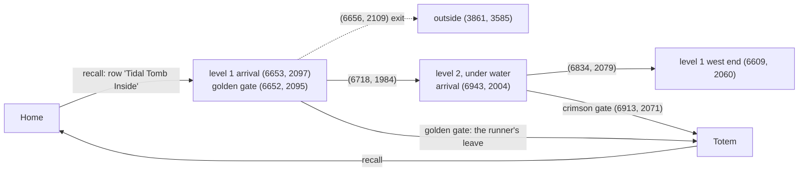

# Dungeon simulator (`harness/sim/`): the Mausoleum, Tidal Tomb

An offline game world for the hunt runner (user request 2026-10-13: "train our combat runner in the
emulated game world ... run tests much faster"). It is not an Outlands server: it is the one dungeon
level Logan Wolf fought on (2026-10-12, capture `20261012_210013`), on the real map, with the creatures,
pets and mechanics the `--pets` runner meets there, each number calibrated from that capture or the
wiki. The runner under test is the unmodified `loop_hunt.HuntLoop` (`tamer.Team`), on virtual time:
a 30-minute hunt takes 2–5 s of wall time (260–670× real time), and 24 runs take under 20 s on 7
processes. Since 2026-10-24 a second scenario, **Tidal Tomb** (`--scenario tidal_tomb`, "Tidal Tomb" below), from
Logan's first visit there; everything below that names no dungeon is the Mausoleum's.

```mermaid
flowchart LR
  subgraph Runner[unchanged runner code]
    HL[loop_hunt.HuntLoop + tamer.Team<br/>Mover, crawl, escape, humanize]
  end
  subgraph Sim[harness/sim]
    CL[clock.SimClock<br/>time.* patched in harness modules]
    LK[link.SimLink<br/>the Link API]
    WM[world.runtime.WorldRuntime<br/>the client's world model]
    W[world.World<br/>the server: map, mobs, pets, mechanics]
  end
  HL -- act / send --> LK
  LK -- C2S --> WM
  LK -- C2S --> W
  W -- S2C --> WM
  LK -- state / movement --> HL
  CL -. advance: World.run_until .-> W
  HL -. sleep / monotonic .-> CL
```

## Running

```
python harness/sim/run.py --runs 24 --minutes 30 --compare -- [loop_hunt arguments]
python harness/sim/run.py --runs 24 --set tamer.FALLBACK_S=0          # an experiment on a constant
python harness/sim/run.py --log run.log --seed 7                       # one run, with the runner's log
python harness/sim/run.py --seed 5 --at-hunt --trace [DIR]             # ... and its trace for the viz Sim page ("Traces")
# or from the viz: Sim page, `run…` (run.py or a fight script with its options; docs/VISUALIZER.md §2.20)
python harness/sim/cast_scan.py [--since 20261010] && python harness/sim/cast_scan.py --summary   # cast/flight times
python harness/test_sim.py                                             # the tests (~50 s)
python harness/sim/calibrate.py [--scenario tidal_tomb] --logs <logs dir> [--scan 20261010] [TAG...]   # refresh the observations
python harness/sim/kb_scan.py --location "Tidal Tomb" --out harness/data/sim/tidal_tomb_kb.json \
    --observed harness/data/sim/tidal_tomb_observed.json --mechanic 4641 ...   # a dungeon's wiki stats from the store
python harness/sim/run.py --scenario tidal_tomb --runs 8 --compare     # Tidal Tomb's level 1 ("Tidal Tomb" below)
python harness/sim/run.py --scenario tidal_tomb --area 6815 1907 6969 2100 -- --enter-via 6718 1984 --leave-gate 6913 2071
                                                                       # ... its level 2, under water
# live against simulated (docs below, "Parity with the live runs"): a batch as live plays, then the comparison
python harness/sim/run.py --runs 144 --seed 17 --others --eerie --prior <main checkout>/harness/data/harness.db \
    --json -- --vet-range 5 --crawl-learn-s 180 > sim.jsonl
python harness/sim/parity.py sim.jsonl --db <main checkout>/harness/data/harness.db --logs <main checkout>/logs
python harness/sim/fight1822.py 1,2,...,24 [--log] [--trace DIR] [--harness DIR]   # the 18:22 live death replayed
python harness/sim/fight1820.py 1,2,...,48 [--awake] [--log] [--trace DIR] [--harness DIR]   # the 2026-10-21 18:21 blightmare death
python harness/sim/fight2227.py 1,2,...,12 [--log] [--trace DIR] [--harness DIR]   # the 2026-10-21 22:27 ping-pong at a ledge
python harness/sim/fight1853.py 1,2,...,12 [level1|level2] [--log] [--trace DIR] [--harness DIR]   # the 2026-10-22 18:53 red on the walk in
python harness/sim/fight2001.py 1,2,...,24 [--log] [--trace DIR] [--harness DIR]   # the 2026-10-22 20:01 reds in the east wing's dead end
python harness/sim/fight2203.py 1,2,...,24 [--log] [--trace DIR] [--harness DIR]   # the 2026-10-22 22:03 caster red at the east wing's mouth
python harness/sim/fight2330.py 1,2,...,96 [--log] [--trace DIR] [--harness DIR]   # the 2026-10-23 23:30 blightmare death, the pets off guard
# with red players (docs below, "Red players"): gold banked an hour with them, their numbers against the live ones
python harness/sim/run.py --runs 98 --jobs 16 --careers 14 --seed 17 --reds --others --eerie --prior <main checkout>/harness/data/harness.db \
    -- --vet-range 5 --crawl-learn-s 180
python harness/sim/red_scan.py <capture tag> ...                       # the live reds' evidence from the captures
```

- Defaults added to the runner's arguments: `--pets --leave-recall <tome> --enter-recall <tome>
  --enter-rune Mausoleum --crawl --timeout <minutes>`, and the scenario's
  `runner` block: `--enter-via` the four teleporters Logan took in (two of them short hops on the
  second level) and `--leave-gate 5203 703 --gate-dest Totem`. The character starts at home (the DTF
  landing) with both pets, recalls to the gold gate on the first level, walks in, hunts, leaves by the
  crimson moongate to Totem and recalls home from there, by the runner's own rules. `--at-hunt` starts
  on the fight level instead.
- **Memory persists across runs** (user 2026-10-13). The runs are split into `--careers` (default
  CPU threads - 1, `DEFAULT_CAREERS`) careers. Each career runs one after another on one memory store, as the
  live runner keeps its store between runs: crawl priors, fights, avoided types, learnt teleporters. `--fresh`
  gives every run a new store. Summaries carry `career` and `career_run`. A career's next run starts `RUN_GAP_S`
  600 s of game time after the last one ended (live: median 685 s between Logan's runs), so the store's times read
  as live: the return rule's visits since `hunt_return.LIVE_SINCE` (game time starts 2026-10-21 00:00, `EPOCH`) and
  the crawl's recent kills. Before 2026-10-20 every run started at 2026-10-12 21:16, before that cut: the return
  rule never saw a career's visits.
- `--prior DB`: every career's store starts with DB's hunt history for the scenario's character (episodes and hunt
  job events older than `EPOCH`): the live store, so the crawl starts from the live zone knowledge and the return
  rule from the live visits, as a live run does. Without it a career starts empty and the crawl stays shallow
  (77 % of its time in zones 1-2 against the live 46 %).
- **Parallel runs**: one process per career (`--jobs` workers, default CPU threads - 3), so the
  careers bound the parallelism. A batch keeps off two logical CPUs for the game (`cpu_budget.limit`, user
  2026-10-17). The desktop has 16 cores / 32 threads (user 2026-10-13): batches
  since then use `--runs 98 --jobs 16 --careers 14` (careers of 7 runs, as the earlier `--runs 49
  --jobs 7` ones).
- Each run prints a row (kills, gold, damage taken, deaths, pet deaths, vet uses, potions, rule
  violations); `all:` aggregates (kills and gold per game hour, deaths per hour, runs with a death /
  a pet death / a pet left behind, crashes, violations); `--compare` sets the runs per hour on the level
  beside the live trip's; `--json` prints every run's summary (with `death_causes`: who did the damage
  in the 15 s before a death, `junctures`, `kills_by`, `bard`, ...).
- Seeds make runs reproducible (the world's randomness and the runner's `--seed`).
- `--others`: other (blue) players on the fight level (the scenario's `others`, "Other players" below). Off by
  default, so batches stay comparable with the earlier ones; `all:` then adds an `others` block (in-view numbers
  against the captures', their kills, the runner's "All Kill" at a monster on one, opens of their corpses, seconds
  engaged on a monster fighting one before ours hurt it, kills lost to their loot rights).
- `--eerie`: the Field of Souls' eerie corpses (the scenario's `eerie`, Halloween 2026-10-17 to 10-24): one appears at
  one of the 11 live spots at `per_h` an hour, lies `lifetime_s`, and goes when another player stands within 2 of it;
  the pack holds `jars` empty soul jars. Off by default. The runner's `--soul-jars` walks to them (docs/HUNT_LOOP.md
  "Soul jars").
- `--json` summaries also carry the runner's own records as the live store keeps them (`visits`, `fights`,
  `death_events`, `leave_events`), the monsters met by type (`met`) and the eerie corpses (`eerie`): sim/parity.py
  reads them.

## Pieces

| File | What it is |
|---|---|
| `sim/clock.py` | `SimClock` + `install()`: every loaded harness module's `time` becomes a view of the virtual clock (`monotonic`, `time`, `sleep`, `strftime` on game time), so the runner's 100+ direct `time.*` calls run unchanged. `sleep(dt)` advances the world. |
| `sim/link.py` | `SimLink`: `act`/`send` (walks get their sequence number, as the proxy stamps them), `state`/`movement` (the server's position as movement truth, the client model's snapshot, events), `wait`/`pos`/`open_containers` from `agent_link.Link`. A state read costs 20 ms of game time, a packet 2 ms. |
| `sim/world.py` | The server (module docstring): walking by `pathfind.Walk.can_walk` on the install's map (z from the map), line of sight by `los.Sight`, monster and pet AI, other players (`--others`), bard skills, vet supplies, potions, Stationary Penalty, corpses and loot, the rune tome (escape.py's gump layout), our death. |
| `sim/packets.py` | The S2C packets in the Outlands V10/V12 shapes the world model reads. |
| `sim/scenario.py` | Loads `harness/data/sim/<name>.json` (its `inherit` takes the named blocks of another scenario: Tidal Tomb has Logan's pets, pack, bard, vet, potions and the engine defaults from the Mausoleum's) and builds each creature's spec from the wiki stats and the capture (its docstring gives the order of evidence); `fit_bard` re-derives the barding skill. |
| `sim/calibrate.py` | The capture extractor that writes `<name>_observed.json` for the region and captures of the scenario's `calibration` block (`--scenario`; its rules are in the file's `rules`). Red players are no creature type. |
| `sim/kb_scan.py` | A dungeon's wiki stats from the memory store's wiki rows (Creatures List rows at a location, the tameables' follower abilities, chosen patch notes): `tidal_tomb_kb.json`. |
| `sim/run.py` | Runs, pool, careers (their clock and `--prior` memory), aggregate, comparison with the first trip. |
| `sim/parity.py` | Live against simulated, per hour on the level, with the live 95 % interval ("Parity with the live runs"). |
| `sim/shove_scan.py` | Shoves and stamina in the live captures (the walking rules of "Shoving and stamina"). |
| `sim/cast_scan.py` | Cast and flight times of the monsters' and pets' ranged attacks in the live captures (0x6E -> 0xC0 -> '-N'), per type ("Cast and flight times"). |
| `sim/trace.py` | A run's trace (`run.py --trace`, `fight*.py --trace DIR`): every mobile's record each tick and the combat events, read by the viz Sim page ("Traces"). |
| `sim/viewmap.py` | The Sim page's map underlay (floor/wall PNG chunks) and line of sight, for viz_server's `/api/sim/map` and `/api/sim/los`. |
| `sim/reds.py` | Red players (`--reds`, `World.add_red`): arrivals, Tracking, the walk graph across levels, the kits, the PvP rules ("Red players"). |
| `sim/red_scan.py`, `sim/entry_scan.py` | Every red-player encounter in the live captures, and where players appear and leave on Maus 3 (the evidence of "Red players", docs/NOTES.md "Red players met live"). |
| `sim/fight1949.py`, `sim/fight1822.py`, `sim/fight1820.py`, `sim/fight2330.py` | Live fights replayed from the capture's positions over many seeds, the deployed runner (`--harness`) against the current one. `fight2330` also sets the runner's state as live (the pets on a dropped 'All Kill', following, taken for guarding) and places another player's party on a reanimated daemon. |
| `harness/los.py` | Line of sight (ServUO `Map.LineOfSight`), shared with the live harness: 61 of 61 server answers on the trip agree (59 accepted targets seen, both "Target cannot be seen." blocked) once our z comes from the map; ~100,000 checks/s. |
| `data/sim/mausoleum.json` | The scenario: player, pets, pack, tome rows, bard/vet/potion numbers, defaults, specials, 74 spawns (checked against the live sightings 2026-10-20), eerie corpses, other players, the trip reference. Every number has its evidence in a `note`. |
| `data/sim/mausoleum_kb.json` | Wiki stats of 31 creatures, both pets, 22 mechanics, with knowledge ids. |
| `data/sim/mausoleum_observed.json` | The capture's observations (86 KB), every number with its sample size. |
| `data/sim/tidal_tomb.json`, `_kb.json`, `_observed.json` | Tidal Tomb: the scenario ("Tidal Tomb" below), the wiki's 41 creatures and 7 patch-note mechanics (kb_scan), the capture 20261024_102346's observations (calibrate). |

## Calibration (2026-10-13)

What the capture and the wiki fixed:

- **Creature hits are the wiki's**: every creature that died in view took exactly its wiki Hits + 1 in
  "-N" numbers (shadowguard 8001, shade wolf 5001, bound soul 8001, corpse purger 7001, ...). Gold on the
  corpse is the wiki Gold Value (lifted medians within -5..+17 %). A lift within `world.LIFT_GAP_S` 0.5 s of the last
  one taken is refused as live: "You must wait another moment before you may pick up an item from here." and `27 05`
  (metric `lift_waits`; the store's 144 refusals, docs/NOTES.md "Loot left in corpses").
- **Our pets' real hits** come from the "-N" numbers vs the 0xA1 share: the gravebug ~4.5 hits per point
  (450), the phoenix ~6.6 (660). Their attack periods from the attack animations: 1.91 s and 1.80 s;
  their hits from the attributed numbers (gravebug median 76, phoenix 198-238). The phoenix's damage x 1.373 since
  2026-10-20 from 134 live kills ("Parity with the live runs").
- **Monster melee on pets** from the attributed hits (shadowguard 20-44, shade wolf 18-37, nightstalker
  21-79, ...), swing ~3 s; types never fought take the wiki melee x 0.5 (the observed/wiki ratio).
  Casters' spells are [INFERENCE] (the wiki's spell damage x 0.5 every 6 s): none was attributable.
- **Barding**: the wiki formula `max(S/100 - difficulty/100, 0.33 x S/100)` with S = 149 fitted by
  maximum likelihood to the trip's 47 answered attempts; durations and refusal texts as the trip's. Since
  2026-10-20 the live success rate by type where it has 10+ attempts (`bard.observed`).
- **Aggro range 10** with sight (2026-10-15 audit below: 210 of 211 war-mode flips with the nearest of us
  seen at 1-10 tiles). It was 13 for a day on the user's guess ("I think its 12 or 13"), 10 before that,
  from the capture's war-mode switches 1-13 tiles from us, median 7. The wiki's flat 20-tile Perception
  Range put the sim's banshees on us from across the room (6 of 9 deaths).
- **Threat** (revised 2026-10-15 on the user's word: "Any mob that 'sees' Logan before it sees a pet is
  going to aggro on him directly"): a monster goes for the nearest of us it sees within its aggro range,
  a pet on a tie. (2026-10-13 to 10-15: any guarding pet within 6 tiles of us drew it, `guard_draw_r`,
  seen or not: too kind to a player walking ahead of his pets.) Since 2026-10-20 a guarding Tank in its sight within
  its range + 3 takes it instead with `tank_draw` 0.9 (the live first contacts; "Parity with the live runs"). Damage
  builds threat x 4.0 for the gravebug (Tank) and x 0.3 for the phoenix, fitted so the gravebug takes most of the
  damage as live. Our aggressive acts add 400, but only before any pet has hurt the monster.
- **Specials, from what reached Logan** (all 23 of his hits were these; the cadences, chances and
  numbers below are the 2026-10-13 calibration, revised where the "Monster mechanics audit" says so):
  - Bleeds: 8-10 every 3 s for 5 ticks, then "You are no longer bleeding.".
  - The bound soul's bleed lands on everyone within a tile (an opener of 23-32, 2 per 19 swings with
    Logan beside it) [INFERENCE: area].
  - The vampire bat's bleed hits its target.
  - The nightstalker's Charge: a jump up to 12 tiles every ~8.5 s, 37-42 on up to 3 within a tile.
  - The vampire countess' transfix (three fights over 20261012_210013, 20261013_173449 and _204518):
    an attempt every ~5.3 s; with no copy of hers up half succeed (6 of 12), with one up none (0 of
    5). Each hits the pet for 36-45 at once and makes a hostile copy of it, with the pet's name, that
    wakes 0-2.5 s later, goes for any of us but its original within 3 tiles (live, 4 of its 10 hits
    were on Logan, 28-37 each) and vanishes after 9.9-11 s (n=6). Until then the pet itself stands
    transfixed: no step, no attack.
    About 2 % of her transfixes take Logan instead (`player_share` 0.018: 2 on him live against 110 pet copies):
    "The creature overpowers your will and transfixes you!", no copy, his steps denied and his item uses
    refused for 11.1 s, then "You are no longer hindered." (`World.transfix_player`). A pet command meanwhile gets
    "You have been silenced and cannot speak." and the pets don't take it (live 2026-10-17 15:27:06, 2026-10-21
    09:49:20; `World._speech`, metric `silenced`).
  - The corpsebride's wail, every 7.6 s: 13-25 on each of us within a tile 75 % of the time (the pets
    beside it live: about 18 of 24), 20 % at 2-3 tiles (Logan: 2 of 11) [INFERENCE: an area hit].
  - The shade wolf's Vanish: 4.3-15 s into a fight, then every 19-22 s, it is unseen and can't be hit
    for 3.5-6 s. It comes back on the target it had, with a swing at once.
- **Barding songs** (2026-10-13, the second trip): a bard skill at the ground plays a song for 15
  minutes, 10 s between songs: less damage to us and the pets from creatures (bleeds and area hits
  too), more healing received, more damage by us and the pets. 15.0 % each on the second trip, 17.7 %
  since the user's Effective Barding links (the crawl, 20261013_204518), which also lengthened the
  bard skills' effects ~18 % (discord 71 s, peace 43 s, provoke 36 s); the scenario has the new values.
- **Moongate menus** open with the last destination selected, as live; the runner then presses Travel
  on the first menu. A double-click on a gate within a tile opens its menu, and Travel works from
  there, as Logan left on the crawl.
- **Pet pace**: one step per 0.21 s out of war mode (n=470 and 471, capture), the pace of our run;
  `calibrate.py` writes it as `step_interval_s_not_fighting` (2026-10-13; 0.3 s before, uncited).
  The world's step and swing timers keep their cadence across its 0.1 s ticks (`World._due`). Before
  that fix every 0.21 s step re-armed from the tick it fired on, so pets walked at 0.3 s anyway and
  fell 9-10 tiles behind a runner leaving a room.

`run.py --runs 24 --minutes 30 --compare`, per hour on the level (sim 8.7 h over 24 runs; the trip 13.1 min):

| | sim | trip |
|---|---|---|
| kills | 66 | 115 |
| damage to us | 1453 | 1703 |
| vet supplies | 121 | 197 |
| heal potions | 26.5 | 27.5 |
| provocations | 0 | 18 |
| discord success | 0.58 | 0.60 |
| peace success | 0.53 | 0.57 |
| gravebug : phoenix damage taken | 6.3 | 9.5 |

The runner kills at about 58 % of Logan's rate there: it explores an unknown floor (85 crawl waypoints)
where he walked straight to the next pack, and waits for mobs to come rather than opening (user
2026-10-12). It never provokes: Logan's 4 provocations went at mobs not yet fighting (an opener).

## What the simulator found (and what was fixed)

- **The crawl never moved with our pets out** (fixed, `crawl.py`): our own pets fell through to the
  monster branch of `Crawl.observe` (threats.identify calls every non-human a monster), so they were
  "targets in reach" and the crawl held at its waypoint for minutes.
- **Pets counted as attackers** (fixed, `loop_hunt.attackers`): a war-mode pet adjacent to us while we
  took damage was "attacking us", so two pets beside us made the two-attacker leave rule fire. Now a
  pet line or a non-attackable notoriety excludes it (also in `tamer.pet_attackers`).
- **Resting after the run's time was up** (fixed, `loop_hunt.go_back`): a leave at the end rested at home
  before noticing; it now stops at once.
- **Pets left behind vs dying while waiting for them** (`tamer.follow`; first calibration, before aggro 10
  and the threat fit): recalling at once after a low-hits leave left a pet more than 3 tiles off behind
  in 13 of 24 runs; standing 3 s for the pets killed us in 8 of 16 (bleeds and ranged hits finish us during
  the wait and the cast). Now a hurt leave
  falls back from the attackers while the pets come (`FALLBACK_*`), a leave for a pet while we are fine
  waits the full 10 s. On the final model 6 of 24 runs still leave a pet behind and 6 of 24 die once in
  30 minutes: the leave thresholds are the open question (below).
- **Thresholds** (24 runs x 30 min each, final model):

  | runner arguments | kills / game h | deaths / game h | runs with a pet left behind |
  |---|---|---|---|
  | defaults (`--leave-at 0.35`, `--heal-at 0.80`) | 58.0 | 0.60 | 6 |
  | `--leave-at 0.5` | 47.5 | 0.23 | 13 |
  | `--leave-at 0.5 --heal-at 0.9` | 52.6 | 0.56 | 11 |
  | `--leave-at 0.6 --heal-at 0.9` | 34.5 | 0.35 | 14 |

  Leaving earlier trades kills for deaths, and every extra leave is another chance to strand a pet.
  Deaths cluster in the shade wolf room at (5180, 710) (several melee mobs at once) and under banshees
  (5205-5210, 705-720). Nothing adopted as a default: the monsters' damage to the player is the least
  calibrated number (23 hits on the trip), see the captures wanted.
- **Recall ping-pong once the vet supplies ran out** (fixed, `tamer.rested`): with no supplies the rest
  counted every pet as rested, so a pet below `--pet-leave-at` made the run leave on arrival, rest,
  recall in and leave again, up to 436 recalls in a game hour (17 of 48 one-hour runs). The rest now
  waits for natural regeneration to `--pet-heal-at` and stops the run past `--rest-timeout`.
- **One-hour runs** (48 x 60 min each, defaults, after that fix):

  | measure | pets step 0.3 s, 59 vet | pets 0.21 s (captured) | + 200 vet supplies |
  |---|---|---|---|
  | game hours | 28.8 | 32.3 | 36.6 |
  | kills / hour on the level (trip: 115) | 69 | 71 | 72 |
  | gold / game hour | 50,800 | 48,700 | 63,100 |
  | deaths / game hour | 0.52 | 0.28 | 0.36 |
  | runs that strand the gravebug on a hurt leave | 10 | 6 | 6 |
  | runs out of vet supplies | 27 | 33 | 0 |
  | median run length (of 60 min) | 38 | 45 | 60 |

  Kills (first batch): banshee 610, shadow minion 371, apparition 220, vampire bat 82, shadowguard 73,
  shade wolf 60, nightstalker 3, reanimated knight 2 (median time from target to kill: shadow minion
  14 s, vampire bat 15 s, shade wolf 18 s, banshee 22 s, shadowguard 30 s, apparition 32 s; 53
  apparitions dropped as unengaged). Deaths in the last batch (13): 4 to a nightstalker and 3 to shade
  wolves, mostly in the room at (5177-5182, 699-711); 3 under banshees (5207, 704-716); 3 to shadow
  minions (5207, 691-695, and one at home after a leave on 30-odd hits).
- **How monsters got onto us instead of the pets** (the first aggro rule, 13 seeds, 240 times a
  monster picked us; replaced the same day, below):
  - 154: **the first sighting**. A monster picks the nearest of us within its 10-tile aggro range
    (guarding pets first, but only those in range and sight). The runner walks first and the pets
    follow 1-3 tiles behind (live too: within 3 tiles at the end of 16 of the trip's 22 10+ step walks),
    so a monster at 9 tiles sees only us. With the pets at 0.3 s a step they fell 9-22 tiles behind
    the runner's 0.20 s run and this was most deaths; the capture's 0.21 s (n=470) halved them.
  - 40: the pets were in range but out of the monster's sight (around a corner or a door).
  - 46: **our aggressive acts**: Discordance/Peacemaking/"All Kill" at it adds 400 threat on us (user
    2026-10-12: aggressive acts pull aggro); a pet must deal 100+ (gravebug, x4) to take it back.
  - It then stays on us: it switches only to a pet with more threat, and both guarding pets go for the
    same monster (the nearest one on us). Seed 2: a nightstalker took us at 9 tiles (pets 12), both
    pets fought the reanimated knight, and the nightstalker hit us 43 then 34 (the knight 23) and
    killed us from full hits in 3 s; the runner had just discorded the knight.
  - Live, that rule is harsher than the server (docs/NOTES.md "Guarding pets take a monster's aggro"):
    on the trip all 11 monsters we hadn't acted on went to a pet first, and none of Logan's 23 hits in
    13 minutes was an ordinary swing or spell from a monster that had picked him. They were bleed ticks
    and openers (bound souls, a vampire bat), one nightstalker Charge (an area hit, knowledge #14625:
    the -42 on him landed with a -37 on the gravebug) and the countess' transfixed copies.
- **The revised aggro and specials** (2026-10-13; 48 x 60 min, defaults, 200 vet supplies):

  | measure | old rule | revised | revised, `--pet-leave-at 0.35` |
  |---|---|---|---|
  | game hours | 36.6 | 41.6 | 44.9 |
  | kills / hour on the level (trip: 115) | 72 | 78 | 79 |
  | gold / game hour | 63,100 | 74,000 | 74,300 |
  | damage to us / hour on the level (trip: 1,703) | 1,321 | 71 | - |
  | heal potions / hour on the level (trip: 27.5) | 23.8 | 0.9 | - |
  | deaths / game hour | 0.36 | 0.17 | 0.18 |
  | runs that strand a pet | 6 | 0 | 1 |
  | runs with a pet death (the gravebug in 10) | 0 | 10 | 2 |

  The risk moved from us to the tank:
  - Leaving at `--pet-leave-at` 0.20 (90 of 450 hits) is too late: in 6 of the 10 the run was already
    leaving for the gravebug (below 20 %) when it died during the "All Follow Me" and the recall,
    with monsters still on it; in 3 it died before the leave. At 0.35, 2 runs of 48 lose it
    instead of 10, at no cost in kills.
  - We take far less than Logan did: 71 an hour against his 1,703. That isn't distance: the runner
    stood within a tile of a fighting monster as often as Logan (13 % of the time a war-mode monster
    was in view vs 12 % live). It is the route: the crawl never reached the bound souls and corpse
    purgers (x 5261-5277, y 645-661) where Logan took two bleeds. His other damage was one countess
    fight, so the trip's 13 minutes are one sample, not a rate.
- **The loop crawl** (`--crawl-loop`, 2026-10-13). This batch includes the pace-grid fix, the shade
  wolf's Vanish and the copies picking any of us. 48 x 60 min, `--pet-leave-at 0.35`, 200 vet
  supplies:

  | measure | zone crawl | loop crawl |
  |---|---|---|
  | game hours | 37.7 | 25.1 |
  | kills / hour on the level (trip: 115) | 78 | 107 |
  | gold / game hour | 74,200 | 79,700 |
  | damage to us / hour on the level (trip: 1,703) | 102 | 686 |
  | heal potions / hour on the level (trip: 27.5) | 1.3 | 7.9 |
  | deaths / game hour | 0.21 | 0.68 |
  | runs with a pet death | 3 | 9 |
  | runs that strand a pet | 3 | 6 |
  | median run length (of 60 min) | 60 | 34 |

  - Looping kills at about Logan's rate and dies three times as often. 7 deaths were to the countess'
    copies (5184-5188, 681-682), where Logan fought and survived by running. 5 were in the
    nightstalker room (5180-5182, 704-715), which Logan never entered: he only saw its wolves and its
    nightstalker from 18 tiles. 3 were to shade wolves, 1 each to a banshee and a corpsebride.
  - The tour (85 waypoints, nearest next from the exit) takes the nightstalker and countess rooms at
    stops 7-11 and the east at 29-33 and 49-80. So no run reached the bound souls before it ended:
    none killed one.
  - Our damage in 8 x 30 min (1,736) was the nightstalker's Charge landing beside the pet it fought
    (867) and the countess' copies (772); the rest was under 40 a source. With guarding pets,
    monsters picked us almost only while the pets were following (the leave) or on "All Kill".
- **With the real way out** (the crimson moongate; 49 x 60 min, `--pet-leave-at 0.35`, careers of 7
  runs on one memory store):

  | measure | zone crawl | loop crawl |
  |---|---|---|
  | game hours | 22.9 | 4.3 |
  | kills / hour on the level (trip: 115) | 80 | 87 |
  | deaths / game hour | 1.14 | 10.07 |
  | runs with a death / a pet death (of 49) | 26 / 24 | 43 / 41 |
  | median run length (of 60 min) | 19 | 3 |

  - Most deaths happen on the walk out: 24 of the zone crawl's ended "moongate: died", 42 of the
    loop's. They cluster in the countess' room (5175-5190, 680) and at the gate (5200-5205, 695-700).
  - The gate is reachable from the west rooms only through the countess' room, 50-110 steps; from the
    arrival, through the nightstalker room (114 steps from (5207, 721)).
  - The loop reaches the nightstalker room 3 minutes in, takes the first leave there and dies on the
    way out in almost every run. A career's memory doesn't save it: it dies before it has a fight to
    learn from.
  - With the same rules, the zone crawl's death rate went 0.18 -> 0.66 a game hour (fresh memory)
    once recall-anywhere was gone.
- **Heal in place, out of the nightstalker room** (user 2026-10-13; the scenario's `runner` block then
  added `--heal-in-place --crawl-avoid 5170 690 5188 718`, the room reopened later the same day, below;
  49 x 60 min, careers, `--pet-leave-at 0.35`):

  | measure | zone crawl | loop crawl |
  |---|---|---|
  | game hours | 35.4 | 18.1 |
  | kills / hour on the level | 80 | 84 |
  | gold / game hour | 74,000 | 66,600 |
  | deaths / game hour | 0.39 | 2.10 |
  | runs with a death / a pet death (of 49) | 14 / 7 | 38 / 22 |
  | leaves / game hour | 1.0 | 2.1 |
  | median run length (of 60 min) | 60 | 18 |

  - The loop now reaches the east: 19 bound souls and 13 corpse purgers killed.
  - It still dies too often. 25 of its 38 deaths are on the walk to the gate, clustered at
    (5200-5210, 690-700), the banshee room around the gate, and in the countess' room.
  - Before the loot fix (below), 19 runs ended on "to the corpse: no route".
  - With heal potions between steps on the walk out (user: "I just run and heal and hope for the
    best, with pets guarding"; `drink_on_the_run`), 49 more runs: 10.1 potions a hunting hour (was
    6.9) but deaths 2.35 a game hour, no better. The walk out is as dangerous for a real player
    (user: banshees catch players on their way to the gate too).
- **An unreachable corpse ended the run** (fixed, `loop_hunt` loot): the walk to it raised Abort("no
  route"). Now that corpse is left.
- **The second trip's model, and the barding songs** (capture 20261013_173449; 2 x 49 x 60 min per
  arm, seeds 0 and 1000, careers, `--pet-leave-at 0.35`, heal in place, out of the nightstalker room).
  The transfixed pet now stands out of the fight for the copy's ~11 s, one copy at a time; the
  corpsebride wails; `--songs` (default on) keeps the three songs up.

  | measure | zone, songs | zone, no songs | loop, songs | loop, no songs |
  |---|---|---|---|---|
  | game hours | 78.3 | 80.8 | 40.7 | 33.6 |
  | kills / hour on the level | 85 | 82 | 89 | 87 |
  | gold / game hour | 78,400 | 75,700 | 67,300 | 69,400 |
  | deaths / game hour | 0.33 | 0.31 | 1.70 | 2.11 |
  | runs with a death / a pet death (of 98) | 26 / 7 | 25 / 13 | 69 / 38 | 71 / 46 |
  | damage to us / hunting hour | 121 | 118 | 946 | 909 |
  | damage to the pets / hunting hour | 8,479 | 11,027 | 18,628 | 20,294 |

  - The songs spare the pets: about half the runs with a pet death in the zone crawl, a fifth fewer
    deaths in the loop. Our own damage doesn't fall: most of it is now the corpsebride's wail, the
    transfixed copies and, in the loop, the nightstalker (174 an hour, though the crawl stays out of
    its room) [INFERENCE: its Charge reaches 12 tiles, onto us passing the room on the way to the gate].
  - The loop still dies five times as often as the zone crawl.
- **With the crawl's updates** (20261013_204518: the barding after the links, the transfix hit on the
  pet, the gate double-clicked from a tile, songs on the way in, the teleporter pet fix; same 2 x 49 x
  60 min per crawl, songs on): zone 83 kills a hunting hour, 0.34 deaths a game hour, 10 runs of 98
  with a pet death; loop 84 kills, 1.47 deaths, 35. No run failed at a teleporter (2 of 14 had before
  the fix).
  - Against Logan's crawl on the same level (12.7 min, his loop plus the nightstalker room and the
    east): 137 kills an hour, ~780 damage an hour to him, no death. The simulated loop takes about as
    much damage (961) but kills 40 % slower and dies. He fought nearly without a break (595 of 764 s,
    6 engagements, the longest 11 kills); the gap is in how fast the next fight starts and ends, not
    in the damage [INFERENCE].
- **The nightstalker room open, and aggro management** (user 2026-10-13; `aggro.py`, docs/HUNT_LOOP.md
  "Aggro"; the vampiric consort spawned where Logan met one; 98 x 60 min per arm, `--jobs 16 --careers
  14`, `--pet-leave-at 0.35`; "off" = `--pull-budget 0 --no-reposition --never-aggro none`):

  | measure | zone, aggro on | zone, off | loop, aggro on | loop, off |
  |---|---|---|---|---|
  | deaths / game hour | 1.10 | 0.81 | 3.19 | 3.85 |
  | runs with a death / a pet death | 50 / 47 | 42 / 44 | 45 / 73 | 45 / 79 |
  | kills / hunting hour | 79 | 80 | 89 | 91 |
  | median run (min) | 21 | 26 | 3 | 3 |
  | the consort's damage on the pets | 0 | 0 | 108 | 843 |

  - With the room open both crawls die far more (the zone crawl had 0.34 deaths and 10 pet-death runs
    with it closed). Most pet damage in the loop is the nightstalker's (6,000 an hour).
  - The aggro rules keep the consort off (843 -> 108) and help the loop a little; the zone crawl is
    within noise or worse.
- **The gravebug's Devour mid-fight** (fixed 2026-10-13 on the user's question; docs/NOTES.md "Aggro
  management"): the simulator fed it 36 every 14 s and only out of a fight; live it feeds 54 every
  15 s, mostly mid-fight. Same arms after the fix:

  | measure | zone, aggro on | zone, off | loop, aggro on | loop, off |
  |---|---|---|---|---|
  | deaths / game hour | 0.81 | 0.88 | 3.54 | 3.90 |
  | runs with a death / a pet death | 43 / 50 | 44 / 47 | 49 / 71 | 51 / 75 |
  | kills / hunting hour | 84 | 82 | 101 | 83 |
  | gold / game hour | 74,200 | 72,700 | 69,300 | 52,800 |
  | median run (min) | 28 | 23 | 4 | 3 |

  - The aggro rules now give the loop more kills and gold (+31 %) and slightly fewer deaths; the zone
    crawl is even. Both still die far more than with the room closed.
  - An earlier reading that the simulator overrates two monsters on the tank (19.6/s vs live 8.5/s) came
    from a small sample of early-death runs; on longer runs it is 5.9/s. The room's toll is more likely
    how the runner walks in: from the south past the stalker and the knight, waking both, where Logan
    held at the north edge and let them come in stages [INFERENCE].
- **Hold at first sight** (`--hold-first-sight`, 2026-10-14; docs/HUNT_LOOP.md "Aggro"): with nothing
  fighting, stop where an idle monster first sees us and let it come, as Logan did at the nightstalker
  room. 98 x 60 min per arm, the other aggro rules on:

  | measure | zone, hold | zone, no hold | loop, hold | loop, no hold |
  |---|---|---|---|---|
  | deaths / game hour | 0.51 | 0.81 | 2.23 | 3.54 |
  | runs with a death / a pet death | 29 / 40 | 43 / 50 | 49 / 61 | 49 / 71 |
  | kills / hunting hour | 82 | 84 | 97 | 101 |
  | gold / game hour | 71,100 | 74,200 | 64,600 | 69,300 |
  | median run (min) | 32 | 28 | 6 | 4 |

  - A third fewer deaths in the zone crawl and over a third fewer in the loop, for 4-7 % less gold.
  - The loop still dies four times as often as the zone crawl; the nightstalker still does most of its
    pet damage (4,800 an hour).
- **The pull spot** (2026-10-14): holding now starts a tile outside the first monster's aggro range,
  and the runner first steps (up to 3) to where the fewest of the waiting monsters (by weight, at least
  one) would see it. Same arms, hold on: zone 0.47 deaths a game hour (0.51 without the spot), 28 runs
  with a death, 46 with a pet death (40), 88 kills a hunting hour (82), 78,300 gold a game hour
  (71,100); loop 2.14 deaths (2.23), 40 runs with a death (49), 62 with a pet death (61), 95 kills
  (97), 63,700 gold (64,600). More kills and gold in the zone crawl, fewer runs with a death in the
  loop; the pet deaths didn't move. The nightstalker still does 5,300 an hour on the pets in the loop.
- **The 2026-10-14 runs** (docs/NOTES.md "Logan Wolf's Mausoleum runs of 2026-10-14"): the reanimated
  knight now charges like the nightstalker (live -32 on Logan once in 3 charges) and the character
  carries 15 Adventurer's Ropes (the simulator answers `[Rope` with the prompt and a cursor, jumps up to
  10 tiles in sight, takes the following pets along, 5 s cooldown). Same arms: zone 0.40 deaths a game
  hour, 24 runs with a death, 42 with a pet death, 87 kills a hunting hour, 77,100 gold; loop 2.47, 50,
  59, 96, 65,500. The knight's charges do 69 (zone) and 216 (loop) an hour to us. The ropes don't run:
  no players in the simulator, so no flight from one.
- **Faster from one fight to the next** (2026-10-14, user: "can you make it move from one fight to the
  next faster?"). The zone crawl spent 30 % of its time on the level holding at cleared waypoints
  (`--crawl-depleted-s` 90 s, a virtual-time profile of the runner); the pets style now waits 5 s
  there (`--crawl-dwell` 1.5), and doesn't walk on while a vet channel runs or a pet in reach still
  needs one (`tamer.Team.busy_healing`). 98 x 60 min: zone 98 kills a hunting hour (87), 85,100 gold
  a game hour (77,100), 32 runs of 98 with a pet death (42), but 1.17 deaths a game hour (0.40);
  loop 99 kills (96), 67,400 gold (65,500), 50 pet-death runs (59), 1.86 deaths (2.47).
- **What killed us at the faster pace** (2026-10-14): the crawl opened its deep zones sooner and spent
  more time there (zone 4 opened 28 times in the 98 runs against 16; 37 countess kills against 11), and 46
  of the 54 deaths came after a leave at 35 %: about half 20-29 tiles from the gate in the countess and
  corpsebride rooms 1-25 s after it, 13 at the gate itself waiting for the pets. Arms (98 x 60 min each,
  same seeds; the runs are deterministic per seed):

  | arm | kills/h | gold/game h | deaths/game h | runs with a death |
  |---|---|---|---|---|
  | fast pace, leave 35 %, zones <= 30 | 103 | 89,300 | 1.25 | 53 |
  | old pace (90 s / 6 s), leave 35 % | 83 | 72,500 | 0.58 | 38 |
  | fast, zones <= 15 | 91 | 84,700 | 0.64 | 38 |
  | fast, leave 50 % | 106 | 89,900 | 0.79 | 37 |
  | fast, leave 60 % | 103 | 86,000 | 0.93 | 43 |
  | fast, leave 50 %, zones <= 20 | 100 | 89,100 | 0.54 | 29 |
  | fast, leave 50 %, zones <= 15 | 92 | 84,700 | 0.65 | 36 |
  | old pace, leave 50 % | 86 | 75,100 | 0.67 | 41 |

  The pets style now leaves at 50 % and opens a zone only below 20 hits lost a minute (STYLE_DEFAULTS).
  With everything below too (the vet resurrection, the daemon, the purger, the souls, Maus 4): zone 95
  kills an hour, 86,600 gold a game hour, 0.48 deaths (31 runs), 24 runs with a pet death, 11 pets
  vetted back; the old defaults in the same world: 104, 92,600, 0.82 (48). Loop: 100, 71,700, 1.51.
  The same code without Maus 4's links (a different random draw) gave 0.62 deaths: differences of 0.1-0.15
  a game hour are within the noise of 98 runs.
- **A target that left the view alive counted as a kill** (fixed, `HuntLoop.scan_events`): a 0x1D
  without the 0xAF of a death (a shade wolf's Vanish) was a kill, so the runner logged 4,967 kills for
  the simulator's 4,220 and walked off mid-fight; now 4,310 for 4,078.
- **The first live run's death** (2026-10-15, docs/NOTES.md "The pets runner's first live run"): the
  apparition's hit on everyone within 1 (`burst`, radius 1, every 8.8 s, 46-49 on us, 36-38 on a pet),
  a retreat to the tile the fewest idle monsters see, apparitions and daemons stood off, no wait for the
  pets beside the gate when hurt, potions drunk while waiting. Zone 98 x 60 min: 99 kills an hour, 88,500
  gold a game hour, 0.38 deaths (25 runs; 0.48, 31 before), 4 of the 25 at the gate (13 of 54 at the
  faster pace's start); loop 101, 70,200, 1.36 (1.51).
- **Vet supplies at 5 tiles and keeping off the tank** (2026-10-15: the Healer's Codex at tier 3; the user
  asked to stand off the tank). `run.py` now gives the simulated supplies the runner's `--vet-range`
  (before, the world healed at 2 whatever the runner thought). 98 x 60 min zone:

  | arm | kills/h | gold/game h | deaths/game h | runs with a death | runs with a pet death |
  |---|---|---|---|---|---|
  | range 2 | 99 | 88,500 | 0.38 | 25 | 29 |
  | range 5, no spacing (`--set tamer.SPACING_R=99`) | 88 | 78,400 | 1.11 | 52 | 15 |
  | range 5, spacing | 98 | 83,300 | 1.43 | 63 | 31 |

  With the pets kept alive the runs last longer in the countess rooms (countess kills 5 -> 22, transfixed
  copies' damage to us 56 -> 159 an hour): our deaths rise with range 5 alone. Spacing adds fight deaths
  (36 against 17; nightstalkers, corpsebrides, banshees) [INFERENCE: stepping 3 off the tank leaves us
  the monsters' nearest target and walks us into casters' sight more; not checked]. Kept on: the user's
  call, and the simulator's targeting of a lone player is a model, not measured.
- **New in the world** (captures 20261014_210020 and _221341, docs/NOTES.md): the forgotten souls (4 at
  the consort, their fire marks 0x6D70, no damage), the reanimated daemon (its bone burst on each of us
  within 5: pets 94-107, us 39-49, every ~15 s), the corpse purger's disease (2 of 3 barrage hits; -21
  every 5 s, 4 ticks, stacking), the vet resurrection of a pet's ghost (31 %), Maus 4's two links and four
  of its monsters (wiki stats; no fight there yet), the second level's hop at (5512, 669).
- **The 19:49 live fight** (20261015_171928, 2026-10-15; the user: "prove that the runner can handle that
  same fight correctly before we try again"). Three new rules from that capture, each with its evidence in
  the scenario's notes:
  - the apparition's **blink**: "*phases*", gone 0.5-1.3 s, back on its target's own tile with its area hit at
    once, when its target is beyond reach (cooldown 6 s [INFERENCE]);
  - the banshee's **spells** as seen (`ranged_observed`): 21-28 every 3.4 s at 5 tiles (n=8), about three
    times the wiki-derived 12.5-17.5 every 6 s;
  - a **wake delay** (`defaults.wake_s` 1.5-3 s): an idle monster takes a target that long after one of us
    came into its range and sight (live 1.8 and 2.7 s for apparitions; a second one 12 tiles off, out of
    sight by the map, idle 6 s).
  The fight replayed from the arrival (5207, 737) with both apparitions, two banshees and no respawns
  (`python harness/sim/fight1949.py 1,2,...,24`, `--harness <snapshot>` for the deployed runner; 24 seeds,
  4 game minutes each):

  | measure | deployed runner (0f55eb8) | after the fixes |
  |---|---|---|
  | deaths | 2 | 0 |
  | leaves before the time was up | 2 | 0 |
  | Logan's lowest hits, median / worst | 41 / 0 | 42 / 12 |
  | damage on Logan, mean | 173 | 159 |
  | from banshees, mean | 74 | 29 |
  | from apparitions, mean | 99 | 129 |
  | kills, mean (of 4) | 3.7 | 2.9 |

  The apparition damage rose: the phoenix, a ranged pet that follows Logan, draws the second apparition's
  blink onto itself within 2 of him. Kills fell: two banshees seeing one tile are now passed by.
  The whole level for 30 min (8 seeds, the live arguments) died in 5 of 8 runs with either runner (deployed:
  shade wolves, a banshee, corpsebrides; new: tormented souls twice, a corpse purger, a reanimated knight
  with an apparition, a banshee with a bat): with the new calibration the simulator is far harsher than its
  0.17 deaths per game hour of 2026-10-13, nearer the live runs of 2026-10-15.
- **A monster on another player behind a wall was still waited for** (fixed 27b3e84, `tamer.walk_to_see`; found with
  the other players, "Other players" below): the live 10:10:57 case of 2026-10-19 put in the simulator, Lord
  Phaze's tormented soul stood out of Logan's sight from his tile (5242, 683), no tile within bard_step's 2 steps
  saw it, and 4b06515's "All Kill" rule waited 15 s for it to come on. Now the runner walks round until it sees it.
- **The 18:22 live death at an eerie corpse** (2026-10-20, capture 20261020_180909; docs/NOTES.md "Dead after a
  soul-jar walk" and "The 18:22 death replayed"): the jar walk went 18 tiles alone into the countess room while the
  pets fought a shadowguard. `harness/sim/fight1822.py` replays the minute from 18:22:00 (Logan at (5210, 680), the
  shadowguard, the countess room and its neighbours as live, the corpse, no respawns; 4 game minutes, 24 seeds). On
  the final calibration below: the morning's runner (c334fce) 7 deaths, jars filled 24, Logan's lowest hits median
  43; the runner with the jar guards (4c72c12), the transfix wait and failed-walk carry-on (d445cbd, 7047a1d) and
  fight step-aways that don't wait for mobiles (`mobile_wait=0`, docs/HUNT_LOOP.md "Self care") 1 death, 13 jars,
  55; with the Tank draw since ("Parity with the live runs") 3 deaths, 9 jars, 53. Seed 5 had died "retreat: … cut
  by mobiles we couldn't shove; waiting" in the corridor.

## Monster mechanics audit (2026-10-15)

Every creature type fought on 2026-10-15 (test shard 20261015_090607, _115604, _171928, _204514; the live
server 20261015_210709 as it stood at 21:32; _195157 never reached the Mausoleum), with the earlier
Mausoleum captures (20261012_210013 to 20261014_221341) where a rate needed more n. Each capture replayed
through `WorldRuntime`; a "-N" on one of us is a monster's when that monster's animation came within 0.15 s
of it (the number and the animation arrive together: lag 0.0 s in 244 of 357 unambiguous cases) and no
other did. Observed numbers are divided by (1 - the Song of Discordance then up, 15.8-18.4 %): the sim
cuts them again (Logan's apparition hit: 56/59/60 without the song, 45-49 with it). Each change carries
its evidence in `mausoleum.json`'s notes.

| creature | mechanic | observed (n) | modelled before | now |
|---|---|---|---|---|
| all | wake range | 252 idle monsters woke (3 more were woken by our hits); none had kept one of us in sight within 10 tiles for 5+ s idle, 102 had within 13; the onset (2.2 s before the flip) median 10 | 13 | **10; 13 for the shadow minion and the calamity** (`aggro_observed`) |
| all | wake delay | 10-tile crossing to war 1.4-2.6 s, median 2.2 (188) | 1.5-3 s | same |
| all | whom first | nearest seen at the crossing; the gravebug got the first contact in 61 of the 99 wakes where Logan was nearest (guard + Tank threat) | nearest seen, pet on a tie; threat | same (2026-10-20: the simulator gave the gravebug 29 % of those; now `tank_draw`, 61 %) |
| all | Logan's and the phoenix's share | Logan 1.4-1.95x the gravebug's number (4 types, 30 hits); the phoenix 1.35-1.92x on melee (5 types, 34 hits), ~1x on spells and area hits | everyone x1 | **Logan x1.6 (melee and spells), phoenix x1.7 melee** (`_taken_x`) |
| all | chase pace | one tile per 0.33-0.54 s by type (14 types, 12-157 steps) | wiki speed 0.33-0.55 | same (within 10 %) |
| all | swing | 3.36-3.43 s (shade wolf 61, apparition 55, shadowguard 22, bat 16, nightstalker 13) | 2.96-3.36 s | same (<15 % off) |
| all | spell range | hits at 11-14 tiles: 12 of 65 | 10 | **12** |
| all | leash, fleeing | none of 136 monsters at 20 % hits or less fled (banshees aside; an apparition's blink and one shadowguard at the view's edge moved 5+ off); no chase out to a give-up seen | leash 24 / 8 s unseen | same, unmeasured |
| apparition | blink | "*phases*" 0.6-3.3 s after waking (30), then every 7.8-16.5 s, median 8.1 (48), beside its target or not; back on the target's own tile 1.1-1.6 s later (56) | only when the target was out of reach, every 6 s | **every ~8 s from waking** |
| apparition | area hit | only at a blink's landing (56 of 56), radius 2 (34 hits at 2, none at 3+); Logan 55-60 song-free, the pets 37-38 with or without the song (12/6) | own 8.8 s timer; Logan 46-49 | **at the landing only; Logan 55-60; pets uncut by the song** |
| apparition | melee | gravebug 15-26, median 20.5 (44) | 20-25 | same |
| banshee | spells | gravebug 16-23, median 19 (17); Logan 1.74x; every 3.4 s (8) | 21-28 on everyone | **16-23 gravebug-referenced** |
| banshee | dematerialize | at the instant it is hit (63 of 63), 7.5-14.8 s apart (42); gone 0.5 s after the emote, back 1.5 s after it, 3-12 tiles off (61); "*evasive*" 5.1 s, "*materializes*" 6.7 s after | none | **new** |
| corpsebride | melee | gravebug 7-13, median 10 (44) | 20-24 (the wail mixed in) | **7-13** |
| corpsebride | wail | every 7.5-7.8 s (57); hit within 2 tiles 82 of 94, at 3-4 47 of 61, 5+ 2 of 73; Logan 23-33, pets 15-26 | 75 % within 1, 20 % at 2-3; 13-25 | **90 % within 2, 75 % at 3-4; split** |
| nightstalker | melee | gravebug 18-29, median 25 (30) | 21-79 | **18-29** |
| nightstalker | Charge | "*charges*" every 8.0 s (32); the jump and its hit 0.8-1.0 s after the emote (25); gravebug 31-43 | at once, every 8.5 s, 37-42 | **called 0.8-1.0 s ahead**, 31-43 |
| nightstalker | Vanish | gone 3.2-4.4 s mid-fight, back 2 tiles off with a hit (5) | none | **new** [INFERENCE: how often] |
| reanimated knight | melee | gravebug 12-21 (6), 3.39 s (25) | 25-30 | **12-21** |
| reanimated knight | Charge | every 15.1-15.8 s (6), 1.0-1.1 s after the emote (13); gravebug 25-37, Logan 44-56 (3) | every 8.5 s, 25-35 | **15.2 s, called, Logan 44-56** |
| shade wolf | melee | gravebug 13-33, median 20 (128) | 18-37, 22.5 | same |
| shade wolf | Vanish | gone 3.2-10.1 s, median 4.4 (43); first 2.7-31 s in (23), then every 18.6-26.1 s (21) | 4-15 s, 15-22 s, 3.5-6 s | same |
| shade wolf, nightstalker | Frenzy | "*frenzies*" 31: no change in damage or cadence (27) | none | none |
| shadow minion | spells | gravebug 11-23, median 15 (32), 3.3 s apart (10) | 10-15 every 6 s | **11-23 every 3.4 s** |
| shadowguard | melee | gravebug 19-32, median 23 (33) | 20-44, 27 | same |
| vampire bat | melee | gravebug 9-17, median 12 (26) | 13-22, 15.5 | same (23 % off) |
| vampire bat | bleed | none reached Logan; on pets invisible | 15 % | same, unmeasurable |
| vampire countess | melee, spells | gravebug melee 13-23 (20), spells 5-27 (8) | 15-20, 15-20 | same |
| vampire countess | transfix | attempts every 5.5 s (83); a copy in 27 of 100: 20 of 76 with none up, 7 of 24 with one up (the other pet); the hit on the pet 40-55 | 50 %, never with a copy up; 36-45 | **27 % either way; 40-55** |
| transfixed copy | pace, hits | steps 0.36-0.41 s (101), swings 3.38 s (24); Logan 24-34 (11), phoenix 31-36 (7) | the pet's 0.21 s and 1.91 s; 28-37 | **0.4 s, 3.38 s, 15-21 gravebug-referenced** |
| transfixed pet | after release | attacks again within 0.3-2.7 s in 25 of 27 releases (attack animations); once (21:20:02.8 live) the phoenix stood 46.7 s until "All Guard Me", an "All Kill" having come while it was transfixed | resumes at once | same; the one idle case is n=1, not modelled |
| guarding pets | the other pet's fight | the phoenix on guard attacked within 2 s in 99 % of 2,414 half-second samples where a monster fought only the gravebug | guard takes whatever attacks us or the pets | same |
| vampire | feed | "*attempts to feed*", "*feeds*" 5.0-5.9 s later (4 of 9), 4-5 ticks 0.5 s apart on its target, 13-18 (47 ticks); no heal seen after 24 feeds | drain 10 % of hits, 10, with a heal | **feed** [INFERENCE: every 6-14 s] |
| elder vampire | feed, spawn | as the vampire's, ticks 19-23 (51); idle at (5213-5217, 639-640) in 5 captures | not spawned | **spawned, feed** |
| elder vampire countess | transfix, spawn | 12 attempts; copies of both pets 19:19:04/22 (171928); idle at (5216-5218, 638-640) in 6 captures | not spawned | **spawned, the countess' transfix** [INFERENCE] |
| abomination, newly reanimated, tormented soul, spare parts | melee | 1-4 hits each | wiki x 0.5 | same, n < 3 |

**Wake distances per type** (`mausoleum.json` `aggro_observed`, which the runner can read: flip = the nearest of
us at the war-mode flip; onset = the nearest of us in sight 2.2 s before it, the median delay; idle = monsters
that had one of us in sight within 10 / 13 tiles for over 5 s and stayed idle):

| type | wakes | flip median / p90 / max | onset median / p90 / max | idle in sight ≤10 / ≤13 | range |
|---|---|---|---|---|---|
| shade wolf | 41 | 8 / 10 / 15 | 10 / 12 / 13 | 0 / 12 | 10 |
| apparition | 32 | 9 / 10 / 15 | 10 / 11 / 16 | 0 / 7 | 10 |
| banshee | 30 | 7 / 11 / 18 | 10 / 11 / 11 | 0 / 8 | 10 |
| shadow minion | 20 | 7.5 / 15 / 18 | 13 / 18 / 18 | 0 / 0 | **13** |
| vampire bat | 18 | 7 / 10 / 10 | 10 / 11 / 13 | 0 / 4 | 10 |
| corpsebride | 16 | 7.5 / 10 / 10 | 8 / 10 / 10 | 0 / 3 | 10 |
| calamity | 15 | 7 / 9 / 10 | 12 / 13 / 14 | 0 / 0 | **13** |
| nightstalker | 13 | 6 / 10 / 12 | 10 / 12 / 14 | 0 / 1 | 10 |
| shadowguard | 12 | 8 / 10 / 13 | 9 / 11 / 11 | 0 / 0 | 10 |
| reanimated knight | 12 | 6 / 8 / 9 | 9 / 11 / 11 | 0 / 3 | 10 |
| vampire countess | 10 | 6 / 9 / 10 | 10 / 11 / 11 | 0 / 2 | 10 |
| spare parts, newly reanimated, insane reanimator, abomination, elder vampire(s), vampire, corpse eater, others | 1-7 each | 2-8.5 medians | 7-12.5 medians | 0 / 0-2 | 10 |

**Our line of sight (`harness/los.py`) is not too permissive** at this level: within 10 tiles nothing it called
"in sight" stayed idle, so the long idle sightings are range, not sight. The user's column case (20261015_210709,
the reanimated knight at (5179, 707), Logan coming up x=5182): our LoS said in sight from 13 tiles at 21:49:57;
he stood at 13 for 10 s with the knight idle, reached 10 at 21:50:07.5, and it went to war at 21:50:09.5 at 6.
That is the 10-tile range plus the ~2 s delay; the columns didn't need to block anything. If anything our LoS is
a little strict: in 25 of 252 flips the nearest of us was out of sight by it (the monster may have seen another
of us, or the line was a near thing) [INFERENCE].

Not measurable from the captures: bleeds and poison on the pets (no message for them; none reached Logan
on 2026-10-15), the leash distance, the dematerialize's landing rule (it looks random), how often a
nightstalker vanishes, the elder vampires' own numbers (one fight each), and whom a monster picks before
the pets' threat takes it (the first hit is after the guard has engaged).

The 19:49 fight replayed on this calibration (`fight1949.py 1,...,8`): no deaths in 8; Logan's lowest
hits median 38, worst 23; damage on him mean 272 (apparitions 240: every blink now lands its hit, beside
the gravebug too; banshees 32); kills 3.0 of 4.

The whole level from home, 8 game minutes (`run.py`, seeds 1-8, the current runner): Logan died in 5 of 8
(shadow minions' spells at 13 tiles on the walk out, transfixed copies with a corpsebride, apparitions);
with every aggro range at 10, 3 of seeds 1-6. Live on 2026-10-15 the runner died in at least 6 of the 13
test-shard runs (1, 4, 5, 9, 10, 11) and in neither of the two longest (run 13, 20 min; the first live-server
run): near the test shard's rate, harsher than the latest runs.

Then the runner took the same per-type ranges (`aggro.aggro_range`, holding for a monster only within its own
range): the whole level, seeds 1-8, 8 minutes: 1 death in 8 (seed 8), 273-617 damage on Logan, 8-14 kills;
test_hunt is back on seed 1. The 19:49 fight, 24 seeds: 1 death, Logan's lowest hits median 34.5, 378 damage
(342 from apparitions: the second one on Logan in 22 of 24). Holding a tile beyond each range instead: no
death in 24, median 28.5, 371; within noise, so the hold stays at the range itself (the user: no holding for
a monster that can't wake).

**A pet holds while its target blinks (2026-10-17).** Live 20261017_110506 the gravebug moved 0-1 tiles in the
1.6 s after 15 of 20 apparition "*phases*"; the simulator's pets went back to following Logan the moment their
target vanished, so they came onto him and the landing hit both (a step off the tank could never work there).
Now a pet whose target blinked (`blink_to` set; not a banshee's dematerialize, not on "All Follow Me") holds
until it lands. The runner's step-off on the "*phases*" (`Team.blink_tiles`, HUNT_LOOP "Out of a Charge's
reach"), the whole level, seeds 17-64, 8 minutes:

| | deaths | of them at the gate on the way out | damage on Logan | from apparitions | kills |
|---|---|---|---|---|---|
| before both | 10 | 6 | 494 | 292 | 9.6 |
| the step-off, old pets | 7 | 5 | 455 | 291 | 7.7 |
| the pet hold, no step-off | 18 | 14 | 371 | 107 | 10.3 |
| both | 17 | 14 | 351 | 70 | 11.6 |

The step-off takes a third off the apparitions' share. The pet hold itself moved the deaths to the walk out at
time up (14 of 48 dead between the fight and the crimson gate): more kills, deeper zones open [INFERENCE], and a
long way out through the countess room. That walk is the open problem now, not the apparitions.

## Other players (2026-10-19)

User request 2026-10-19: other (non-hostile) players in the simulator, so the pets runner's handling of monsters
fighting someone else, loot rights on their kills and crowded spawns can be tested and A/B'd. Off by default
(`run.py --others`, the scenario's `others.enabled`); reds are out of scope here ("Red players" below). The numbers
come from 19 live captures with Logan on Maus 3 (6.69 h, docs/NOTES.md "Other players at the Mausoleum"); each
parameter's evidence is in `mausoleum.json`'s `others.note`.

- **Who**: blue players (notoriety 1, 92 % of the live sightings), a human body, flags 0x20 as every live player's
  0x20/0x77, a player's name (16 seen live) as name and click label: the runner's `threats.identify` calls them
  players. 47 % come with a pet or summon (live 266 of 565), drawn by the live sightings (giant and black widows,
  liches, a vampire, a colossal spitting viper, a sun wyrmling, ...) with the live tag ("(bonded)" or "(summoned)").
- **Coming and going**: they arrive at a spawn area out of our view, 11 an hour across the level (Poisson), and stay
  5-30 min (mode 10) [INFERENCE: both level-wide, not observable; set so the in-view numbers match]; some are there
  at the start. They run (0.2 s a step) to a spawn area within 40 tiles, stand about it 5-40 s, and go on; their time
  up, they leave once out of our view.
- **Fighting**: a player takes a monster on itself or its pet, else the nearest in its sight within 10 that isn't
  on our party [INFERENCE], and hits it every 1.5 s from up to 8 tiles (its pet in melee, 60 % of the damage) at a
  group rate drawn per player from the live kills (178-885 hits/s, mode 456). Monsters take them as targets by the
  same rules as us (first sight, threat). They never die (healed at a quarter) [INFERENCE]. No "-N" over their
  fights, as live; their hits on a banshee trigger its dematerialize as ours do.
- **Loot rights**: a monster another player did more damage to than our party leaves a blue corpse (0xDEAD notoriety
  1, live 160 of 164), sent when it comes into our view; opening one answers "You may not loot this corpse." (and a
  lift from it `27 05`). Such kills aren't in `kills` (`others_kills`).
- **In view, live against the simulator** (144-run batches, players on, the code of 27b3e84):

  | | live | zone crawl | loop crawl |
  |---|---|---|---|
  | one or more players in view | 27.4 % | 31.2 % | 31.4 % |
  | players in view, mean | 0.36 | 0.41 | 0.39 |
  | arrivals in view an hour | 82 | 66 | 77 |
  | in-view stay p25 / median / p75 / p90, s | 3.9 / 8 / 25 / 44 | 3 / 11 / 28 / 52 | 4 / 10 / 22 / 43 |
  | monsters on a player dying in view an hour | 42 | 34 | 30 |
  | our credited kills that were theirs (blue) | 12 % (task logs 10-16..19) | 9 % | 9 % |

- **A/B** (144 runs each, seeds 17/65/113 x 48, 20 min; "waited" = seconds the runner was engaged on a monster fighting
  another player before any of ours hurt it, by `World.engaged_fn`):

  | | Runs with a death | Deaths/h | Gold/h | Kills/h | Pet-death runs | "All Kill" at a monster on a player | Kills lost to their loot rights | Their corpses opened | Waited, s (monsters) |
  |---|---|---|---|---|---|---|---|---|---|
  | Zone crawl, players off | 58 | 1.46 | 96.0k | 101.6 | 53 | - | 0 | - | - |
  | Zone crawl, players on | 45 | 1.05 | 80.5k | 84.3 | 42 | 333 | 363 | 0 | 1,455 (375) |
  | Zone crawl, players on, before 27b3e84 | 51 | 1.21 | 82.1k | 85.6 | 42 | 280 | 395 | 0 | 1,991 (406) |
  | Loop crawl, players off | 62 | 1.60 | 98.1k | 104.8 | 43 | - | 0 | - | - |
  | Loop crawl, players on | 52 | 1.27 | 82.2k | 81.6 | 43 | 274 | 318 | 0 | 1,234 (309) |
  | Loop crawl, players on, before 27b3e84 | 56 | 1.38 | 82.1k | 81.7 | 44 | 217 | 327 | 0 | 1,352 (295) |

  Players take a sixth of the gold and kills (they kill 260-270 monsters an hour across the level) and a quarter of
  the deaths [INFERENCE: fewer monsters left to wake us]. The runner never tried one of their corpses; the walk to
  see a monster on a player behind a wall (27b3e84) cut the waits by a quarter on the zone crawl at no cost. The
  waits left are ~4 s a monster: the approach and the "All Kill" itself.
- **Why off by default**: players move every headline number 15-30 % (gold, kills, deaths), so with them on no batch
  would compare with the tables above this section. Use `--others` for anything players touch (targets on others,
  loot rights, crowding), and for a final check of a change.

## Red players (2026-10-21; a batch option since 2026-10-23)

User 2026-10-22: red players as an option in the simulator, "as accurate as you can make it to what we've seen from
reds live", to model gold banked per hour with the main killer in it and to try strategies against them; "reds are
regular players so all the same rules apply to them, and extra PvP restrictions apply to them once they attack
someone". `run.py --reds` turns on the scenario's `reds` (off by default, so earlier batches stay comparable); the code
is `sim/reds.py`; every number in `mausoleum.json` `reds` carries its evidence: docs/NOTES.md "Red players met live"
(31 live Logan captures, `sim/red_scan.py`) and "Red players: the game rules" (wiki, patch notes, forums, knowledge
ids). `World.add_red(x, y, kit=, spec=, route=)` still places one for a test or a live-death replay: an attacker that
knows where we are, walking a live red's own tiles first when given a route.

- **Coming in.** Groups of 1-4 (live sizes) arrive at `arrive_per_h`, recalling in within 8 tiles of a first-level gold
  gate (the only places magic travel into a dungeon lands), and run the teleporters down as Logan does, some hunting
  the first two levels a while first (`upper`). That is the only way onto Maus 3 (user 2026-10-23): the crimson gate is
  exit-only, and (5243, 612) at the north end of the north-east hall, where players were seen popping in and leaving,
  is the door of the mini-boss room, the Cistern Gorgon's (its other side about (5199, 842)). On the fight level a
  group hunts for `stay_s`, then leaves; some are there when a run starts.
- **Finding us.** Tracking every 5 s at the red's skill (80-100), 50 tiles in a dungeon, gives our tile at that moment;
  in view they see us move. A group shares what it knows and decides together whether to attack (`attack_p` 0.9 on
  Maus 3, `attack_p_transit` 0.1 on the levels it crosses). It drops us as a target when we leave its level or stay
  out of its view 30 s (`lose_s`).
- **Moving.** Running 0.19-0.22 s a tile on the map's walk graph (`reds.Graph`: ~17k tiles, the teleporters as edges;
  routes from a BFS distance field per goal, ~10 ms, cached), through a mobile only at full stamina (a shove -10, a
  Total Refresh when blocked), Teleport or a rope to close 6+ steps (in view 0.22 jumps an appearance, live 0.23),
  through a teleporter after us if it saw us take it (live Botan). No red follows through the crimson gate (Heat of
  Battle: no moongate for 2 min after attacking a blue; live 0 of 13 escapes).
- **Kits** (live shares 30 / 7 / 2 of 39): **mage**: an opener then the live spell mix (Energy Bolt 22-34 every ~2.2 s,
  Explosion, Flamestrike, Lightning, Magic Arrow, Weaken, Poison, Paralyze, Telekinesis with a stuck explosion potion,
  a Greater Heal when hurt); it stands its cast, checks range (12) and sight when the cast ends and holds the spell
  (precast) while they fail, moving meanwhile; casts from within 8 and closes to 1-4; 100 mana at 1 a second.
  **melee**: swings when adjacent (59 % for 10-28, 1.34-2.26 s), Hamstring on a hit, weapon poison; 30 % approach in
  Stealth (walking, unseen) and open with a swing beside us. **archer**: a crossbow (8) or bow (10), standing 0.5-1 s
  to shoot, melee and Hamstring when adjacent. 25 % bring a summon whose 1-7 chips add to theirs. What a red holds is
  sent (0x2E): the runner reads empty hands, a bow or a crossbow as a ranged red.
- **The PvP rules on our side** (World): a red's attack line or hit flags us 60 s (`PVP_FLAG_S`): a rope then starts the
  2-minute cooldown and no pet follows the jump; heal potions heal 21-29 (live while flagged) and the vet supplies 15-22
  on us. A red's hit breaks our recall (500641, then the disturb recovery: 502644 until it passes). Hamstring: stamina
  0, a walk's pace (steps closer than 0.38 s refused), no regen, 3 s, then the stamina back and 30 s immune. Paralyze:
  steps refused with "You are frozen and cannot move." until 10 s pass or damage breaks it.
- **Monsters** take reds as targets by the rules they take anyone (a hit breaks a red's cast); reds heal themselves
  and never die here [INFERENCE: one of ~50 live appearances died]; reds and our pets leave each other be (live).
- `run.py` reports `reds` in `all:` (the live comparisons below) and the scenario's `places` share of our time
  (`place_share`: `east_wing`, `gate_arrival`).

**Against the live numbers** (196 runs, seeds 17 and 115 x 98, 30 min, `--reds --others --eerie --prior <the live
store> -- --vet-range 5 --crawl-learn-s 180`; live: the runner era on Maus 3, 11.22 h, 20 groups):

| | live | simulator |
|---|---|---|
| red groups coming into view an hour on Maus 3 | 1.78 (1.09-2.75) | 1.81 |
| ... an hour of walk-in (levels 1-2) | 1.57 | 1.46 |
| group size 1 / 2 / 3 / 4 | 58 / 25 / 12.5 / 4 % | 70 / 19 / 7 / 3 % |
| appearances that attacked | 62 % | 79 % |
| attack line: s after first sight / tiles (median) | 2.9 / 4 | 2.3 / 4 |
| jumps (Teleport, rope) an appearance in view | 0.23 | 0.25 |
| met within 2.6 min of our arrival on the level | 9 of 24 | 55 % |
| a group met again in the run | ~2-3 of 20 | 9 % |
| our position at first sight: east wing / gate and arrival | 7 / 4 of 24 | 23 / 43 % |
| red deaths an hour on Maus 3 | 0.71 (0.31-1.40) | 0.47 |
| groups that killed us | 8 of 18 (44 %) | 27 % |
| first sight to death, median | 9.5 s | 14.9 s |
| killed us: a red nearer the gate at first sight / not | 7 of 12 / 0 of 5 | 35 % (80) / 4 % (28) |
| killed us: Logan in the east wing at first sight / elsewhere | 4 of 7 / 4 of 11 | 32 % (25) / 25 % (83) |

The encounters come out at the live rates, places and timing; the current runner dies in them about half as often
as the runners of the live era did. Replaying the live red deaths (the live tiles; this simulator) with the runner that
died live (a snapshot of its checkout, `--harness`) against today's: `sim/fight2001.py` 24 of 24 dead against 0 of 24,
`sim/fight1853.py level2` 8 of 12 against 1 of 12 (`level1` 0 of 12 against 1 of 12), `sim/fight2203.py` 2 of 24
against 0 of 24 (live that run ended on a route error with Logan alive, which the simulator doesn't reproduce). So
the simulated reds kill the runner versions that died to them [INFERENCE: today's lower lethality is the runner's
fixes of 10-21/22, not the model]. Not matched: the simulator meets 55 % of its groups within 2.6 min of our arrival
(live 38 %) and more of them at the gate and the arrival (43 %, live 4 of 24): every red comes onto Maus 3 at the
arrival, beside the gate.

**Gold banked** (since 2026-10-23, with or without reds): live the drop-off at home takes what we carry; the simulator
has no house (`--no-drop-off`), so `World._land` on the home rune counts the gold looted so far as banked
(`gold_banked`), and a death loses only what came after (`gold_lost`). `all:` gives `banked_per_h` (game hours of the
runs) and `banked_per_h_net`, which adds `--death-downtime-min` (default the scenario's `reds.death_downtime_s`: live
the next run came a median 21 min after a red death) for each death. Same seeds, 196 runs each:

| | no reds | reds |
|---|---|---|
| gold looted an hour | 107.1k | 90.4k |
| gold banked an hour | 102.5k | 84.3k |
| banked an hour net of death downtime | 91.1k | 68.6k |
| deaths an hour | 0.36 | 0.65 |
| kills an hour | 96.8 | 83.3 |

Reds take 18 % of the banked gold (25 % net; Welch t -6.1 on per-run banked gold per hour).

**First strategy A/B: keep the crawl out of the east wing** (user 2026-10-22: hunt where we can loop round a red back to
the gate, not in a dead end; `--crawl-avoid 5224 655 5247 737`, 196 runs each, reds on): our time in the wing 33 % ->
13 %, groups first met there 25 -> 12 and their deaths 8 -> 3, but deaths elsewhere 21 -> 25; deaths an hour 0.65 ->
0.67, banked an hour 84.3k -> 80.6k (Welch t -0.6). A group met in the wing kills us a little more often than one met
elsewhere (32 % against 25 %); the strong marker is a red nearer the gate than we are (35 % against 4 %, live 7 of 12
against 0 of 5), and every red comes in at the arrival beside the gate, so the time taken out of the wing went to
places where reds coming in stand between us and the gate. No gain from this one.

The simulator also sends the 0x1D the live server sends when a mobile goes out of view range (since 2026-10-21; live
17:37:10.92 I Make Bodies stepping to 19 tiles, 17:37:13.63 Botan); before, the client model kept such a mobile at
its last tile out to its own 24-tile prune (the simulator sends no 0xC8), so a red out of view still showed where it
left the view, and so did monsters. Before / after, the runner of the day, 20 min runs: 144 runs seed 1017 deaths/h
0.71 / 0.89 (runs with a death 28 / 34), kills/h 111.8 / 115.3, gold/h 111,661 / 114,755, damage on Logan/h 3,110 /
3,262, runs with a pet death 42 / 45; 48 runs seed 17 deaths/h 0.73 / 0.93 (10 / 12), kills/h 113.5 / 110.2. Both
blocks put the deaths up a little (38 / 46 runs with a death of 192, about the noise) [INFERENCE: the runner no longer
sees stale monsters 19-24 tiles off, as live it never did].

## Parity with the live runs (2026-10-20)

After the 18:22 death the question was how close the simulator is to the game as the runner meets it now. The
yardstick: Logan's live pets visits on the live server since 2026-10-15 21:10 (41 visits, 5.55 h on the level when
the last table was made; the store grows with every run), against a batch played as live plays: `run.py --runs 144
--seed 17 --others --eerie --prior <the main store> -- --vet-range 5 --crawl-learn-s 180`, compared by
`sim/parity.py` (both sides the runner's own records; the captures for the pets' damage and the monsters met; the
live 95 % interval a bootstrap over the visits; deaths in a visit left for a red or a hostile player don't count,
the simulator has none).

What was off, and the changes:

- **Game time** (`run.py`): the simulator's clock started 2026-10-12, before `hunt_return.LIVE_SINCE`, so the return
  rule never read a career's own visits; each career run restarted at the same time. Now `EPOCH` 2026-10-21 and a
  career's runs 600 s apart (`RUN_GAP_S`, live median 685 s).
- **The runner's memory** (`run.py --prior`): careers started empty and the crawl stayed shallow (77 % of its time in
  zones 1-2 against the live 46 %). Seeded from the live store, zone shares 17/22/36/21/4 % against 15/31/31/21/2 %.
- **Spawns** (`spawn_note`): idle first sightings over 37 live visits put one monster at each spawn. Out: a second
  banshee and a second shadowguard at one spawn, a shadow minion, a vampire bat and a shade wolf where none was ever
  seen. In: the apparition as the two live spawns (A and B of the 19:49 fight), a second vampire, the blightmare
  (met 2.5 an hour live, absent before) with its spells and Spellblight from the 10-19 fight.
- **Bard success by type** (`bard.observed`, 458/653 discords, 111/163 peaces live): the formula's 49 % floor for
  every target past difficulty 100 gave 1.6x the live failures.
- **The phoenix's damage** x 1.373 (134 live kills from full hits: 530 a phoenix attack against the simulator's 386;
  the cadences 1.86 s and 1.79 s and the gravebug's numbers matched). Kill times from our first hit came within
  0.9-1.3x of live (tormented soul 20.2 s against 15.6, shadowguard 20.5 against 18.0; 1.6x and 1.5x before).
- **Eerie corpses** (`--eerie`): 2.4-2.7 an hour in view against the live 2.5.
- **First contact** (`defaults.tank_draw`, adopted on the user's call 2026-10-20): where Logan was the nearest seen
  at a wake, the gravebug took the first contact in 61 of 99 live (the 2026-10-15 audit) but 29 % in the simulator
  (334 wakes), where a monster kept the nearest it saw until a pet's damage outweighed him. Now a guarding Tank that
  the monster sees within its range + 3 takes the wake with a chance of 0.9, which gives 61 % (373 wakes). It was
  the nightstalker's gap above all: at its wakes live a pet was nearer in 13 of 22 and Logan in 4, simulated Logan in
  31 of 44 (the pets a tile behind him on the line, as live: idle pets stood behind him 290 of 320 times live), and
  it charged onto him. Deaths 2.0 -> 1.5 an hour; the damage on Logan 2,308 -> 1,757, which the capture mapping fix
  below shows was at the live 2,315 before and is under it since.
- **Vet range after a step** (`World._vet_finish`): the first build cut a channel's range to 1 when we stepped during
  it [INFERENCE then]; live, 126 of 128 channels with steps of ours in them finished and healed, 44 of them with the
  nearest pet 2-8 tiles off. The simulator's runner had "too far from every pet at the finish" 30 times an hour
  (live 0.6). Removed (`test_bard_and_vet`).
- **The phoenix's shot** (`World._step_to_shot`): blind to its target, the simulated phoenix stepped only straight at
  it and stood 25 % of its targeting time behind a pillar or the gravebug in a gap, 2 tiles off, without an attack
  (527 s an hour; one bound soul fight lasted 100 s on the gravebug alone). Live it went 10+ s without an attack in
  1.2 % of the gravebug's fighting time (17 of 1,457 s an hour). Now it walks to the nearest tile in range that sees
  the target: 53 s an hour (`test_pet_shot`). Monsters adjacent to the gravebug for 60+ s: 5.4 an hour simulated
  before, 0.8 after.
- **A shadowguard spawn** from (5227, 724) to (5230, 724), where 3 of its 4 live first sightings stood: at 5227 it
  sat 8 tiles from a spot of Logan's west of a wall, in pull reach by a 155-168-step route the runner walked 2-3
  times a run (live no approach route was over 100 steps).
- **A corpse purger spawn** at (5229, 732): 12 idle first sightings at x 5224-5234, y 726-737, one at a time; purgers
  met 3.2 an hour simulated against 9.7 live, 7.8 with it.
- **The capture mapping** (`parity.capture_char`): a visit's capture was the first whose rows spanned its start, and
  a second character's day-long sessions (0x000ED575, 20261018_113327, 20261019_095918 and 20261019_133709, at
  (400-449, 900-949)) spanned 16 of Logan's visits: their damage on Logan and the pets counted 0 and their monsters
  met none. Now the capture of our serial, all 41 visits. Live per hour: the damage
  on Logan 1,617 -> 2,315, on the gravebug 7,373 -> 10,417, on the phoenix 1,533 -> 2,111, most monsters met
  1.25-1.6x what they read. Numbers taken from the same captures earlier this day (the pace, the level's population,
  the gravebug's fights) were 31 % another character's samples; they are redone below.
- **The countess leaves a held pet** (`World._think`): while a copy of the gravebug was up, 2 of the countesses' 47
  hits on us went to the held gravebug, 28 to the phoenix, 17 to Logan (with it free 107 of 134 on it); the simulated
  countess kept hitting the held gravebug, her highest threat. Now a countess drops a pet whose copy is up and takes
  the next of us at once, and comes back by threat when it ends (`test_countess_held_pet`). The countess's share of
  the damage on Logan 0.01 -> 0.03 (live 0.10); the 18:22 replay 3 deaths of 24 -> 1.
- **Logan's share of the damage** (`world.RETARGET_P` 0.05): live he took 16 % of our side's damage (2,295 of
  14,830 an hour), the simulator's 8 %, and of each type's attributed hits his share was 0.03-0.23 live against
  0.00-0.05 (the shadowguard 0.18 against 0.05, the banshee 0.17 against 0.02, the apparition and the vampire bat
  0.13 against 0.01-0.02). Not the bard skills: a Discordance on a monster already hitting the pets left his share of
  its hits at 4 % (360 casts). Now a monster on a pet turns to Logan when he is nearer it and in its sight,
  `RETARGET_P` a think: 0.05 (with the spawn spread and wander below, 144 runs each: 0 gave his damage 0.75x and
  deaths 1.2 an hour, 0.05 0.84x and 1.1, 0.1 0.95x and 1.8, 0.15 0.99x and 2.0; live 0.6, its interval to 1.3)
  [INFERENCE: the mechanism, the server re-acquiring the nearest]. Tried and not kept: turning to him anywhere in its
  reach (a caster's range): 0.05 already gave deaths 4.5x.
- **The Tank draw on the phoenix's wakes too**: live a monster's first victim was the gravebug 74 % and the phoenix
  7 % in the 58 wakes where the phoenix was the nearest of us (the gravebug 73-79 % whoever was nearest, 1,173
  wakes); the simulated draw only took Logan's, and the phoenix was the first victim of 20 % of the monsters (live
  10 %). With it 14 %, and the damage on the phoenix 3,600 -> 3,095 an hour.
- **The nightstalker goes for the pets** (`defaults.pets_first`): live its first victim was never Logan (0 of 35), 1
  of its 111 attributed hits was on him and 5 of 86 '*charges*' hit him; simulated it went for him first 10 % and
  killed him most (18 of ~70 deaths a batch). Now a `pets_first` type takes a pet whenever one is a candidate.
- **The phoenix holds its spot while it has a shot** (`World._pet_attack`): it stepped back to within 2 tiles of
  Logan between shots; live in fights it stood 3+ from him 57 % of the time (one-second samples, 41 visits), simulated
  11 %, so a charge at it landed beside him (Logan within a tile of a nightstalker's landing 17 % against the live
  8 %; 40 charge hits on him in 24 runs). Now its distances from him match live by the tile (1: 26 % and 27 %, 3: 28
  % and 26 %, 4: 15 % and 15 %), and 13 charges hit him.
- **Diseases on the pets** (`pet_chance` 0.01 on the purger's and the blightmare's disease): live -21 numbers 5 s
  apart (an infection's ticks) came 0.32 infections an hour on the gravebug and none on the phoenix, against 2.0 on
  Logan; at the player's 0.67 a hit the simulated gravebug took ~24 an hour (2,014 of its damage). The gravebug's
  damage 1.23x -> 1.07x.
- **Spawn spread and idle wander** (`defaults.spawn_spread` 4, `wander_per_s` 0.11): live idle first sightings stood a
  median 3 tiles from their spawn's point (q75 4, q90 6; 1,037) and idle monsters in view moved in 11 % of seconds;
  the simulator's stood on the point. Now a spawn puts its monster on a random tile within 4 in sight of the point,
  and an idle one steps within 2 of it (moved 10 % of seconds). The spawn occupancy at Logan's approach 63 % -> 48 %
  (live 33 %), idle monsters in his view 1.9-2.1 -> 1.76 (live 1.52), the transfixed copies met 0.33x -> 0.55x,
  the reanimated knight 0.40x -> 0.71x, and the damage on Logan rose with it (0.82x -> 0.99x at the retarget's 0.15).
- **The level's unseen hunters** (`others.unseen`: life_s 600, start_fill 0.6): an idle spawned monster out of Logan's
  view goes at 1/600 a second, and 60 % of the spawns are up at a run's start. Live idle monsters in his view 1.52
  on average and 0.87 in war mode; with the spread and wander the simulator still had 1.72 and 0.92, and a spawn's
  point occupied at his first approach 59 % (live 36 %) and 7+ minutes after his last pass 59 % (live 23 %). With
  them 1.50, 0.87, 49 % and 47 % [INFERENCE: other hunters clearing the level; a 480-1,200 s respawn instead emptied
  the spots he had just passed: 8 % at 1-3 minutes against the live 28 %]. The gravebug's damage 1.24x -> 1.11x.
- **The purger's barrage** (`ranged_observed`): [15, 38] gravebug-referenced put 24-61 a shot on Logan (a simulated
  purger 3 tiles off took him 65 -> 0 in 7 s; 8 of 24 deaths in one sample); live his numbers with a purger the
  nearest monster in war mode, its -21 disease ticks left out, were 14 / 20.5 / 27 (q10 / median / q90, n=26). Now
  [11, 21, 15.5].
- **Melee on Logan** (`defaults.melee_to_player_x` 1.2): a melee hit on him was the gravebug's x 1.6 (from four types
  and 30 hits, spells among them); by type over the 41 visits his medians were 0.88-1.41x the gravebug's (the bat
  1.30, shadowguard 1.19, shade wolf 1.41, tormented soul 0.97, countess 1.13, bound soul 0.88; 1.18 weighted).
  Spells keep 1.6 (the banshee's 1.74).
- **The level's box** (`area` north to y 610, `World._on_level`): it ended at y 640, so the time in the north-east room
  and the elder vampires' hall (10 % of live Logan's time on the level) fell out of the simulated hours while the
  damage there and on the walk in still counted. Now the hours, the damage on us and the pets and the monsters met
  count on the level only, as the live visits do.
- **The dear rare spawns' respawn** (`spawns[].respawn_s`): met an hour live the blightmare 4.4, the reanimated daemon
  3.2, the master reanimator 2.6, the vampiric consort 1.5; simulated at every spawn's 120-300 s 5.7, 4.3, 3.9, 3.1.
  The blightmare now 180-480 s, the other three 360-720 s: 4.2, 2.6, 2.5, 1.7 [INFERENCE: fitted to the meetings;
  no respawn of theirs was seen live]. Gold 1.23x -> 1.19x.
- **Heals as the live server's numbers** (`potions.heal`, `vet.heal_self`): a heal potion's own number (cliloc
  1008158) on 612 live drinks, those that didn't fill him, 30 / 34 / 41 (q25 / median / q75), under 30 hits a median
  40: now 28-50 (25-40 before, from the trip's six). A vet channel on him: his hits' rise at its finish 21 / 29 / 36
  (q10 / median / q90, n=167): now 20-37 (12-25 before, from 11). Live Logan fell below 15 hits 2.9 times an hour and
  mostly lived (7 -> 71, 15 -> 54 on a potion); the simulated one 1.2 times and nearly always died. Deaths 1.2 -> 0.9
  an hour.
- **A caster's shot strays to Logan** (`world.SHOT_AT_PLAYER_P` 0.2): a monster shooting at a pet sends a shot at him
  instead when he is in its reach and sight. Live his share of the casters' attributed hits was the purger's 0.23,
  the shadowguard's 0.18, the banshee's 0.17, the minion's 0.12, simulated 0.00-0.05. 288 runs each: 0 gave his damage
  0.63x and the potions 0.64x, 0.1 0.83x and 0.83x, 0.2 0.99x and 1.02x, deaths 0.9-1.1 an hour throughout (raising
  `RETARGET_P` to 0.1 or 0.15 instead: 0.69x and 0.75x, deaths 1.2 and 1.3) [INFERENCE: the mechanism].
- **The yardstick's runner** (`parity.RUNNER_SINCE`, `--since`'s default since 2026-10-21): the live visits from
  10-15 21:10 were run by several runners, and the crawl that seeks monsters in view (11c884b) came only at 10-17
  23:08; the simulator runs the current one. Its seeks ("in view at N tiles: patrolling toward it") came 74 an hour
  simulated against 21 on all live visits, and the "where the crawl goes", gold, bard and west-wing gaps of the
  earlier tables were largely that. The visits since 10-17 23:08 (32, 3.76 h) are the yardstick now (the earlier 47
  with `--since 2026-10-15T21:10`).
- **Spawns and the eerie rate on that yardstick**: a second tormented soul at (5236, 685) (54 idle first sightings at
  x 5235-5239, y 670-687, two at once 7 times; met 17.8 an hour simulated against 25.8); the dear rare spawns refitted
  (the blightmare back to 120-300 s, the daemon and the master reanimator 240-480 s, the consort 360-720 s; met
  live 5.3 / 3.5 / 3.2 / 1.6); the eerie corpses' level rate 7.5 an hour (3.7 came into view live, 2.3 at 5.0).
- **Whom the pets' foes hit**: of the monsters' attributed hits on all 41 live visits the gravebug took 81 %, the
  phoenix 9.6 %, Logan 9.4 %; the simulator with the phoenix's `threat_x` 0.3 78 / 11.6 / 10.6 %, with 0.1 80 / 9.4 /
  11 %: now 0.1. The nightstalker (`pets_first`) takes the Tank before the phoenix (live 94 % of its hits on the
  gravebug, 5 % on the phoenix; any pet put 32 % on the phoenix).
- **The vet supplies' heal on a pet** (`vet.heal_pet` 104-202, median 135): the gravebug's hit bar rose 23 / 30 / 45 %
  (q10 / median / q90, n=145) at a channel's finish live, x 4.5 hits a percent; 40-120 before (36 from the first
  capture). Vet supplies an hour 1.19x -> 1.11x.
- **The elder vampires keep near their points** (a spawn's `spread`, never wider than `defaults.spawn_spread`): live
  their idle first sightings stood 1-2 tiles off (the countess, 15 of 19) and 2-3 (the elder vampire, 19 of 21).
- **The runner's approach passes over a target behind a purger** (`tamer.Team.approach`, docs/HUNT_LOOP.md): the
  simulated runner backed off from a purger, approached the same target the same way and held again 1-3 s later,
  7 repeated purger holds an hour (live none in the 1.15 h of hold lines since the purger rules of 10-18 17:06); purger
  holds 10.2 -> 4.7 an hour (live 3.5), pull holds 1.20x -> 1.16x.
- **The interval of a rare count** (`parity.boot`): the bootstrap over visits can't hold more events than the visits
  that had one, and read the live 2 deaths in 3.76 h as 0-1.4 an hour; a count of 200 or fewer is widened to its
  exact Poisson interval (0.06-1.92 there).
- **Deaths**: per blightmare engagement the simulator kills Logan as live (1 death in 5 live infection episodes, 10
  in 45 simulated), but its blightmares reach him 2.7 times an hour against 0.9 on all live visits (1.5 on the
  yardstick's 2.67 captured hours); 9 of 23 simulated deaths had a blightmare and its diseases in their last 15 s.
- **A vet channel's finish with a whole pet in range** says "You finish using veterinary supplies." (live 373
  channels on the yardstick's captures, none "too far"; the simulator said "too far" in 111 of 1,417, 93 of them with
  the gravebug in range but whole again by then). The runner treats both alike: the batch's numbers didn't move.
  The vet's heal per channel matches (the gravebug's bar rose a median 34 % from below half, n=79, 1 % of those
  filled it); the devours too (104 an hour live, 109 simulated); 1.12x the channels is open.

| per hour on the level | live since 10-17 23:08 (95 % interval) | live since 10-15 21:10 | sim at the start | sim now |
|---|---|---|---|---|
| kills | 103.8 (97.4-110.3) | 96.1 | 87.8 | 103.2 |
| gold | 114,000 (107,600-119,800) | 91,800 | 89,500 | 112,500 |
| damage on Logan (overhead numbers live, the world's simulated) | 2,588 (2,185-3,078) | 2,362 | - | 2,485 |
| hits lost (the runner's count) | 2,424 (2,051-2,851) | 2,144 | 2,125 | 2,375 |
| heal potions | 51.6 (43.4-60.3) | 48.0 | 46.4 | 51.6 |
| vet supplies | 144 (132-157) | 129 | 227 | 161 |
| stand-offs | 31.7 (24.5-39.0) | 28.9 | 30.9 | 26.8 |
| retreats | 1.6 (0.3-3.5) | 1.7 | 3.3 | 1.6 |
| pull holds | 92.0 (82.2-102.0) | 83.6 | 64.0 | 106.7 |
| discord successes | 78.5 (72.4-84.7) | 67.0 | - | 81.2 |
| discord fails | 35.4 (28.7-42.1) | 31.5 | 51.4 | 41.8 |
| peace successes | 36.7 (30.8-43.4) | 29.2 | - | 37.2 |
| peace fails | 18.9 (14.2-24.0) | 15.4 | 23.3 | 19.7 |
| deaths to monsters | 0.5 (0-1.9) | 0.6 | 1.7 | 1.4 |
| deaths on the walk out | 0.5 (0-1.9) | 0.5 | 0.5 | 0.5 |
| soul jars filled | 1.3 (0.3-3.1) | 0.9 | 1.2 | 1.3 |
| eerie corpses seen | 3.7 (1.7-6.4) | 2.7 | 1.6 | 3.4 |
| damage on the gravebug | 11,794 (10,460-13,063) | 10,937 | 14,255 | 10,905 |
| damage on the phoenix | 2,165 (1,640-2,749) | 2,150 | 4,779 | 2,722 |

"At the start": the scenario and runner of the morning (c334fce) with eerie corpses and players, no `--prior`;
"now": with the fixes above (288 runs, seeds 1001-1288, 99.5 h). The damage on Logan: live the overhead numbers on
him match the server's status drops (12,843 to 12,805 on 41 visits); the runner's own hits-lost count reads 0.94x of
them on the yardstick and 0.96x of the world's simulated. Monsters met an hour: every type within the yardstick's
interval but the void slime (not in the scenario). Crawl time by zone 16/21/30/28/5 % live, 15/28/30/22/5 %
simulated. The 18:22 replay: 2 deaths of 24, 14 jars, lowest hits median 59.

**On par** (one-second samples, all 41 visits, 5.2 h, against 12 simulated runs, before the retarget): the pace
(5,555 walk requests an hour on the level live, 5,836 simulated; quiet and standing 18 % of the time live, 15 %
simulated; moving with nothing in war mode in view 27 % in both; fighting in view 55 % and 58 %), Logan's distance to
the nearest monster in war mode (adjacent 7.6 % of fighting time live, 9.2 % simulated), the gravebug's fights (a
monster in war mode beside it 0.55 on average live, 0.53 simulated after the phoenix fix), whom a monster hits first
(Logan 15 % in both), the server's answers (a skill's target cursor median 46 ms, a corpse opened 47 ms) and the
runner's reactions to them (the next packet after a bard result median 2.7 s live, 2.3 simulated; after a vet
channel 0.47 and 0.3). Since: the phoenix's distance from Logan in fights, idle monsters' drift, the share of the
monsters' hits on each of us.

**Still apart** (open, on the yardstick):
- **Pull holds** 1.16x: by reason, idle monsters "in sight: letting it come" for the tormented souls (12.9 an hour
  against 6.1 in 1.97 h of live hold lines), the nightstalker (5.9 / 3.1) and the elder vampires' "would see us"
  (6.0 / 4.1, 4.1 / 1.5); the bound souls fewer (2.7 / 7.6). Vet supplies 1.12x (just above the interval's 157).
- **Deaths** 1.4 an hour against 0.5 (inside the Poisson interval of the 2 live deaths): the blightmare engagements
  above.
- The void slime (1.9 met an hour live) isn't in the scenario: 5 first sightings in 41 visits, idle at (5244-5248,
  733-737), 16-18 tiles from Logan, never a runner line about one (no fight, no hold).
- Of the ~45 rates compared, 2 outside their 95 % interval is what parity itself would give by chance (2.25
  expected); both are 1.1-1.2x.

## Shoving and stamina (2026-10-22)

User 2026-10-22: "in Outlands I can run through mobs when I have full stamina, and they block me when I don't". Before,
`World._walk` refused every step into a monster's tile and let one into a player's or pet's at full stamina for free;
our stamina never changed. Measured with `harness/sim/shove_scan.py` (the 82 captures since 2026-10-13, replayed through
`WorldRuntime`; docs/NOTES.md "Mobiles don't block walking in UOO"):

- **A shove**: a step into a live monster's or another player's tile goes through at full stamina only (into monsters
  at full 202 confirmed, 1 refused; below full 250 refused), with "You shove something out of the way." (cliloc
  1019042; 1019043 "something invisible" for a hidden one), the confirm, then 0xA3 with 10 less (25 -> 15 at all 83 such
  shoves with the cliloc). `SHOVE_STAM`, metric `shoves`, `shoves_by`.
- **Our own pets don't block**: steps into GraveRobber's or AlaFlambe's tile went through 1,257 of 1,278 times, 244 of
  255 below full stamina, 14 with the shove cliloc [INFERENCE: the owner walks through, or the pet steps aside first].
  With the pets blocking as other mobiles do the simulated runner shoved its own pets 86 times an hour and drank 32
  refreshes an hour.
- **Stamina**: a point off every 15 steps on foot (`STEP_STAM_EVERY`: 1,464 of 3,393 intervals between Logan's -1
  drops on Maus 3, most since 10-18; 19 before 10-17, 737 [INFERENCE: a server change]), a point back every 2.04 s
  (`STAM_REGEN_S`: q10-q90 1.98-2.07 s, n=4,255). Logan below full 22 % of his time on the level live (5.6 h since
  10-17 23:08), 22-23 % simulated.
- **The Total Refresh** (the loadout's 15, `refresh_potion`): stamina to full (live 15-17 -> 25 at once); at full it
  isn't drunk [INFERENCE: ServUO's cliloc 500767]. Metric `refresh_potions`.

Per hour on the level, live (6.76 h of captures on Maus 3 since 10-17 23:00) against the simulator (200 runs, seeds
1001-1200, the goal batch below): shoves 5.9 / 14.4, refused steps into a mobile 14.5 / 9.3 (the simulator's all
refused steps), Total Refreshes 2.1 / 6.2 (Limits: the runner's view has no lag).

The goal batch (`run.py --runs 200 --seed 1001 --careers 20 --others --eerie --prior <the store frozen at EPOCH> --
--vet-range 5 --crawl-learn-s 180`, docs/NOTES.md "Half the deaths in the simulator"), before and after this change:

| 200 runs | deaths/h | gold/h per run | kills/h | pet-death runs | pets left behind |
|---|---|---|---|---|---|
| runner 41412d3, old walking | 1.047 | 98,707 | 93.1 | 4 | 1 |
| runner 41412d3, shoves and stamina | 0.835 | 101,862 | 94.6 | 1 | 3 |
| runner d703532 (main), old walking | 0.512 | 104,554 | 97.4 | 5 | 2 |
| runner d703532 (main), shoves and stamina | 0.267 | 106,994 | 97.8 | 11 | 6 |

With the older runner the deaths in the countess corridor around (5192, 672, 25), where refused shoves at 25/25 had left
it "cut by mobiles … waiting", went 12 -> 1, and it is near the live yardstick (deaths to monsters and on the walk out
1.0 an hour live, "Parity with the live runs"). The current runner's pet-death runs rose 5 -> 11 (open). test_sim
`test_shove`.

## Cast and flight times; traces (2026-10-23)

User 2026-10-23: see everything in a simulator run (mobiles, statuses, projectiles and casts, swings, damage) to devise
new strategies, and give the monsters' and pets' ranged attacks their real cast and flight times.

**Measured** (`sim/cast_scan.py`, 103 captures since 2026-10-10, 33 with samples; raw rows in `logs/cast_scan/`, not
committed). An `effect` sample is a moving 0xC0 from a monster (or our pet) to another mobile: cast = the source's last
0x6E within 3 s before it, flight = the effect to the first '-N' over the target within 2 s (dropped when another mobile
within a tile of the target animated within 0.15 s before the number: the melee attribution rule above). Types that
send no 0xC0 get `anim_hit` samples: a monster 0x6E with no 0xC0 from it within 3 s, then the first '-N' on us or a pet
2+ tiles from it. Medians (q10-q90):

| type | samples | cast s | flight s | effect |
|---|---|---|---|---|
| blightmare | 57 effects / 43 flights | 1.21 (1.19-1.24) | 0.50 (0.44-0.51) | 0x36D4 (14036) speed 7, hue 2821 |
| banshee | 77 / 61 | 1.22 (0.37-2.03) | 0.51 (0.48-0.52) | 14036 speed 7 |
| shadowguard, shadow minion, countesses, reanimators, reanimated daemon, forgotten soul, familiar, vampire | 5-56 each | 1.18-1.35 | 0.50-0.51 | 14036 speed 7 |
| calamity | 618 / 531 | 0.05 (0.03-0.20) | 0.33 (0.08-0.88) | 7816 speed 10, hue 1165 |
| corpse purger, elder vampire, eldritch experiment, reanimator zealot | 96 / 37 / 8 / 9 anim-to-hit | 0.84 / 1.60 / 1.57 / 1.74 | none | no 0xC0 seen |
| the phoenix (AlaFlambe) | no 0xC0, no sample | - | - | none: its hit stays at its animation [INFERENCE] |

The spellcasters cast ~1.2 s and fly ~0.5 s at every distance (the 14036 fireball's flight median 0.51 / 0.51 / 0.50 s
at 1-3 / 4-7 / 8+ tiles, n=119 / 127 / 82). The `*monsters*` pool (`defaults.ranged_cast_s`, used by the fleshweaver and
the muddled vampire hunter only) is 618 of 1060 calamity shots, so it sits at a 0.15 s cast: a known skew, kept as the
plan's rule. Each number is in `mausoleum.json` (`ranged_observed.<type>` / the phoenix's `ranged` / `defaults`) with its
`cast_note`.

**Model** (`World._cast` / `_release` / `_impact`): at its attack time a monster (or pet) starts a cast: the 0x6E
(`cast_action`) to the client, `cast_s` standing (no step, no melee, no timed special), then the release: lost when its
target is gone, beyond `range` or out of sight then (the next cast `every_s` x 0.85-1.15 later), else the 0xC0 (`effect`;
sent when the caster or its victim is in our view or us [INFERENCE: the live server's broadcast range]) and the hit
`flight_s` later, wherever the victim stands by then; the attacker's death meanwhile doesn't stop a hit on its way.
Damage never breaks a cast; pacifying, losing the target, a banshee's dematerialize, a transfix on a casting pet and death
do. The 20 % shot at the player instead of a pet (`SHOT_AT_PLAYER_P`) is drawn at the release. The reds' own cast model
(sim/reds.py) is unchanged. The runner now sees the casts as live: an animation, then the effect on us before the hit
(`threats.py` reads the effect).

**Traces** (`sim/trace.py`): `run.py --trace [DIR]` (default `logs/sim_traces`, gitignored) and `fight*.py --trace DIR`
write `<stamp>_<label>_s<seed>.trace.jsonl.gz`: a head (seed, runner args, per-type ranges), every mobile's record at a
key line every 10 s and the changed fields each tick, the world's timers, the ground items, and events (hurt, heal, die,
swing, cast, release, cast_lost, ability, bard, song, potion, vet, recall, spawn, say, sys, speech, the runner's intents
and log lines). The tracer only reads the world (`test_trace_no_side_effects`: a traced run is the untraced one). A
30-min `--at-hunt` run (seed 5, 12.5 game minutes to its first leave): 250 KB, 9.1 s wall against 6.0 s untraced. The
viz's Sim page plays a trace back (docs/VISUALIZER.md).

**Parity before and after** (the "Parity with the live runs" batch: 144 runs, seed 17, `--others --eerie --prior`, live
53 visits / 6.81 h; `parity.py` rows per hour on the level; nothing retuned, the user decides):

| row | live (95 %) | before | after |
|---|---|---|---|
| us (damage on Logan) | 2552 (2237-2881) | 1968 << | 1843 << |
| pet:AlaFlambe | 2430 (1957-2900) | 2565 | 2423 |
| pet:GraveRobber | 11587 (10394-12824) | 10944 | 10826 |
| hits_lost | 2416 (2122-2716) | 1890 << | 1779 << |
| potions | 52.3 (46.3-58.7) | 48.9 | **45.8 <<** |
| vet | 145.7 (134.6-157.4) | 162.1 >> | 158.6 >> |
| lost_kills | 10.6 (7.2-14.0) | 7.6 | **6.6 <<** |
| discord_fail | 35.0 (30.7-39.5) | 39.6 >> | 38.2 |
| deaths_mob | 0.4 (0.0-1.3) | 0.7 | 0.5 |
| met:shade wolf | 26.6 (22.2-31.2) | 22.3 | **20.7 <<** |
| banshee's share of the damage on us | 0.03 | 0.12 | 0.09 |

Deaths in the batch 28 -> 17, pet deaths 4 -> 8. Left the live interval: potions, lost_kills and met:shade wolf (the
last a first-sighting count the cast model doesn't touch [INFERENCE: draw noise]). The damage on Logan, already under
the live rate, fell a further 6 % [INFERENCE: casts now lost when he steps out of range or sight first]. Time-to-kill
medians moved under 2 s per type (tormented soul 18.3 -> 18.8, blightmare 20.4 -> 19.3).

## Tidal Tomb (2026-10-24)

The second scenario, `harness/data/sim/tidal_tomb.json`, is built from Logan Wolf's first visit. The user played it
on 2026-10-24 from 10:59:55 to 11:14:06 (capture `20261024_102346`).

It is the start of a Tidal Tomb crawler like the Mausoleum's. Every number carries its evidence in the scenario's
notes. docs/NOTES.md "Tidal Tomb" has the operational facts.



**What was built from the capture and the store:**

- **Levels, by a map flood fill** (`pathfind.Walk` from each arrival):
  - Level 1: x 6608-6738, y 1932-2109, 7,701 tiles.
  - Level 2: x 6817-6967, y 1909-2098, z down to -127, 7,278 tiles.
  - All 1,153 of Logan's steps there walk on the map.
  - Level 1 is the hunting level by default (`area`). Logan spent 485 s there and 320 s on level 2.
  - Level 3 and the boss rooms weren't reached.
- **Six teleporters**, with the gates and the recall rule. The recall rule now covers both dungeons:
  `escape.recall_forbidden` and `aggro`'s wiki stats read every scenario.
- **68 spawns** from the first sightings, both levels. This is one visit, not the Mausoleum's 41-visit check.
- **`tidal_tomb_kb.json`** (`sim/kb_scan.py`): 41 creatures, including the bosses, and the tameables' follower
  abilities.
- **`tidal_tomb_observed.json`** (`calibrate.py --scenario tidal_tomb`): 21 creature types.
  - A red player, *BUL SA PA oOo*, is left out of the creature types since this change.
  - Hits: the wiki's + 1 in numbers for 13 of the 15 types killed in view. The exceptions are a bottomfeeder, which
    took 3,921 against 3,500 hits (its feed heals it), and a `[Paragon]` giant pincer crab at 15,001.
  - Gold lifted per corpse: within 10 % of the wiki's value for 10 of the 14 types. Above it: the clearwater
    grouper (+61 %, n=2), the giant pincer crab (+44 %, n=2, one a paragon), the ruby smallshell (+46 %, n=2) and
    the soulcatcher (+14 %, n=1). The simulator keeps the wiki x 0.9-1.15.
  - Melee overrides where calibrate's one-monster-in-reach rule took a noughtilus's ooze ticks for a neighbour's
    hits (`melee_observed`).
  - Shot damage for the drowned mariner and the soulcatcher (`ranged_observed`).
- **The character's blocks are the Mausoleum's** (`inherit`). Barding takes the game's own Guide "Barding Chance"
  Logan opened on 5 types (`bard.guide`, used before the wiki formula). Songs are 16.9 % here. The live durations
  were discord 68 s, peace 34 s and provoke 42 s.

**New mechanics** (world.py, scenario-driven, so a Mausoleum run is unchanged):

- **Oxygen** (scenario `oxygen`, patch notes #4641-4645).
  - Under water, the player's time adds up. It refills on leaving level 2.
  - After 10 minutes: -5 every 5 s while above 66 %, and each pet -5 % of its max.
  - After 20 minutes: -10 / -10 % while above 33 %.
  - No song cuts this damage (`UNPREVENTABLE`).
  - Live: the 'Oxygen' gump came every 6 s, its bar a step every 30 s. The simulator doesn't send it.
- **Ooze aura** (oozing noughtilus, special `ooze`): 4 bursts 0.3 s apart on everyone within 2 tiles, every 7-12 s.
  The capture had 9 bursts, and the wiki's Ooze Aura matches.
- **Brood** (dungeon-nest crab, special `brood`): '*digs*', then a pincer crab '*emerges*' beside it 0.5 s later,
  every ~15 s while it fights, at most 2 of its own up. Live, 8 crabs emerged beside fights.
- **Feed** (bottomfeeder): the vampire's mechanism with the capture's ticks.

**Runs** (2026-10-24, from home, 30 game minutes):

- **Level 1**: 8 runs, seeds 3-10, `--compare`, 4.05 h on the level. None died, no pet died, and each banked
  ~42-46k gold.

  | per hour on level 1 | sim | Logan's visit (8.1 min) |
  |---|---|---|
  | kills | 207 | 245 |
  | damage to us | 370 | 1515 |
  | vet supplies | 103 | 156 |
  | heal potions | 4.2 | 7.4 |
  | discord success | 0.88 | 0.94 |
  | gravebug : phoenix damage taken | 16.6 | 10.6 |
  | gold looted | 85,074 | 115,600 |

- **Level 2**: 8 runs, seeds 4-11, `--area` level 2.
  - Command: `-- --enter-via 6718 1984 --leave-gate 6913 2071`.
  - 3 of 8 died. Two died within 2 minutes of the arrival, to drowned mariners' and soulcatchers' shots.
  - The oxygen bit in every run past 10 minutes.
  - Level 2 needs crawler rules (oxygen, the shooters at the arrival) before a live try.

**Open on Tidal Tomb:**

- **Damage to Logan on level 1 is a quarter of live.** Live, his 11 hits of 22-32 came from monsters on him, not
  on the pets: flying mantas 3 times, a ruby smallshell's Pierce Claw twice, and a singing noughtilus. The
  Mausoleum's threat rules (inherited) send fewer here.
- **Not modelled**, all listed in the scenario's `specials.note`:
  - armor pierce;
  - the scavenger's large swing;
  - Pressure;
  - the ooze's greater poison;
  - Recovery Dolphins.
- **The arrival tile holds a golden and a crimson moongate.** The runner's default leave double-clicks that tile,
  and which menu opens there live is untested.
- **Live, the Tidal rune is in the runebook "Bad Places II".** It is not in Logan's tome, which is what the
  simulator's tome row stands for.

## Limits

- The fight level is modelled whole, but the first two levels only along Logan's way in: his
  teleporters and the monsters first seen near it.
- Eerie corpses (`--eerie`) lie at the 11 live spots only; their level-wide rate and how long one lies are
  [INFERENCE], set to the live in-view rate. Other players fill jars at them only by standing within 2.
- Other players since 2026-10-19 ("Other players" below), blue only (reds: "Red players"), no chat, trades or
  guild/party play, no greens or greys (3.6 % of the sightings), and they never die.
  Their routes (spawn area to spawn area, standing about each), damage cadence and reach, the monsters they pick (not
  one on our party) and their pets' share are [INFERENCE]. No item loot beyond gold, no skill gain,
  no pet levels or xp, no Society job. The countess' drain and the poisons are generic (the wiki's; no
  drain heal was ever seen); the bound soul's bleed as an area on everyone within a tile, the
  transfixed copies' hits (2000) and their pick among us within 3 tiles are [INFERENCE].
- **Red players** ("Red players"): not observable live and so [INFERENCE] or set to the live in-view numbers: the
  level-wide arrival rate, the stays, the share by each way in, the while on the first levels, how they roam with no
  fix (random walkable tiles within 40), the summons' chip (on the red, no summon mobile). Reds never die, never fight
  monsters or our pets, and our pets don't take them on (the wiki's Guard says they would; no capture shows it). No
  looting (the run ends at our death), no greys or oranges, no time of day (live 0.6-6.9 groups an hour by 3-hour
  block, too few hours each). No one goes into the Cistern Gorgon's room (5243, 612); live players did and came back
  out there. Where we were met differs from live: 43 % at the gate and arrival (live 4 of 24), 55 % within 2.6 min of
  arriving (live 9 of 24).
- Our casts are broken by a red's hit, not yet by a monster's (live 44 % of creature hits during a cast,
  docs/research/SPELL_INTERRUPTS.md); the only cast we make is the recall, near a gold gate on a walk-in flight.
- Not modelled: Frenzy ("*frenzies*" 31 times on shade wolves and nightstalkers on 2026-10-15: their
  next 10 s of hits 10-32, median 16, against 17.5 otherwise, 3.38 s apart as always, n=27: no effect
  measurable); the banshee's "*evasive*" after a dematerialize (it was still hit and still cast).
- **Entering and leaving the Mausoleum** (since 2026-10-13). Before that the simulator let the runner
  recall out from anywhere, so every earlier leave, death and stranded-pet number above is too kind.
  - Recall works only outside the dungeon or within 2 tiles of a gold gate (`dungeon`; user).
  - The tome lands at (5626, 688) beside one.
  - The four teleporters and the crimson moongate's menu are as captured (docs/NOTES.md "Getting in
    and out of the Mausoleum").
  - Not known: the gold gates' menus and the ways back up.
- Pet AI is a model: Follow ignores attackers, Guard takes whatever attacks us or the pets, Kill holds
  its target, pets within 3 tiles come along on a recall (ServUO's TeleportPets range [INFERENCE]), and through a
  teleporter also any on Follow within the view (18; user 2026-10-20: on Outlands pets on "All Follow Me" come
  through with Logan while in view).
  Patrol ("All Patrol", since 2026-10-18 from the user's demo, docs/NOTES.md "All Patrol"): a location
  cursor, "Target cannot be seen." for a tile out of our sight, the pets run to the tile, attack a monster
  within 3 of it (`PATROL_TAKE_R`) and stay about the spot; "All Guard Me" leaves the target they fight.
- Purgers against the pets run slower than live: a patrol-pulled purger took 33-42 s to kill in the sim
  (54 % left at 16 s), live 14 s with a Discordance (17:56:01-15). Its disease ticks (21, Logan's live
  number) hit the pets unscaled [INFERENCE]: both make purger fights dearer for the pets than seen.
- The rune tome's charges aren't spent (36 on the trip); the ping-pong above would have emptied it.
- Monster positions and respawns aren't carried across a career's runs: only the runner's memory is.
- The blightmare stands while it has its target in reach and sight and otherwise walks toward it, like every ranged
  monster: a step out of its reach or sight is followed. Live it stood at its spot in both fights (10-19 19:54:40-57 at
  (5243, 684-685), 10-21 18:20:40-18:21:14 at (5242, 685)), and the one time Logan left its reach (18:21:12.7, 10 -> 14
  tiles in 1.3 s) it didn't follow and was out of war mode at 18:21:14.6 [INFERENCE: one sample, 2 s]. Both
  blightmare deaths of the 2026-10-21 batch (seed block 1017) had it walk up to Logan after his steps out of its
  reach or sight (to 2 tiles, and to 1). The tests of that death hold it still (`next_step`), as live. **To fix**: the
  2026-10-22 goal run (docs/NOTES.md "Half the deaths in the simulator") saw it again with `Team.cover`: in seed 2014
  of the holdout block, after Logan's cover steps out of its shot, it stood 2 tiles from him on the tile he had just
  looted from, so the cover reads worse here than it may be live. Wanted: a live blightmare fight where Logan leaves
  its sight and stays near (does it step after him, and how far). **Seen live 2026-10-23 23:30:26-30** (docs/NOTES.md
  "Dead with the pets off guard"): a blightmare awake on Logan, his cover walk ending out of its sight 3 tiles off; it
  stepped after him at once, (5244, 685) -> (5246, 687) in 1.7 s (beside him), then to 2 tiles after his next step,
  and cast from there. So the follow is right at short range; out of reach (10-21 18:21:12.7) it still didn't.
- **The blightmare casts less often here than live at short range**: its `every_s` 3.4; live 2026-10-23 23:30:23-36
  its cast animations (0x6E action 7) came every 0.7-2.3 s with Logan 1-7 tiles off (ten in 13 s; six hits on him and
  three diseases). `sim/fight2330.py` kills fewer than live for it: 3 of 96 seeds before the fix.
- **Blightmares reach Logan 2.7 times an hour here against 0.9 live** ("Parity with the live runs", "Still apart"),
  and per engagement they kill about as live: the simulator's blightmare deaths (14 of 84 in the goal run's baseline,
  9-17 of 38-53 in its batches after the runner's fixes) are likely too many. Unexplained; the follow above is one
  candidate.
- **The runner sees every mobile where the server has it** (the client model is fed the server's packets at once), so
  a refused step into a monster's tile is always a refused shove to it, and it drinks a Total Refresh 6.2 times an hour
  on the level against the live 2.1 ("Shoving and stamina"). Live the model's positions lag and many refusals read as
  walls. Not modelled: packet latency on mobile moves.

## Captures wanted (live, on Logan Wolf)

Each is a normal play session with the proxy capturing as always; tell the coding agent the times.

0. **Two or three monsters on the gravebug at once** (the nightstalker room as on the crawl is ideal,
   barding as usual): the captures have 64 s with two on it and 10 s with three or more, too little to
   check the simulator's piles (docs/NOTES.md "Aggro management").
1. **One creature type at a time**, Peacemaking off, pets on guard: kill 3+ of each of shadowguard,
   nightstalker, shade wolf, banshee, bound soul, vampire. Gives monster swing period and damage per hit
   on pets and on us, and the casters' spell damage and cadence (none could be attributed: 2-4 types
   were usually fighting at once, and monster attack animations are rarely sent).
2. **Aggro range**: pets on "All Stay" out of the way (or stabled), walk toward an idle monster in plain
   sight and stop at 14, 12, 10, 8 and 6 tiles for ~10 s each; 2-3 types. The sim's aggro range 10 is
   inferred from censored data.
3. **Phoenix vs gravebug damage**: "AlaFlambe kill" on one monster with the gravebug on stay, and the
   reverse (428 of the trip's numbers couldn't be attributed).
4. **Damage to us**: let one monster hit us for a while at full hits with potions ready (e.g. open with a
   discord on a lone shade wolf). The trip had only 23 hits on us; the sim's deaths hinge on this number.
5. **Respawn**: clear a room and stay 20+ minutes nearby (one weak candidate, 123 s, on the trip).
6. **The vampire countess, a few more fights** (user offered, 2026-10-13; one more came in
   20261013_173449, cut short by two reds): the copies' hits (whom and how much: the second fight's copy
   reached the phoenix while the bat and the bride hit it too) and her own melee and spells. The
   timing (attempts, one copy at a time, ~11 s, the pet frozen meanwhile) is now from 2 fights.
7. **The rest of the level** (and the way back out): walk every room of the fight level once, and the
   teleporters from it. The sim had 42 spawns from where Logan happened to see monsters (74 across the three
   levels since; the fight level's checked against 37 live visits' sightings on 2026-10-20).
8. If it happens anyway (don't force it): a full stable/claim at home (the pet death and its vet
   resurrection came in 20261014_221341, one try).

Tidal Tomb (since 2026-10-24; one visit so far):

9. **More level 1 visits, barding as usual.** The 68 spawns are from one visit. Logan's damage there came from
   monsters on him, not on the pets, and the simulator gives him a quarter of it.
10. **The golden moongate at the arrival (6652, 2095).** A crimson gate stands on the same tile. Double-click it
    and note which menu opens and its rows. This is the simulated runner's way out.
11. **A step back onto level 2's arrival (6943, 2004).** Does it lead up to (6718, 1984), as the other pairs do?
12. **The oxygen past 10 minutes on level 2**, if a safe spot allows it: the deprivation's texts, buff icons and hits.
    The simulator has the patch notes' numbers only.
13. **A dungeon-nest crab fighting alone.** Do pincer crabs emerge from it, and how often? The 8 seen came during
    digs and large swings with several monsters fighting.
